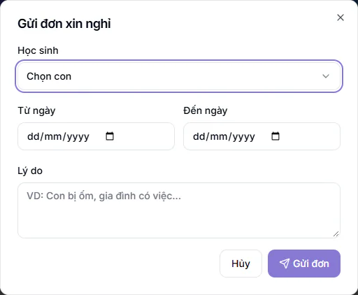

# Gửi đơn xin nghỉ cho con

Khi con cần nghỉ học, phụ huynh gửi đơn ngay trong cổng để trung tâm và giáo viên biết trước. Nhân viên xử lý đơn ở [Đơn xin nghỉ](../diem-danh/don-xin-nghi.md).

## Gửi đơn

::: steps
1. Vào **Xin nghỉ** ở menu cổng.
2. Bấm **Xin nghỉ** ở đầu trang, hộp **Gửi đơn xin nghỉ** hiện ra.

   

3. Chọn con ở ô **Học sinh** (nếu chỉ có một con, hệ thống tự chọn).
4. Chọn **Từ ngày** và **Đến ngày**.
5. Ghi **Lý do**, ví dụ con bị ốm hoặc gia đình có việc.
6. Bấm **Gửi đơn**.
:::

Cả bốn ô đều bắt buộc. Thiếu ô nào, cổng báo **Vui lòng nhập đủ thông tin**. Ngày bắt đầu phải trước hoặc bằng ngày kết thúc. Sau khi gửi, nhân viên cùng cơ sở và giáo viên các lớp con đang học được báo để duyệt.

## Theo dõi kết quả

Danh sách đơn ghi con, khoảng ngày nghỉ, lý do và trạng thái:

| Trạng thái | Ý nghĩa |
| --- | --- |
| **Chờ duyệt** | Trung tâm chưa xử lý |
| **Đã duyệt** | Trung tâm đồng ý |
| **Từ chối** | Trung tâm không đồng ý, có thể kèm dòng **Phản hồi** |
| **Đã huỷ** | Phụ huynh đã huỷ đơn |

## Huỷ đơn

Đơn còn ở trạng thái **Chờ duyệt** có nút **Hủy**. Bấm vào, xác nhận **Hủy đơn xin nghỉ này?**, đơn chuyển sang **Đã huỷ**. Đơn đã duyệt hoặc đã từ chối không huỷ được, hãy liên hệ trung tâm.

::: tip Mẹo
Gửi đơn trước buổi học để giáo viên nắm sĩ số. Kết quả buổi đó (**Vắng có phép** hay **Vắng**) xem ở [Điểm danh](diem-danh.md).
:::

::: warning Lưu ý
Mục **Xin nghỉ** chỉ hiện khi trung tâm bật. Quản trị viên bật ở [Bật tắt mục cho phụ huynh](cai-dat-cong.md).
:::

## Câu hỏi thường gặp

::: details Có xin nghỉ cho nhiều ngày liền được không?
Được. Chọn **Từ ngày** và **Đến ngày** cho cả khoảng.
:::

::: details Gửi nhầm lý do thì sửa thế nào?
Huỷ đơn đang **Chờ duyệt** rồi gửi đơn mới.
:::
