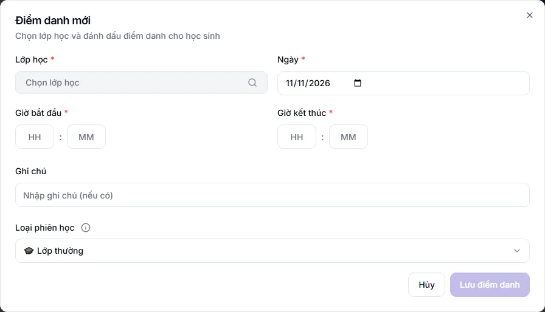
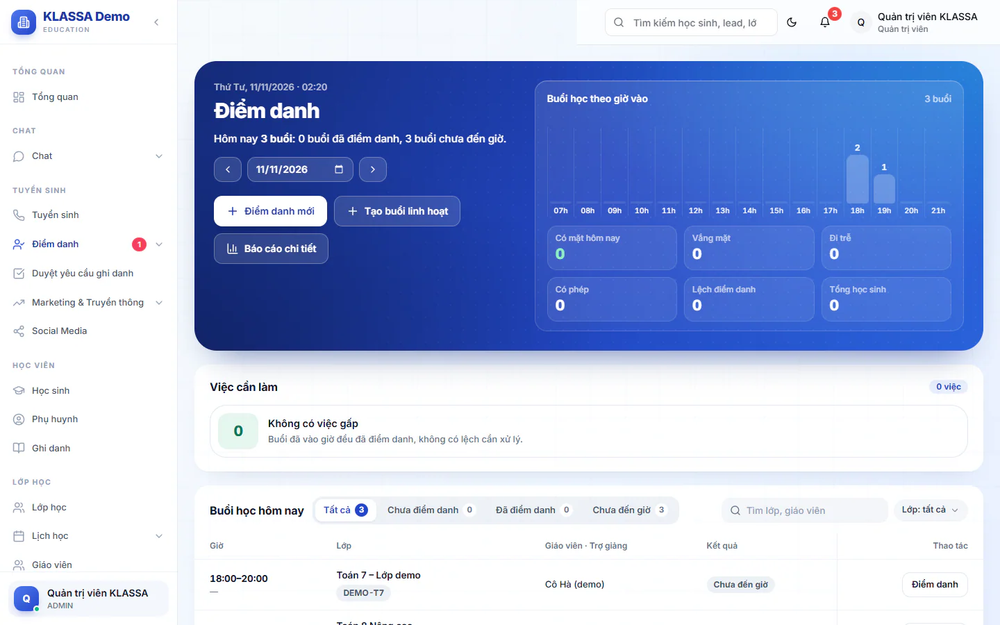

# Điểm danh hằng ngày

Trang **Điểm danh** cho biết hôm nay lớp nào đã có người chấm, lớp nào còn thiếu, và là nơi bạn chấm từng học sinh trong buổi học. Giáo viên và trợ giảng chỉ thấy lớp mình phụ trách.

## Chấm điểm danh cho một buổi học

Buổi theo thời khoá biểu của lớp luôn hiện sẵn trong danh sách, kể cả khi chưa ai chấm. Hệ thống chỉ tạo buổi thật vào lúc có người bấm lưu điểm danh.

::: steps
1. Vào **Điểm danh → Điểm danh cơ bản**. Trang mở ở ngày hôm nay. Muốn xem ngày khác, bấm mũi tên **Ngày trước**, **Ngày sau** hoặc chọn ngày trong ô ngày.
2. Ở bảng **Buổi học hôm nay**, tìm đúng lớp rồi bấm **Điểm danh**. Hộp **Điểm danh mới** hiện ra, lớp, ngày và giờ đã được điền theo thời khoá biểu.
3. Kiểm tra **Giờ bắt đầu** và **Giờ kết thúc** (ô bắt buộc cùng với **Lớp học** và **Ngày**). Cần ghi chú cho buổi thì nhập vào ô **Ghi chú**.
4. Ở danh sách học sinh, bấm một trong các nút **Có mặt**, **Vắng**, **Trễ**, **Phép** bên cạnh tên từng em. Muốn chấm cả lớp có mặt rồi chỉ sửa vài em vắng, bấm **Tất cả có mặt**.
5. Bấm **Lưu điểm danh**. Báo **Điểm danh thành công!** là đã xong.
:::

Bảng buổi học có thể lọc bằng các nhãn **Tất cả**, **Chưa điểm danh**, **Đã điểm danh**, **Chưa đến giờ**, hoặc gõ tên lớp, giáo viên vào ô **Tìm lớp, giáo viên**. Buổi đã chấm hiện số **Có mặt**, **Vắng**, **Trễ**, **Phép** của lớp và nút **Chi tiết**.

Buổi phát sinh ngoài thời khoá biểu thì bấm nút **Điểm danh mới** ở đầu trang rồi tự chọn lớp, ngày, giờ.

::: warning Mọi học sinh mặc định là Vắng
Khi mở một buổi chưa ai chấm, cả lớp được điền sẵn **Vắng**. Đây là quy tắc có chủ ý: em nào có mặt thì bạn bấm **Có mặt**, em nào bạn quên bấm sẽ không bị tính là đi học. Vì vậy hãy xem lại cả danh sách trước khi bấm **Lưu điểm danh**.
:::

## Bốn trạng thái khi chấm

| Nút khi chấm | Tên trong báo cáo | Dùng khi |
|---|---|---|
| **Có mặt** | Có mặt | Học sinh có đến lớp đúng giờ. |
| **Vắng** | Vắng mặt | Học sinh không đến, chưa có lý do hoặc không báo trước. |
| **Trễ** | Đi trễ | Học sinh đến muộn nhưng có học buổi đó. |
| **Phép** | Có phép | Học sinh nghỉ và đã xin phép. |

Về cách tính:

- **Có phép vẫn được đếm là vắng.** Khi bạn chấm, số **Vắng** ở đầu danh sách đã gồm cả em chấm **Phép**. Học sinh nghỉ có phép không được xem là đã đi học.
- Báo cáo **Chi tiết điểm danh** tách riêng hai cột **Vắng** và **Có phép** để bạn biết em nào nghỉ có xin phép.
- **Trễ** là trạng thái riêng, hiện thành cột **Trễ** trong báo cáo.
- Tỷ lệ điểm danh của một buổi là số học sinh **Có mặt** chia cho tổng số học sinh của buổi.
- Đơn xin nghỉ đã được duyệt có thể tự chuyển học sinh sang **Có phép**. Xem phần đơn xin nghỉ ở mục **Điểm danh** trong menu.

Màn chấm chỉ có bốn lựa chọn này. Buổi học bù và học sinh học nhờ lớp khác được xử lý riêng, xem [Học bù và học sinh ngoài lớp](diem-danh-bu.md).

## Ẩn nút Trễ và Phép

Trung tâm chỉ cần chấm Có mặt hoặc Vắng thì có thể ẩn hai nút này cho gọn. Mặc định cả hai đều hiện. Quản trị viên tắt ở **Cài đặt → Cấu hình**, tab **Điểm danh**:

::: steps
1. Tắt công tắc **Hiện lựa chọn “Trễ” khi điểm danh** và/hoặc **Hiện lựa chọn “Có phép” khi điểm danh**.
2. Bấm **Lưu cài đặt điểm danh**.
:::

Sau khi tắt, nút tương ứng biến mất khỏi bảng chấm trên web. Học sinh đã được chấm **Trễ** hoặc **Phép** từ trước vẫn hiện đúng trạng thái và sửa lại được. Công tắc chỉ áp dụng trên web.

## Làm việc với buổi đã có người chấm

- **Hai người cùng chấm một buổi** (giáo viên và lễ tân) là bình thường, hệ thống đối chiếu hai bên. Xem [Điểm danh đối chiếu](doi-chieu.md).
- **Mở lại buổi đã chấm** thì bảng hiện lại đúng trạng thái bạn đã chấm trước đó, không bị đặt về Vắng.
- **Sao chép từ buổi trước** điền sẵn theo buổi gần nhất của lớp. Dùng khi lớp ít thay đổi, rồi sửa các em khác.
- **Bản nháp:** nếu bạn đóng trình duyệt giữa chừng, lần sau vào trang sẽ có câu hỏi khôi phục bản nháp (chỉ giữ dưới 1 giờ).
- Đóng hộp khi đã chấm mà chưa lưu, hệ thống hỏi **Có thay đổi chưa lưu**. Chọn **Quay lại chỉnh sửa** để giữ, hoặc **Đóng không lưu** để bỏ.

## Chặn điểm danh học sinh không thuộc lớp

Hệ thống chỉ nhận điểm danh cho học sinh đang ghi danh vào lớp đó. Nếu một học sinh không thuộc lớp mà vẫn nằm trong bảng gửi lên, hệ thống báo **Học sinh không thuộc lớp này nên chưa lưu được điểm danh** và yêu cầu tải lại danh sách. Em học nhờ từ lớp khác chỉ được thêm bằng cách riêng, xem [Học bù và học sinh ngoài lớp](diem-danh-bu.md).

## Đóng điểm danh sau một thời hạn

Trung tâm có thể không cho chấm hoặc sửa điểm danh những buổi đã quá cũ. Xem [Khoá điểm danh](khoa-diem-danh.md).

## Tạo yêu cầu dạy thay từ màn điểm danh

Khi giáo viên hoặc trợ giảng của buổi học nghỉ đột xuất, bạn gửi yêu cầu dạy thay ngay từ dòng buổi học. Việc này dành cho Quản trị viên, Quản lý chi nhánh, Quản lý và Lễ tân. Giáo viên, trợ giảng không có mục này.

::: steps
1. Ở bảng **Buổi học hôm nay**, tìm buổi đã có người điểm danh rồi bấm biểu tượng ba chấm ở cột **Thao tác**.
2. Chọn **Dạy thay**. Hộp **Dạy thay** hiện giáo viên và trợ giảng hiện tại của buổi.
3. Chọn người thay. Ở **GV dạy thay**: giữ nguyên, chọn giáo viên khác, hoặc **Không có GV**. Ở **TG dạy thay** làm tương tự cho trợ giảng. Cần chọn ít nhất một thay đổi.
4. Nếu lớp có hơn một trợ giảng, chọn em nào được thay ở ô **TG cần thay**.
5. Nhập **Lý do dạy thay** (bắt buộc), rồi bấm **Gửi yêu cầu**.
:::

Yêu cầu chỉ có hiệu lực sau khi Quản trị viên, Quản lý chi nhánh hoặc Quản lý duyệt. Cách duyệt và ảnh hưởng đến giờ dạy ở [Dạy thay](../nhan-su/dan-day-thay.md). Buổi đã có dạy thay hiện dòng **Dạy thay** kèm tên người thay ngay trong bảng.

## Câu hỏi thường gặp

::: details Em đến muộn nên chấm Trễ hay Có mặt?
Chấm **Trễ** nếu trung tâm còn dùng nút này. Nếu đã ẩn nút **Trễ**, chấm **Có mặt**.
:::

::: details Tôi quên chấm hôm qua, hôm nay chấm được không?
Được nếu trung tâm chưa bật [khoá điểm danh](khoa-diem-danh.md) hoặc buổi đó chưa quá hạn. Buổi quá hạn thì nhờ Quản trị viên hoặc Quản lý chi nhánh chấm.
:::

::: details Sao dòng lớp có chữ "Trợ giảng ... đã vào ca, chưa ai chấm"?
Trợ giảng đã bấm có mặt ở ca làm của mình nên buổi được mở sẵn, nhưng chưa ai chấm học sinh. Bạn bấm **Điểm danh** để chấm.
:::

::: details Ai xuất được bảng điểm danh ra Excel?
Chỉ Quản trị viên và Quản lý chi nhánh, bằng nút **Xuất Excel** ở đầu trang khi có buổi trong ngày.
:::

::: details Ai xoá được một buổi điểm danh?
Quản trị viên, Quản lý chi nhánh và Quản lý. Xem [Xem lại, sửa và xoá điểm danh](sua-loi.md).
:::
