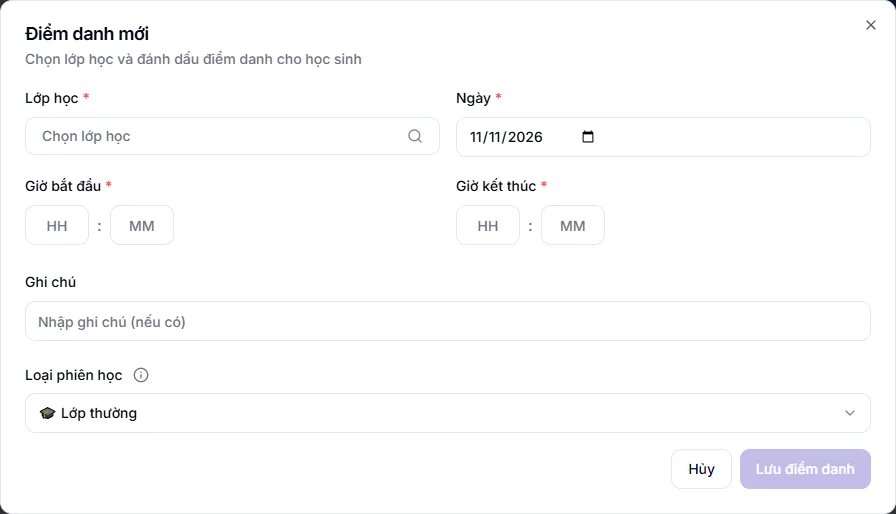

# Học bù và học sinh ngoài lớp

Có hai tình huống ngoài buổi học thường: lớp mở thêm một buổi khác loại (học bù, bổ trợ, học online), hoặc một học sinh của lớp khác sang học nhờ buổi này. Bài này hướng dẫn ghi nhận cả hai để điểm danh và học phí không bị lệch.

## Điểm danh một buổi học bù, bổ trợ hoặc online

Buổi này không có trong thời khoá biểu nên bạn tạo bằng nút **Điểm danh mới**.

::: steps
1. Vào **Điểm danh → Điểm danh cơ bản**, bấm **Điểm danh mới**.
2. Chọn **Lớp học**, **Ngày**, **Giờ bắt đầu**, **Giờ kết thúc**.
3. Ở ô **Loại phiên học**, chọn loại phù hợp (bảng bên dưới).
4. Nếu chọn **Học bù**, ô **Buổi học gốc (bị vắng)** hiện ra và là bắt buộc. Chọn buổi mà học sinh đã vắng để nối buổi bù với buổi gốc. Danh sách gồm các buổi của lớp trong 60 ngày gần đây.
5. Chấm từng học sinh rồi bấm **Lưu điểm danh**.
:::

| Loại phiên học | Cách tính theo lời giải thích ngay trong hộp |
|---|---|
| Lớp thường | Học phí 100%, lương 100% |
| Học bù | Học phí 100%, lương 100% (tính như buổi chính) |
| Bổ trợ/Tăng cường | Học phí 100%, lương 100% |
| Bổ trợ miễn phí | Học phí 0% (miễn phí), lương 100% |
| Học online | Học phí 50%, lương 50% |

Bấm biểu tượng chữ **i** cạnh **Loại phiên học** để xem lại bảng này. Trong danh sách buổi, loại khác thường được gắn nhãn, ví dụ **Học bù** hoặc **Học online**.

::: warning Lưu ý
Nếu lớp chưa có buổi nào trong 60 ngày qua, ô **Buổi học gốc (bị vắng)** báo **Lớp chưa có buổi nào trong 60 ngày qua** và bạn không lưu được buổi học bù.
:::

## Thêm học sinh lớp khác vào buổi (học hỗ trợ)

Dùng khi một học sinh cùng khối nhưng thuộc lớp khác sang học nhờ buổi này, kể cả học bù. Em được ghi là **Học hỗ trợ** và hiện riêng trong báo cáo, không lẫn với học sinh chính thức của lớp.

::: steps
1. Trong hộp **Điểm danh mới**, chọn lớp rồi kéo xuống khung **Thêm học sinh ngoài**.
2. Bấm **Thêm học sinh ngoài**. Gõ tên hoặc mã em vào ô **Tìm học sinh cùng khối...**. Danh sách chỉ gồm học sinh cùng khối, ngoài lớp này.
3. Bấm **Thêm** cạnh em cần thêm. Hộp **Xác nhận thêm học sinh ngoài** hiện ra.
4. Chọn **Hình thức học phí**: **Tính theo lớp chính** hoặc **Miễn phí buổi này**.
5. Bấm **Xác nhận thêm**, rồi chấm trạng thái cho em như các bạn khác.
:::

Em vừa thêm có nhãn **Học hỗ trợ** kèm tên lớp gốc. Thêm nhầm thì bấm dấu **x** cạnh tên (**Xóa học sinh ngoài**) trước khi lưu.

Nếu chọn **Tính theo lớp chính**, phụ thu của buổi này được cộng vào hoá đơn lớp chính của em ở kỳ tới. Nếu chọn **Miễn phí buổi này** thì không phát sinh khoản nào.

::: tip Mẹo
Chỉ thêm được học sinh cùng khối. Em khác khối cần được ghi danh thật vào lớp, xem [Ghi danh](../hoc-sinh/ghi-danh.md).
:::

::: warning Không thêm học sinh ngoài bằng cách khác
Hệ thống từ chối lưu điểm danh cho em không thuộc lớp mà không được thêm đúng cách ở trên. Bạn sẽ thấy báo **Học sinh không thuộc lớp này nên chưa lưu được điểm danh**.
:::

## Buổi linh hoạt

Lớp học linh hoạt dùng nút **Tạo buổi linh hoạt** ở đầu trang **Điểm danh** thay vì điểm danh cả lớp. Trung tâm có thể tắt quyền này cho Giáo viên và Trợ giảng: khi đó nút biến mất với hai vai này và chỉ Quản trị viên, Quản lý chi nhánh, Quản lý, Lễ tân, Kế toán tạo được. Công tắc nằm ở **Cài đặt → Cấu hình**, tab **Điểm danh**, mục **Cho phép Giáo viên & Trợ giảng tạo buổi linh hoạt**.

## Câu hỏi thường gặp

::: details Học sinh vắng buổi chính, học bù ở lớp khác thì làm sao?
Điểm danh buổi bù ở lớp nơi em học bù và thêm em bằng **Thêm học sinh ngoài**. Chọn hình thức học phí đúng với thoả thuận với phụ huynh.
:::

::: details Thêm nhầm học sinh ngoài sau khi đã lưu thì sao?
Nhờ Quản trị viên, Quản lý chi nhánh hoặc Quản lý xoá buổi nhập nhầm, xem [Xem lại, sửa và xoá điểm danh](sua-loi.md).
:::
