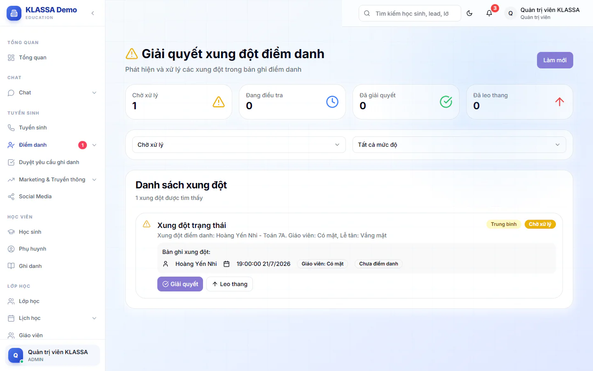
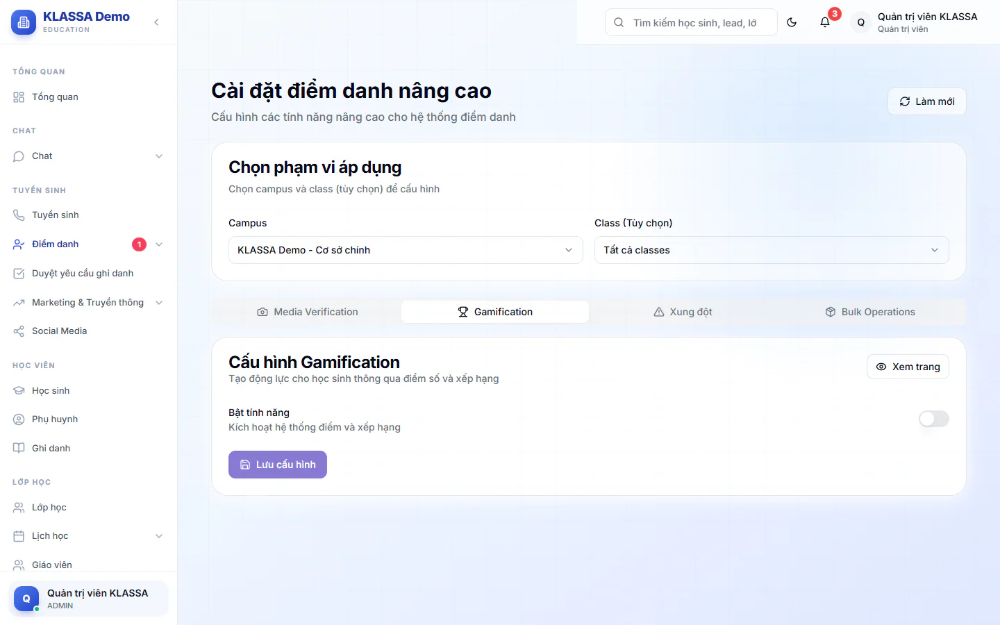
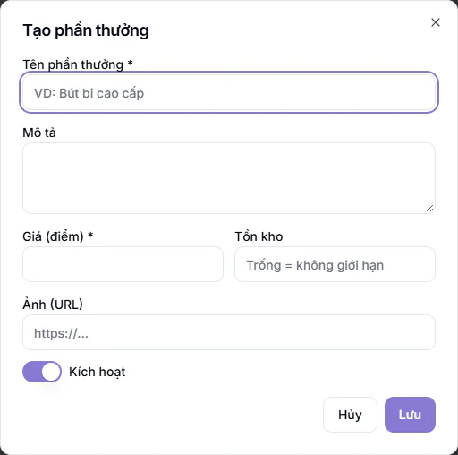
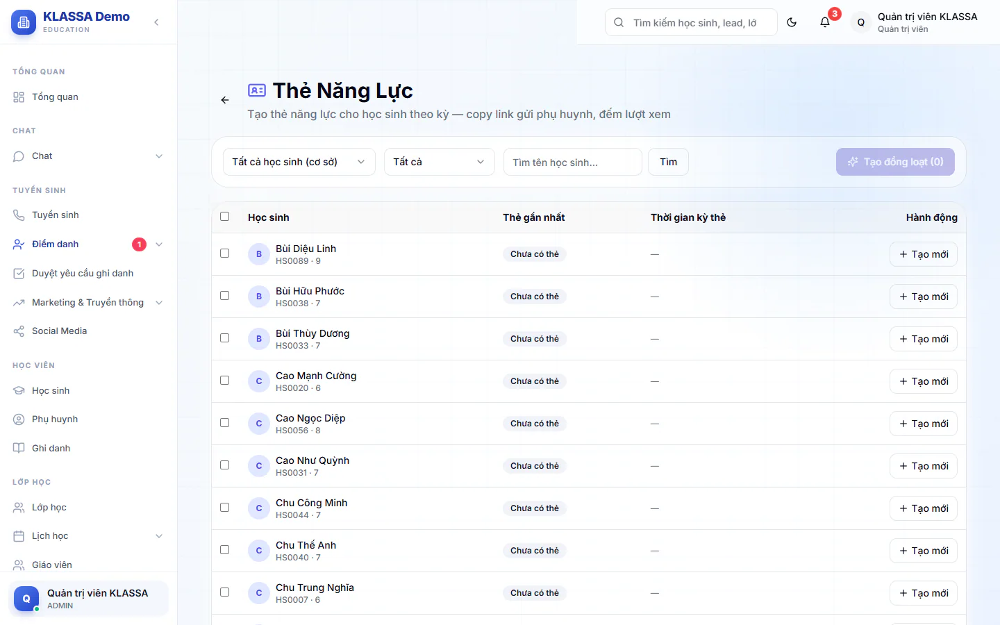

# Điểm danh nâng cao

Nhóm **Điểm danh → Nâng cao** gom các công cụ dành cho quản lý: xử lý những buổi giáo viên và lễ tân chấm khác nhau, khuyến khích học sinh đi học đều bằng điểm và quà, và tạo thẻ năng lực gửi phụ huynh.

Trong nhóm này, các mục sau dùng được:

- **Đối chiếu xung đột**
- **Gamification** (bảng xếp hạng)
- **Phần thưởng & Đổi quà**
- **Thẻ Năng Lực**
- **Cài đặt** (phần Gamification)

::: warning Lưu ý
Mục **Thao tác hàng loạt** và **Xác minh Media** chưa vận hành được trọn vẹn, nên chưa dùng. **Thao tác hàng loạt** chỉ hiện với Quản trị viên, Quản lý chi nhánh và Quản lý. **Xác minh Media** hiện với ba vai đó cùng Giáo viên và Trợ giảng, còn Lễ tân không thấy mục này. Các tab **Media Verification**, **Xung đột**, **Bulk Operations** trong trang **Cài đặt** cũng chưa có tác dụng thực tế.
:::

## Giải quyết xung đột điểm danh

Khi giáo viên chấm một em khác với lễ tân (hoặc quản lý) chấm cho cùng buổi, hệ thống không tự chọn bên nào mà đánh dấu **xung đột** và để lại cho quản lý quyết định. Trong lúc chưa giải quyết, buổi đó chưa có kết quả cuối cùng.

Hai trạng thái **Vắng** và **Vắng có phép** được coi là cùng nhóm, nên chấm lệch giữa hai nhãn này không tạo xung đột.

Trang này chỉ dành cho Quản trị viên, Quản lý chi nhánh và Quản lý. Giáo viên, Trợ giảng và Lễ tân không thấy mục **Đối chiếu xung đột** trong menu.

::: steps
1. Vào **Điểm danh → Nâng cao → Đối chiếu xung đột**. Trang **Giải quyết xung đột điểm danh** hiện ra, đầu trang có bốn ô đếm: **Chờ xử lý**, **Đang điều tra**, **Đã giải quyết**, **Đã leo thang**.
2. Danh sách mở sẵn ở trạng thái **Chờ xử lý**. Bạn đổi sang **Đang điều tra**, **Đã giải quyết**, **Đã leo thang** hoặc **Tất cả trạng thái** ở ô lọc đầu tiên, và lọc thêm theo mức độ ở ô thứ hai (**Tất cả mức độ**, **Thấp**, **Trung bình**, **Cao**, **Nghiêm trọng**). Mỗi dòng ghi học sinh, lớp, ngày, giờ và trạng thái mà giáo viên cùng lễ tân đã chấm.

   

3. Bấm **Giải quyết** ở dòng cần xử lý, hộp **Giải quyết xung đột** hiện ra, đối chiếu hai kết quả.
4. Chọn **Theo Giáo viên** hoặc **Theo Lễ tân**.
5. Nhập **Ghi chú (không bắt buộc)** nếu muốn ghi lý do.
6. Bấm **Xác nhận giải quyết**.
:::

Nếu chưa quyết được, bấm **Leo thang** cạnh nút **Giải quyết**, rồi **Xác nhận leo thang** ở hộp **Leo thang xung đột**. Xung đột chuyển sang trạng thái **Đã leo thang** để quản lý cấp cao xem xét. Dòng đã giải quyết thì không còn hai nút này.

Kết quả bạn chọn trở thành trạng thái cuối cùng của buổi đó. Báo cáo, học phí và lương tính theo kết quả này. Cách chấm của giáo viên và lễ tân vẫn được giữ lại để đối chiếu về sau.

::: tip Mẹo
Nút **Làm mới** tải lại danh sách. Nếu chưa chắc nên chọn bên nào, bạn hỏi lại giáo viên của buổi đó trước khi xác nhận.
:::

Giáo viên và trợ giảng cũng xử lý được chỗ lệch ngay trên trang điểm danh. Xem thêm ở [Điểm danh hằng ngày](cham-hang-ngay.md).

## Bật tính năng điểm và xếp hạng

Gamification biến việc đi học đều thành điểm tích luỹ. Học sinh có mặt thì được cộng điểm, vắng hoặc đi trễ thì bị trừ. Điểm là căn cứ để xếp hạng, nhận huy hiệu và đổi quà.

Tính năng này **mặc định tắt**. Quản trị viên, Quản lý chi nhánh hoặc Quản lý bật theo từng cơ sở (hoặc riêng từng lớp).

::: steps
1. Vào **Điểm danh → Nâng cao → Cài đặt**.
2. Ở phần **Chọn phạm vi áp dụng**, chọn **Campus** (cơ sở). Muốn cài riêng cho một lớp thì chọn thêm ở ô **Class (Tùy chọn)**, để "Tất cả classes" nếu áp cho cả cơ sở.
3. Mở tab **Gamification**. Bật công tắc **Bật tính năng**.
4. Điền các ô điểm (xem bảng dưới).
5. Bật hoặc tắt **Streak bonus**, **Bảng xếp hạng** và **Huy hiệu** theo ý bạn.
6. Bấm **Lưu cấu hình**.
:::

Cấu hình của lớp được ưu tiên hơn cấu hình của cơ sở.

| Ô | Ý nghĩa | Giá trị gợi ý ban đầu |
| --- | --- | --- |
| **Điểm đi học đúng giờ** | Điểm cộng cho mỗi buổi có mặt | 10 |
| **Điểm hoàn hảo tuần** | Thưởng khi 7 ngày gần nhất không vắng buổi nào | 100 |
| **Điểm hoàn hảo tháng** | Thưởng khi 30 ngày gần nhất không vắng buổi nào (cần ít nhất 5 buổi) | 500 |
| **Phạt vắng mặt** | Điểm trừ cho mỗi buổi vắng (nhập số âm) | -20 |
| **Phạt đi trễ** | Điểm trừ cho mỗi buổi đi trễ (nhập số âm) | -5 |
| **Hệ số streak bonus** | Hệ số nhân điểm khi đi học liên tiếp | 1,5 |

Vài điều cần biết về cách tính:

- Điểm được tính lại từ điểm danh của 90 ngày gần nhất mỗi khi điểm danh được lưu, nên sửa điểm danh sẽ đổi điểm theo.
- Đi học liên tiếp (có mặt hoặc đi trễ) và bật **Streak bonus** thì từ buổi thứ hai điểm cộng được nhân hệ số. Chuỗi bị cắt khi học sinh vắng.
- Học sinh có mặt sớm hơn giờ học hơn 15 phút (khi có ghi giờ đến) được cộng thêm điểm đến sớm.
- Buổi **Vắng có phép** không bị trừ điểm.

Khi bật **Huy hiệu**, phần **Cấu hình Huy hiệu** cho phép đổi biểu tượng, tên và mô tả từng huy hiệu. Trung tâm mới có sẵn sáu huy hiệu tên tiếng Việt, bạn giữ nguyên hoặc đổi theo ý:

| Huy hiệu | Mô tả sẵn có |
| --- | --- |
| **Tuần chuyên cần** | Hoàn thành 1 tuần không vắng |
| **Tháng chuyên cần** | Hoàn thành 1 tháng không vắng |
| **Trở lại đều đặn** | Trở lại đều đặn sau khi vắng |
| **Luôn đúng giờ** | Không trễ giờ trong 30 ngày |
| **Chuỗi đi học dài** | Chuỗi liên tục từ 20 buổi trở lên |
| **Đến sớm** | Đến sớm ít nhất 10 lần |

Tên và mô tả bạn sửa ở đây sẽ hiển thị đúng như bạn nhập.

## Xem bảng xếp hạng

Vào **Điểm danh → Nâng cao → Gamification**, trang **Bảng xếp hạng điểm danh** hiện ra. Quản trị viên, Quản lý chi nhánh, Quản lý, Giáo viên, Trợ giảng và Lễ tân đều xem được.

- Nút **Cơ sở của tôi** và **Toàn hệ thống** đổi phạm vi xếp hạng.
- Ô chọn kỳ có bốn mức: **Hôm nay**, **Tuần này**, **Tháng này**, **Tất cả**.
- Ba học sinh đứng đầu được làm nổi bật, các em còn lại xếp theo trang (**Trang trước**, **Trang sau**).
- Quản trị viên, Quản lý chi nhánh và Quản lý có thêm nút **Làm mới** để tính lại bảng ngay, cùng đường tắt sang **Phần thưởng & Đổi quà** và **Thẻ Năng Lực**.

Nếu tính năng chưa bật, trang hiện thông báo "Tính năng Gamification đang tắt". Người có quyền thấy nút **Mở trang Cài đặt để bật**, người khác được nhắc liên hệ quản trị viên.

## Tạo phần thưởng và duyệt đổi quà

Học sinh dùng điểm tích luỹ để đổi quà do trung tâm tạo. Quà do bạn đặt giá bằng điểm, phụ huynh đổi cho con, trung tâm duyệt. Mục này dành cho Quản trị viên, Quản lý chi nhánh và Quản lý.

### Thêm phần thưởng

::: steps
1. Vào **Điểm danh → Nâng cao → Phần thưởng & Đổi quà**, ở tab **Phần thưởng**.
2. Bấm **Thêm phần thưởng**, hộp **Tạo phần thưởng** hiện ra.

   

3. Điền **Tên phần thưởng** và **Giá (điểm)**, cả hai bắt buộc, giá phải là số dương.
4. Điền thêm **Mô tả**, **Tồn kho** (để trống là không giới hạn) và **Ảnh (URL)** nếu cần.
5. Bật **Kích hoạt** để phụ huynh nhìn thấy quà này, rồi bấm **Lưu**.
:::

Bạn sửa hoặc xoá quà bằng biểu tượng bút và thùng rác ở cuối dòng. Quà đã có người đổi sẽ không xoá hẳn mà chuyển sang ngừng bán, để giữ lịch sử.

### Duyệt yêu cầu đổi quà

::: steps
1. Vào tab **Đổi quà**. Số yêu cầu đang chờ hiện cạnh tên tab.
2. Xem các ô **Chờ duyệt**, **Đã duyệt**, **Từ chối**, hoặc lọc bằng nút **Tất cả**, **Chờ duyệt**, **Đã duyệt**, **Từ chối**.
3. Ở yêu cầu cần xử lý, bấm **Duyệt** hoặc **Từ chối**.
:::

- Khi **Duyệt**, tồn kho của quà giảm theo số lượng đã đổi. Nếu quà hết hàng, hệ thống báo và không duyệt được.
- Khi **Từ chối**, điểm được trả lại cho học sinh.
- Phụ huynh nhận thông báo kết quả cả hai trường hợp.

Số điểm dùng được của học sinh bằng tổng điểm đã kiếm ở mọi lớp, cộng sao thưởng khi chấm đủ đánh giá thầy cô trong tháng, trừ số điểm đã dùng cho các yêu cầu đang chờ hoặc đã duyệt. Điểm của yêu cầu đang chờ vẫn được giữ lại, nên học sinh không đổi vượt số điểm có.

### Phụ huynh đổi quà thế nào

Phụ huynh vào mục **Đổi quà** trên cổng phụ huynh (cần gói mở rộng **Cổng Phụ huynh**), xem **Cửa hàng quà** với số dư điểm của con. Bấm **Đổi quà**, nhập số lượng và ghi chú nếu muốn rồi xác nhận. Quà nào hết hàng hoặc chưa đủ điểm thì nút đổi bị khoá. Lịch sử nằm ở **Lịch sử đổi quà**.

## Tạo thẻ năng lực gửi phụ huynh

Thẻ năng lực là một trang tóm tắt chuyên cần, điểm trung bình, điểm thưởng, chuỗi đi học, huy hiệu và nhận xét của giáo viên cho một khoảng thời gian. Bạn gửi link cho phụ huynh xem hoặc tải về. Mục này dành cho Quản trị viên, Quản lý chi nhánh và Quản lý.

::: steps
1. Vào **Điểm danh → Nâng cao → Thẻ Năng Lực**.
2. Ở ô đầu tiên (mặc định hiện **Tất cả học sinh (cơ sở)**), mở danh sách và chọn một lớp nếu muốn chỉ làm cho lớp đó. Có thể lọc thêm **Đã có thẻ** hoặc **Chưa có thẻ**, hoặc gõ tên ở ô **Tìm tên học sinh…** rồi bấm **Tìm**.
3. Tạo thẻ cho một em bằng nút **Tạo mới** ở cuối dòng. Muốn tạo nhiều em cùng lúc, tick chọn các em rồi bấm **Tạo đồng loạt** (hoặc **Tạo cho cả lớp** khi đã chọn lớp). Nút này ghi số em đã chọn, ví dụ **Tạo đồng loạt (0)**, và chỉ bấm được khi bạn đã tick ít nhất một em.

   

4. Hộp **Tạo thẻ đồng loạt** hiện ra. Chọn **Từ ngày** và **Đến ngày** của kỳ muốn tổng hợp. Để trống là tính toàn thời gian.
5. Bấm **Bắt đầu tạo**. Hệ thống báo số thẻ tạo được và số thẻ lỗi.
:::

Ở mỗi dòng, các biểu tượng cho bạn xem thẻ, sao chép link gửi phụ huynh và mở lịch sử thẻ của em. Trong lịch sử, bạn xem lại hoặc xoá từng thẻ cũ. Người mở link thấy các nút **Tải ảnh**, **Tải PDF** và **Copy link**.

::: warning Lưu ý
Ai có link thẻ đều xem được mà không cần đăng nhập. Chỉ gửi link cho đúng phụ huynh của em đó.
:::

::: danger Không thể hoàn tác
Xoá một thẻ trong lịch sử sẽ làm link cũ của thẻ đó không còn dùng được.
:::

## Câu hỏi thường gặp

::: details Giáo viên có vào được các trang Nâng cao không?
Menu hiện nhóm **Nâng cao** cho giáo viên, trợ giảng và lễ tân. Lễ tân chỉ thấy **Gamification** (bảng xếp hạng). Giáo viên và Trợ giảng thấy **Gamification** và **Xác minh Media**. **Đối chiếu xung đột**, **Thao tác hàng loạt**, phần thưởng, thẻ năng lực và cài đặt chỉ dành cho quản lý.
:::

::: details Bật Gamification xong mà bảng xếp hạng trống?
Điểm được tính khi điểm danh được lưu. Bạn bấm **Làm mới** trên trang xếp hạng để tính lại, và chắc chắn lớp đã có buổi điểm danh sau khi bật.
:::

::: details Học sinh nghỉ có phép có bị trừ điểm không?
Không. Chỉ buổi **Vắng** và **Đi trễ** bị trừ theo mức bạn cài. Muốn buổi nghỉ được tính có phép, xem [Đơn xin nghỉ](don-xin-nghi.md).
:::

::: details Vì sao phụ huynh không thấy mục Đổi quà?
Mục này thuộc cổng phụ huynh và có thể bị tắt cho phụ huynh ở cấu hình cổng. Bạn kiểm tra gói mở rộng **Cổng Phụ huynh** đã bật và tính năng đổi quà đang mở.
:::
