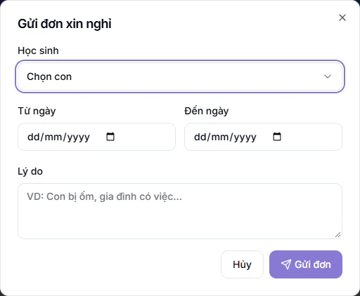

# Đơn xin nghỉ của học sinh

Phụ huynh báo nghỉ cho con ngay trên cổng phụ huynh, trung tâm duyệt đơn tại một nơi. Nhờ vậy buổi vắng có lý do rõ ràng và được ghi là **Vắng có phép** thay vì vắng không phép.

Tính năng này cần gói mở rộng **Cổng Phụ huynh**. Phụ huynh gửi đơn, còn nhân viên duyệt ở mục **Điểm danh → Đơn xin nghỉ**.

## Phụ huynh gửi đơn xin nghỉ

::: steps
1. Đăng nhập cổng phụ huynh, vào mục **Xin nghỉ**.
2. Bấm **Xin nghỉ**, hộp **Gửi đơn xin nghỉ** hiện ra.

   

3. Chọn con ở ô **Học sinh** (chọn trong danh sách con của bạn).
4. Chọn **Từ ngày** và **Đến ngày**. Nghỉ một ngày thì hai ngày giống nhau.
5. Điền **Lý do**, ví dụ "Con bị ốm, gia đình có việc...".
6. Bấm **Gửi đơn**.
:::

Cả bốn ô đều bắt buộc. Ngày bắt đầu phải trước hoặc bằng ngày kết thúc.

Đơn mới có trạng thái **Chờ duyệt**. Khi đơn còn chờ duyệt, phụ huynh có thể huỷ đơn. Đơn đã được duyệt hoặc từ chối thì không huỷ được nữa. Mục **Xin nghỉ** có thể bị ẩn nếu trung tâm tắt tính năng này cho phụ huynh.

::: tip Mẹo
Gửi đơn càng sớm càng tốt. Lễ tân, quản lý và giáo viên có buổi học trong những ngày nghỉ sẽ nhận thông báo ngay khi đơn được gửi.
:::

## Ai nhận thông báo và ai duyệt được

Khi phụ huynh gửi đơn, hệ thống báo cho:

- Quản trị viên, Quản lý chi nhánh, Quản lý và Lễ tân cùng cơ sở với học sinh.
- Giáo viên của các lớp thường mà em đang học, nhưng chỉ khi lớp đó có buổi trong những ngày xin nghỉ.

Người được duyệt đơn là Quản trị viên, Quản lý chi nhánh, Quản lý, Lễ tân và Giáo viên. Giáo viên chỉ thấy và duyệt đơn của học sinh đang học ở lớp mình được phân công. Lớp linh hoạt không tính là "lớp của giáo viên". Trợ giảng không duyệt đơn.

## Duyệt hoặc từ chối đơn

::: steps
1. Vào **Điểm danh → Đơn xin nghỉ**. Trang mở ở tab **Chờ duyệt**.
2. Đọc từng đơn: tên học sinh, mã học sinh, khoảng ngày nghỉ, tên phụ huynh và lý do.
3. Bấm **Duyệt** để chấp nhận. Hoặc bấm **Từ chối**, hộp **Từ chối đơn xin nghỉ** hiện ra.
4. Nếu từ chối, bạn có thể nhập lý do ở ô **Lý do từ chối** (không bắt buộc, phụ huynh sẽ thấy), rồi bấm **Từ chối đơn**.
:::

Các tab trên trang: **Chờ duyệt**, **Đã duyệt**, **Từ chối** và **Tất cả**. Bấm **Làm mới** để tải lại danh sách. Đơn đã xử lý hiển thị tên người xử lý và ghi chú nếu có. Đơn phụ huynh đã huỷ có trạng thái **Đã hủy** và chỉ xem trong tab **Tất cả**.

Sau khi duyệt hoặc từ chối, phụ huynh nhận thông báo kết quả.

::: warning Lưu ý
Đơn đã được xử lý thì không đổi lại được. Hãy đọc kỹ trước khi bấm.
:::

## Đơn được duyệt ảnh hưởng điểm danh thế nào

Duyệt đơn không tạo bản ghi điểm danh mới. Hệ thống chỉ đổi nhãn khi gặp buổi của em trong khoảng ngày nghỉ:

- Buổi đã chấm **Vắng** được đổi thành **Vắng có phép**.
- Khi giáo viên chấm điểm danh một buổi nằm trong khoảng ngày đã duyệt, em nào được chấm vắng sẽ tự thành **Vắng có phép**.
- Buổi đã chấm **Có mặt**, **Đi trễ** hoặc **Học bù** giữ nguyên.
- Buổi đang có xung đột chưa giải quyết giữ nguyên để người duyệt xử lý tay.
- Buổi chưa được chấm không bị tạo thêm.

Việc đổi nhãn này không làm thay đổi học phí, tín dụng hay lương giáo viên. Cách chấm điểm danh hằng ngày xem ở [Điểm danh hằng ngày](cham-hang-ngay.md).

## Câu hỏi thường gặp

::: details Giáo viên không thấy đơn của một học sinh?
Giáo viên chỉ thấy đơn của học sinh đang học ở lớp thường mình được phân công. Em chỉ học lớp linh hoạt, hoặc giáo viên chưa được phân công lớp của em, thì đơn chỉ hiện với lễ tân và quản lý.
:::

::: details Phụ huynh gửi nhầm ngày thì làm sao?
Nếu đơn còn **Chờ duyệt**, phụ huynh huỷ đơn rồi gửi lại. Nếu đơn đã được xử lý, phụ huynh cần liên hệ trung tâm.
:::

::: details Đơn được duyệt xong mà buổi vẫn ghi Vắng?
Hệ thống chỉ đổi nhãn khi buổi đã chấm vắng nằm trong khoảng ngày nghỉ của đơn. Bạn kiểm tra ngày trong đơn có phủ đúng buổi đó không, và buổi có đang ở trạng thái xung đột không.
:::
