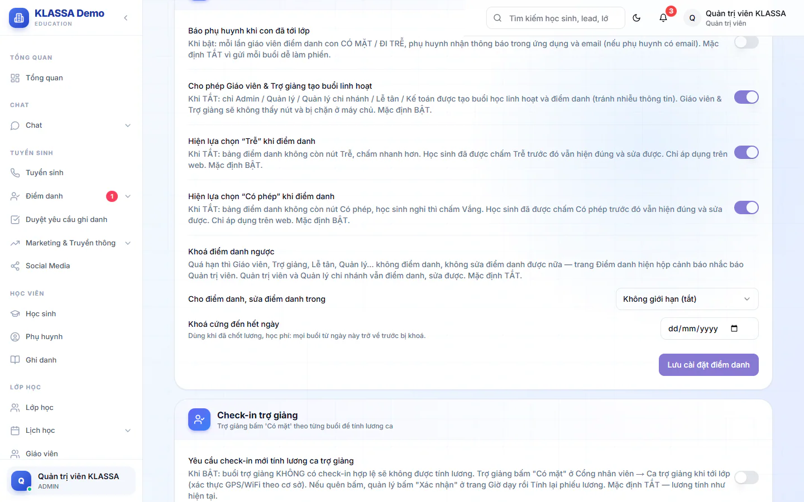

# Khoá điểm danh

Khoá điểm danh ngăn việc chấm bù, sửa điểm danh những buổi đã qua lâu, nhất là sau khi đã chốt lương hoặc học phí. Tính năng **mặc định tắt**: trung tâm chưa bật thì mọi người vẫn chấm và sửa được như bình thường.

## Hai kiểu khoá

Bạn có thể dùng một trong hai kiểu, hoặc cả hai cùng lúc.

| Kiểu | Ý nghĩa |
|---|---|
| **Cho điểm danh, sửa điểm danh trong** | Buổi ngày D chỉ được chấm và sửa đến hết một số ngày sau buổi học. Có các mức **Chỉ trong ngày học**, **1 ngày sau buổi học**, **2 ngày sau buổi học**, **3 ngày sau buổi học**, **7 ngày sau buổi học**. Chọn **Không giới hạn (tắt)** để tắt. |
| **Khoá cứng đến hết ngày** | Mọi buổi từ ngày bạn chọn trở về trước đều bị khoá. Dùng khi đã chốt lương hoặc học phí đến một ngày cụ thể. |

## Bật khoá điểm danh

Chỉ Quản trị viên thấy mục này.

::: steps
1. Vào **Cài đặt → Cấu hình**, mở tab **Điểm danh**.
2. Kéo xuống mục **Khoá điểm danh ngược**.
3. Chọn số ngày ở ô **Cho điểm danh, sửa điểm danh trong**, và/hoặc chọn ngày ở ô **Khoá cứng đến hết ngày**.
4. Bấm **Lưu cài đặt điểm danh**.
:::

Muốn mở lại khoá cứng, bấm **Bỏ khoá** cạnh ô ngày (hoặc chọn lại **Không giới hạn (tắt)** cho kiểu theo số ngày), rồi bấm **Lưu cài đặt điểm danh**.

## Ai bị khoá, ai không

- **Bị khoá:** Giáo viên, Trợ giảng, Lễ tân, Quản lý và các vai khác. Họ không chấm mới, không sửa được điểm danh của buổi đã khoá.
- **Không bị khoá:** Quản trị viên và Quản lý chi nhánh. Hai vai này luôn chấm và sửa được.
- **Nhận xét buổi học** không bị khoá.

## Người dùng thấy gì khi buổi bị khoá

Khi bấm **Điểm danh** hoặc chọn một ngày đã khoá, hộp **Không điểm danh ngược được** hiện ra, nêu rõ lý do và nhắc báo Quản trị viên hoặc Quản lý chi nhánh. Bấm **Đã hiểu** để đóng. Ví dụ lý do: buổi ngày 03/11/2026 đã quá hạn điểm danh vì trung tâm chỉ cho chấm, sửa trong 1 ngày sau buổi học.

Buổi đã khoá vẫn xem được. Ở hộp **Chi tiết điểm danh** có dòng nhắc buổi này đã khoá, chỉ xem. Bấm sửa một học sinh sẽ hiện hộp cảnh báo ở trên.

Khoá được kiểm tra cả lúc bấm **Lưu điểm danh**, nên bản nháp mở từ hôm trước hoặc hộp để qua đêm cũng không lưu được nếu buổi đã quá hạn.

::: warning Lưu ý
Số ngày tính theo ngày dương lịch giờ Việt Nam, không tính theo giờ. Chọn **Chỉ trong ngày học** nghĩa là qua 0 giờ sáng hôm sau là khoá.
:::

## Câu hỏi thường gặp

::: details Giáo viên quên chấm một buổi đã khoá, phải làm sao?
Báo Quản trị viên hoặc Quản lý chi nhánh. Hai vai này mở trang **Điểm danh**, chọn đúng ngày và chấm bình thường.
:::

::: details Bật khoá có làm mất điểm danh cũ không?
Không. Khoá chỉ chặn chấm mới và sửa, dữ liệu cũ giữ nguyên.
:::

::: details Chỉ ẩn nút trên màn hình, hay chặn thật?
Chặn thật. Ngoài hộp cảnh báo trên trang **Điểm danh**, hệ thống cũng từ chối lúc lưu nếu buổi đã khoá.
:::
