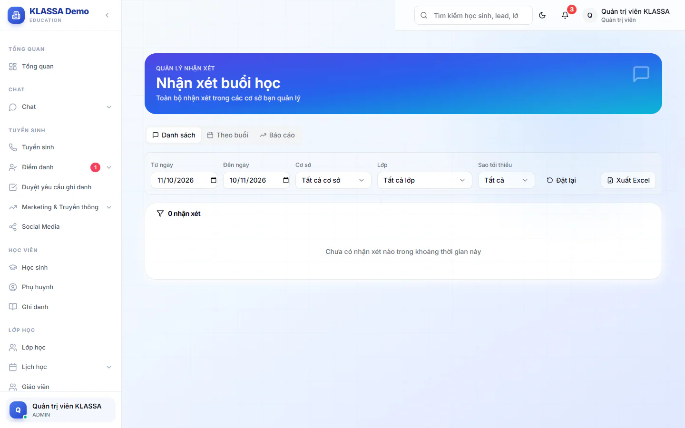

# Nhận xét buổi học

Sau mỗi buổi, giáo viên ghi lại mức độ hăng hái, hiểu bài, tập trung và lời nhận xét cho từng học sinh. Phụ huynh nhờ đó biết con học thế nào, còn quản lý nắm được buổi nào chưa có nhận xét.

## Viết nhận xét cho một buổi học

Bạn viết nhận xét từ trang điểm danh, ngay sau khi buổi học diễn ra.

::: steps
1. Vào **Điểm danh → Điểm danh cơ bản**, chọn ngày của buổi học.
2. Ở dòng của lớp đã điểm danh xong, bấm **Nhận xét**. Hộp **Nhận xét buổi học** hiện ra, tiêu đề phụ ghi lớp, ngày và giờ học.
3. Chọn học sinh trong danh sách (có ô **Tìm học sinh...**). Bấm mũi tên trái phải hoặc phím Ctrl cùng mũi tên để chuyển sang em trước hoặc em sau.
4. Ở phần **Đánh giá theo 5 mức**, chấm sao cho ba tiêu chí **Hăng hái**, **Hiểu bài**, **Tập trung**. Phím 1-5 chấm nhanh.
5. Ở phần **Nhận xét**, điền các ô bạn cần: **📝 Bài tập về nhà**, **💬 Nhận xét chung**, **🌟 Điểm mạnh**, **💪 Cần cải thiện**. Bấm **Thêm ảnh** nếu muốn đính kèm ảnh (tối đa 20MB mỗi ảnh).
6. Bấm **Lưu tất cả**.
:::

Em nào chưa có đánh giá hay nội dung nào thì không được lưu. Nếu không em nào có nội dung, hệ thống báo "Vui lòng nhập ít nhất 1 nhận xét".

Bạn cũng mở được hộp này từ tab **Nhận xét** trong trang chi tiết lớp, hoặc từ trang **Nhận xét còn thiếu** (xem bên dưới).

::: tip Mẹo
- **Áp nhanh** có ba nút **👍 Tốt**, **🤝 Khá**, **⚠️ Cần cố gắng** để điền sẵn đánh giá cho em đang chọn, sau đó bạn sửa lại.
- Cạnh mỗi tiêu chí và mỗi ô nội dung có lệnh áp dụng cho cả lớp, hệ thống sẽ hỏi lại trước khi ghi đè.
- Nội dung đang gõ được lưu nháp tự động. Lần sau mở lại buổi đó, hệ thống hỏi **Khôi phục bản nháp?**.
- Hộp có sẵn các mẫu câu cho từng ô để chèn nhanh.
:::

### Xuất ảnh và gửi cho phụ huynh

Trong hộp nhận xét, bạn có thể:

- Xuất nhận xét của em đang chọn thành ảnh.
- Bấm **Xuất cả lớp** rồi chọn ảnh PNG (gửi nhóm Zalo) hoặc PDF (in, lưu trữ).
- Bấm **Gửi Zalo PH** để gửi ảnh nhận xét cho phụ huynh của em đang chọn, hoặc dùng nút **Gửi Zalo** để gửi từng phụ huynh (mỗi em một ảnh riêng) hay gửi vào nhóm Zalo của lớp.

Gửi qua Zalo dùng tài khoản Zalo của chính bạn nên cần gói mở rộng Zalo cá nhân và bạn phải liên kết Zalo ở mục **Zalo của tôi** trong cổng nhân viên trước. Chưa liên kết thì hệ thống nhắc ngay khi bạn bấm gửi.

## Ai viết được nhận xét

- Giáo viên và Trợ giảng chỉ viết cho buổi của lớp mình được phân công, hoặc buổi có tên mình (ví dụ dạy thay).
- Lễ tân được xếp làm trợ giảng ở lớp nào thì viết như trợ giảng ở lớp đó. Lễ tân không được xếp lớp chỉ xem nhận xét của giáo viên.
- Quản trị viên, Quản lý chi nhánh và Quản lý viết được cho mọi lớp trong cơ sở của mình.

## Xem lại nhận xét đã viết

Vào **Nhận xét buổi học** (Quản trị viên, Quản lý chi nhánh, Quản lý) hoặc **Nhận xét lớp tôi** (Giáo viên, Trợ giảng, Lễ tân kiêm trợ giảng). Giáo viên và trợ giảng chỉ thấy nhận xét thuộc lớp mình.

Trang có ba tab:

| Tab | Dùng để |
| --- | --- |
| **Danh sách** | Xem từng nhận xét: ngày, lớp, học sinh, giáo viên, ba điểm đánh giá và nội dung. Bấm biểu tượng bút để sửa, biểu tượng thùng rác để xoá. |
| **Theo buổi** | Xem nhận xét gom theo từng buổi học của lớp. |
| **Báo cáo** | Xem **Số nhận xét**, **Số lớp có nhận xét**, điểm trung bình toàn bộ phạm vi, bảng **Theo lớp** và **Hoạt động giáo viên** (mỗi người viết bao nhiêu nhận xét). |

Các ô lọc dùng chung cho cả ba tab: khoảng ngày (**Từ ngày**, **Đến ngày**, mặc định 30 ngày gần nhất), **Cơ sở** (chỉ Quản trị viên, Quản lý chi nhánh, Quản lý thấy), **Lớp**, **Giáo viên** và **Sao tối thiểu**. Ô **Giáo viên** chỉ xuất hiện khi danh sách đã có nhận xét, vì tên các giáo viên được lấy từ chính các nhận xét đang hiển thị. Bấm **Đặt lại** để về mặc định. Bấm **Xuất Excel** để tải danh sách ra file (không có với Lễ tân kiêm trợ giảng).

::: warning Lưu ý
Xoá nhận xét chỉ hỏi xác nhận một lần ở hộp **Xoá nhận xét?**. Nhận xét đã xoá không khôi phục được.
:::

## Tìm các buổi còn thiếu nhận xét

Trang **Nhận xét còn thiếu** liệt kê các buổi học đã qua mà chưa có nhận xét nào. Bạn mở trang này từ thẻ nhắc việc trên **Trang chủ** (ví dụ thẻ "Buổi chưa nhận xét" của giáo viên, hoặc nút **Viết nhận xét** của trợ giảng). Trang không có trong menu bên trái.

- Chọn khoảng thời gian: **Hôm qua**, **7 ngày**, **14 ngày** hoặc **30 ngày**. Bấm **Tải lại** để cập nhật.
- Quản lý thấy danh sách gom theo giáo viên, người thiếu nhiều nhất đứng đầu, mỗi lớp kèm các buổi còn thiếu.
- Giáo viên và trợ giảng chỉ thấy buổi của mình. Bấm vào một buổi để mở hộp viết nhận xét ngay, lưu xong danh sách tự cập nhật.
- Vai nào không có quyền viết nhận xét (như Lễ tân không được xếp lớp) chỉ xem được danh sách.

Một buổi được coi là đã đủ khi có ít nhất một nhận xét cho buổi đó.

## Câu hỏi thường gặp

::: details Giáo viên sửa được nhận xét của người khác không?
Giáo viên và trợ giảng chỉ sửa hoặc xoá nhận xét của buổi thuộc lớp mình được phân công. Quản lý sửa được mọi nhận xét trong cơ sở.
:::

::: details Nút Nhận xét không hiện ở dòng lớp?
Nút hiện khi buổi đã điểm danh xong. Buổi chưa điểm danh thì chưa có nút. Xem cách chấm ở [Điểm danh hằng ngày](cham-hang-ngay.md).
:::

::: details Sao tôi không thấy Cơ sở trong ô lọc?
Ô **Cơ sở** chỉ dành cho Quản trị viên, Quản lý chi nhánh và Quản lý. Vai khác chỉ thấy nhận xét của lớp mình.
:::
