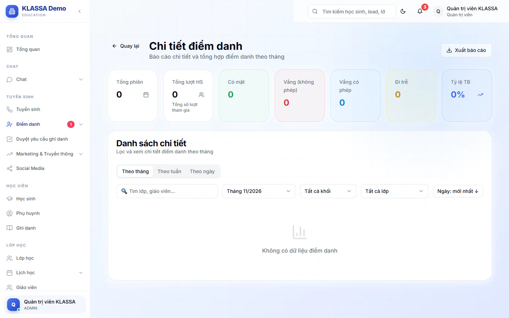

# Xem lại, sửa và xoá điểm danh

Buổi đã chấm vẫn sửa được. Mỗi lần sửa đều bắt buộc ghi lý do và được lưu vào lịch sử, nên sau này ai cũng biết ai sửa gì, vì sao.

## Sửa trạng thái của một học sinh

::: steps
1. Vào **Điểm danh → Điểm danh cơ bản**, chọn ngày của buổi cần sửa.
2. Ở dòng lớp đã chấm, bấm **Chi tiết**. Hộp **Chi tiết điểm danh** hiện ra với tổng số, số **Có mặt**, **Vắng mặt**, **Đi trễ** và danh sách từng em.
3. Bấm biểu tượng cây bút (**Sửa điểm danh**) cạnh học sinh cần đổi. Hộp **Sửa điểm danh** hiện ra.
4. Chọn **Trạng thái** mới (bắt buộc). Có thể ghi thêm **Ghi chú**.
5. Nhập **Lý do chỉnh sửa** (bắt buộc, nút lưu chưa bấm được khi để trống).
6. Bấm **Lưu thay đổi**. Báo **Đã cập nhật điểm danh thành công** là xong.
:::

Danh sách trạng thái gồm **Có mặt**, **Vắng mặt**, **Đi trễ**, **Có phép**. Hai lựa chọn **Đi trễ** và **Có phép** không hiện nếu trung tâm đã ẩn, trừ khi học sinh đang mang đúng trạng thái đó. Ý nghĩa từng trạng thái ở [Điểm danh hằng ngày](cham-hang-ngay.md).

::: warning Khi sửa không được
- **Buổi bị khoá:** hộp **Không điểm danh ngược được** hiện ra. Báo Quản trị viên hoặc Quản lý chi nhánh. Xem [Khoá điểm danh](khoa-diem-danh.md).
- **Buổi linh hoạt khi trung tâm tắt quyền:** Giáo viên và Trợ giảng không có nút sửa. Nhờ Lễ tân hoặc Quản lý.
- **Kỳ lương hoặc học phí đã khoá sổ:** hệ thống vẫn lưu thay đổi nhưng báo rằng thay đổi không tự vào phiếu. Bạn cần báo kế toán điều chỉnh.
:::

## Xem lịch sử chỉnh sửa

Trong hộp **Chi tiết điểm danh**, bấm biểu tượng đồng hồ (**Xem lịch sử**) cạnh học sinh. Hộp **Lịch sử chỉnh sửa điểm danh** liệt kê từng lần đổi: trạng thái cũ và mới, lý do, ghi chú. Chưa ai sửa thì hộp báo **Chưa có thay đổi nào**.

## Xem lại điểm danh theo tuần, tháng

Menu **Điểm danh → Chi tiết điểm danh** (cũng là nút **Báo cáo chi tiết** ở đầu trang **Điểm danh**) cho xem các buổi đã chấm trong một khoảng thời gian.

::: steps
1. Chọn **Theo tháng**, **Theo tuần** hoặc **Theo ngày**, rồi chọn tháng, tuần hoặc ngày.
2. Lọc tiếp theo **Khối**, **Lớp**, hoặc gõ vào ô **Tìm lớp, giáo viên**. Nút **Ngày** đổi thứ tự mới nhất hoặc cũ nhất lên trước.
3. Xem các ô tổng ở đầu trang: **Tổng phiên**, **Tổng lượt HS**, **Có mặt**, **Vắng (không phép)**, **Vắng có phép**, **Đi trễ**, **Tỷ lệ TB**.
4. Bấm **Chi tiết** ở một dòng để xem từng học sinh. Nút **Chỉ HS vắng** lọc ra các em vắng và có phép.
:::

Bảng có các cột **Ngày**, **Lớp học**, **Thời gian**, **Phòng**, **Giáo viên**, **Tổng**, **Có mặt**, **Vắng**, **Có phép**, **Trễ**, **Tỷ lệ**. Giáo viên và trợ giảng chỉ thấy lớp mình phụ trách.

**Ảnh buổi học:** trong hộp chi tiết, Quản trị viên, Quản lý, Quản lý chi nhánh, Giáo viên và Trợ giảng bấm **Tải ảnh lên** để đăng một ảnh chụp cả lớp (tối đa 20MB). Bấm **Đổi ảnh** để thay hoặc **Gỡ** để bỏ.

**Xuất báo cáo:** chỉ Quản trị viên và Quản lý chi nhánh thấy nút **Xuất báo cáo**, chọn tải file CSV để mở bằng Excel hoặc sao chép để dán vào Google Sheets. Thống kê theo giáo viên, học sinh nằm ở [Báo cáo điểm danh](../bao-cao/diem-danh.md).

## Xoá một buổi điểm danh nhập nhầm

Dùng khi tạo nhầm buổi (sai lớp, sai ngày) và muốn bỏ cả buổi cùng toàn bộ điểm danh trong đó. Chỉ Quản trị viên, Quản lý chi nhánh và Quản lý làm được.

::: steps
1. Ở dòng buổi học đã có điểm danh, bấm biểu tượng ba chấm ở cột **Thao tác**.
2. Chọn **Xóa phiên điểm danh**. Hộp hiện lớp, ngày, giờ và số học sinh đã điểm danh.
3. Bấm **Tiếp tục xóa**, đọc phần **Xác nhận lần cuối**, rồi bấm **XÁC NHẬN XÓA**.
:::

::: danger Không thể hoàn tác
Buổi bị xoá cùng toàn bộ điểm danh của buổi đó sẽ không khôi phục được. Chỉ xoá khi chắc chắn buổi tạo nhầm.
:::

## Câu hỏi thường gặp

::: details Sửa điểm danh có làm đổi học phí không?
Học phí tính theo điểm danh nên có thể đổi, miễn là kỳ chưa khoá sổ. Sau khi sửa, kiểm tra lại phiếu của học sinh đó.
:::

::: details Sửa nhầm thì làm sao?
Sửa lại lần nữa, lý do ghi "sửa nhầm". Lịch sử giữ cả hai lần.
:::

::: details Vì sao không thấy nút Xuất Excel?
Nút này chỉ dành cho Quản trị viên và Quản lý chi nhánh.
:::
