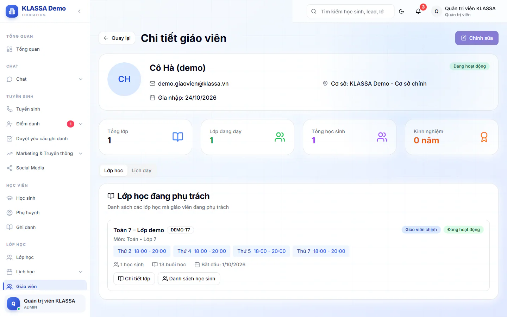

# Hồ sơ giáo viên

Trang này tóm tắt một giáo viên: ai, dạy môn gì, đang phụ trách lớp nào, mỗi tuần dạy vào lúc nào.

## Mở hồ sơ

::: steps
1. Vào **Giáo viên**.
2. Bấm **Chi tiết** ở thẻ của giáo viên cần xem. Trang **Chi tiết giáo viên** mở ra.
:::

Đầu trang có thẻ thông tin chung (tên, email, cơ sở, ngày **Gia nhập**, trạng thái **Đang hoạt động** hoặc **Không hoạt động**) và bốn số: **Tổng lớp**, **Lớp đang dạy**, **Tổng học sinh**, **Kinh nghiệm**. Phần **Thông tin chuyên môn** hiện **Chuyên môn** (các môn giáo viên dạy). Giáo viên chưa có hồ sơ chuyên môn thì cả phần này không hiện. Muốn bổ sung, bấm **Chỉnh sửa** (xem bên dưới, nút này chỉ hiện với Quản trị viên và Quản lý chi nhánh).

Hai tab bên dưới:

- **Lớp học**: mục **Lớp học đang phụ trách**. Mỗi lớp ghi vai của giáo viên (**Giáo viên chính** hoặc **Trợ giảng**) và có nút **Chi tiết lớp**, **Danh sách học sinh**.
- **Lịch dạy**: mục **Lịch dạy trong tuần**, gom các buổi của mọi lớp theo từng thứ.

Nếu giáo viên chưa được phân lớp nào, trang ghi "Chưa có giáo viên được phân công lớp học nào".

## Sửa hồ sơ

::: steps
1. Ở đầu trang, bấm **Chỉnh sửa**. Hộp **Chỉnh sửa thông tin giảng viên** mở ra.
2. Sửa **Họ và tên** và **Email** (bắt buộc), **Số điện thoại**, **Cơ sở**, **Chuyên môn**, **Kinh nghiệm (năm)**, **Loại hợp đồng** (**Toàn thời gian**, **Bán thời gian** hoặc **Hợp đồng**), **Lương (VNĐ)**.
3. Bấm **Cập nhật**. Hệ thống báo "Cập nhật giảng viên thành công".
:::

Chỉ Quản trị viên và Quản lý chi nhánh thấy nút **Chỉnh sửa** và lưu được thay đổi. Vai **Quản lý** mở được trang này để xem nhưng không có nút **Chỉnh sửa**.

Quản lý chi nhánh chỉ được chọn cơ sở mình quản lý ở ô **Cơ sở**. Chọn cơ sở khác rồi bấm **Cập nhật** thì hệ thống báo "Bạn chỉ được chọn cơ sở mình quản lý. Muốn chuyển giáo viên sang cơ sở khác, nhờ quản trị viên thực hiện." và không lưu. Quản trị viên chuyển được giáo viên sang bất kỳ cơ sở nào.

Hộp này không có ô bằng cấp hay chứng chỉ. Chứng chỉ của giáo viên ghi ở hồ sơ nhân sự: vào **Quản lý HR → Nhân viên**, mở hồ sơ người đó, thẻ **Thưởng/CC**, mục **Chứng chỉ & Đào tạo** (xem [Danh sách nhân viên](../nhan-su/danh-sach-nhan-vien.md)).

::: warning Lưu ý
Họ tên, email, số điện thoại và cơ sở sửa ở đây được cập nhật sang hồ sơ nhân sự. Còn **Loại hợp đồng** và **Lương (VNĐ)** chỉ lưu trong hồ sơ giáo viên, không đổi lương cơ bản, loại hình làm việc hay trạng thái dùng để tính phiếu lương. Muốn đổi các mục đó, sửa ở [Danh sách nhân viên](../nhan-su/danh-sach-nhan-vien.md).
:::

## Khi giáo viên nghỉ việc

Việc cho nghỉ việc làm ở hồ sơ nhân sự, xem [Danh sách nhân viên](../nhan-su/danh-sach-nhan-vien.md). Khi chuyển hồ sơ sang **Đã nghỉ việc**, tài khoản bị khoá đăng nhập và hệ thống tự gỡ giáo viên khỏi các lớp đang dạy. Phân công được đóng lại chứ không xoá, nên các buổi đã dạy trước ngày nghỉ vẫn được tính lương như cũ. Giáo viên quay lại làm thì lớp cũ không tự gắn lại, bạn xếp lớp bằng tay.

::: tip Mẹo
Nên giao lớp cho giáo viên mới để phụ huynh thấy đúng người dạy. Vào tab **Lớp học** của hồ sơ này, mở từng lớp bằng **Chi tiết lớp**, rồi chọn giáo viên mới ở trang [Chỉnh sửa lớp học](../lop-hoc/chinh-sua.md). Nhớ điền **Ngày nhận lớp** để lương hai giáo viên chia đúng ngày. Khi cho nghỉ việc, điền ngày làm việc cuối cùng thật vào ô **Ngày kết thúc** của hồ sơ nhân sự, trong cùng lần lưu với việc đổi trạng thái.
:::

## Câu hỏi thường gặp

::: details Muốn xem giáo viên dạy gì tuần này, có lịch đầy đủ hơn không?
Có. Quay lại **Giáo viên** và bấm **Lịch dạy**, bạn sẽ thấy [thời khóa biểu](../lop-hoc/lich-day.md) thật của tuần, gồm cả buổi dạy thay và buổi bù.
:::

::: details Sao tôi không thấy lương giáo viên?
Lương và giấy tờ cá nhân chỉ dành cho Quản trị viên và Quản lý chi nhánh.
:::
