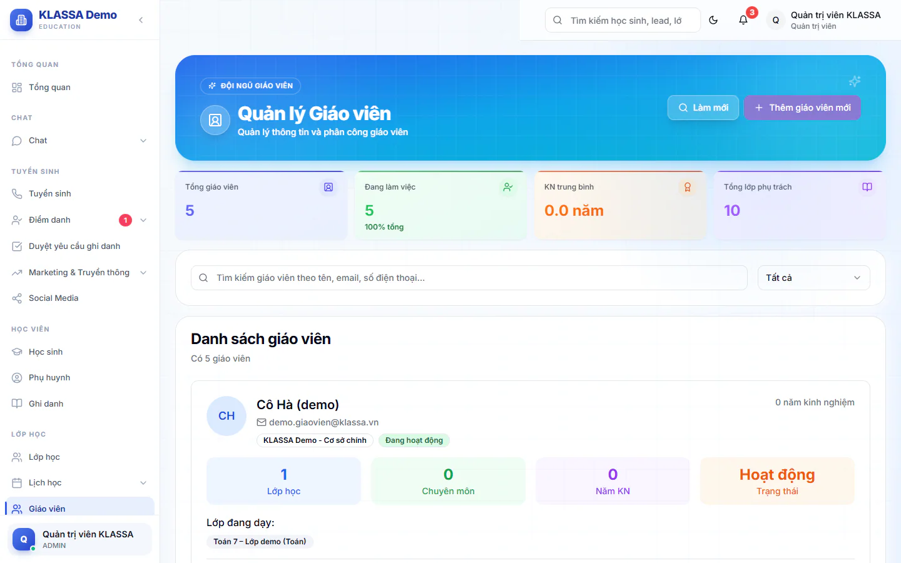

# Danh sách giáo viên

Trang này giúp bạn biết trung tâm có bao nhiêu giáo viên, ai đang dạy lớp nào và ai đã nghỉ. Trang chỉ liệt kê tài khoản mang vai **Giáo viên**. Trợ giảng và các vai khác xem ở [Danh sách nhân viên](../nhan-su/danh-sach-nhan-vien.md).

## Xem và tìm giáo viên

::: steps
1. Vào **Giáo viên** ở menu bên trái.
2. Bốn ô số ở đầu trang: **Tổng giáo viên**, **Đang làm việc**, **KN trung bình** (số năm kinh nghiệm) và **Tổng lớp phụ trách**.
3. Gõ vào ô **Tìm kiếm giáo viên theo tên, email, số điện thoại...** để tìm.
4. Ở ô **Trạng thái** chọn **Tất cả**, **Đang hoạt động** hoặc **Không hoạt động**. Trang mặc định hiện **Tất cả**, gồm cả giáo viên đã nghỉ.
:::

Mỗi giáo viên có một thẻ ghi họ tên, email, số điện thoại (chỉ hiện khi hồ sơ đã có số), cơ sở, mã nhân viên, trạng thái (**Đang hoạt động** hoặc **Không hoạt động**) và số năm kinh nghiệm. Bốn ô số nhỏ trong thẻ là **Lớp học**, **Chuyên môn** (số môn), **Năm KN** và **Trạng thái**. Thẻ còn có khối **Thông tin nhân sự** (**Mã NV**, **Chức vụ**, **Phòng ban**, **Loại hợp đồng**, hiện khi giáo viên đã có hồ sơ nhân sự), danh sách chuyên môn, **Lớp đang dạy** (hiện tối đa 5 lớp, còn lại ghi "+N lớp khác") và ngày **Gia nhập**.

Hai nút cuối thẻ:

- **Lịch dạy**: mở [thời khóa biểu](../lop-hoc/lich-day.md) đã lọc sẵn theo giáo viên đó.
- **Chi tiết**: mở [hồ sơ giáo viên](chi-tiet.md).

Nút **Làm mới** tải lại danh sách. Nút **Thêm giáo viên mới** xem ở [Thêm giáo viên](them-moi.md).

## Ai xem được gì

Quản trị viên, Quản lý chi nhánh, Quản lý, Lễ tân và Kế toán mở được trang này. Giáo viên và trợ giảng không xem được danh sách đồng nghiệp. Lương, số tài khoản, mã số thuế, giấy tờ cá nhân chỉ hiện cho Quản trị viên và Quản lý chi nhánh, các vai còn lại không thấy.

## Câu hỏi thường gặp

::: details Sao trợ giảng không có trong danh sách?
Trang này chỉ liệt kê vai **Giáo viên**. Trợ giảng và lễ tân kiêm trợ giảng được xếp vào lớp ở [Chỉnh sửa lớp học](../lop-hoc/chinh-sua.md).
:::

::: details Giáo viên đã nghỉ có còn hiện không?
Trang mặc định hiện **Tất cả**, nên bạn vẫn thấy người đã nghỉ, thẻ ghi **Không hoạt động**. Các ô chọn giáo viên ở những trang khác chỉ liệt kê người còn làm việc.
:::

::: details Giáo viên nghỉ việc rồi, lớp của họ có tự chuyển người khác không?
Không. Phân công lớp không tự đóng khi nghỉ việc. Hãy vào [chi tiết giáo viên](chi-tiet.md), xem các lớp còn ghi tên họ rồi đổi giáo viên ở từng lớp.
:::
