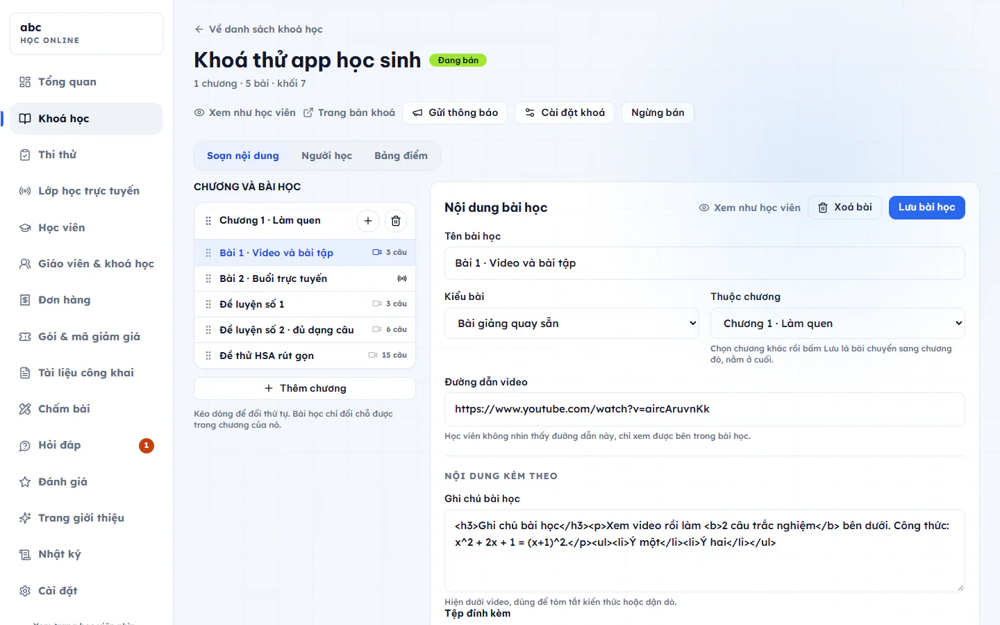
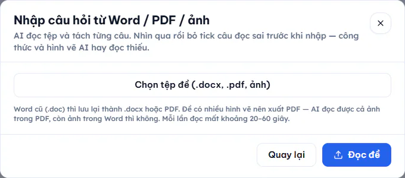

# Bài học, video và bài tập

Bài học là đơn vị nhỏ nhất của một khoá. Mỗi bài có thể có video, ghi chú, tệp đính kèm và câu hỏi bài tập. Bài viết này hướng dẫn soạn một bài và thêm câu hỏi vào bài.

## Thêm bài vào chương

::: steps
1. Vào **Học online → Khoá học**, bấm vào khoá cần soạn.
2. Ở tab **Soạn nội dung**, bấm dấu cộng cạnh tên chương. Hộp **Thêm bài học** hiện ra.
3. Nhập **Tên bài học** rồi bấm **Thêm bài**.
4. Bấm vào tên bài ở cột bên trái. Biểu mẫu **Nội dung bài học** hiện bên phải.

   
5. Điền thông tin (xem các mục dưới) rồi bấm **Lưu bài học**.
:::

Cột bên trái dùng biểu tượng nhỏ để báo bài có video chưa, bài là buổi trực tuyến, hay bài cho học thử.

## Chọn kiểu bài

Ô **Kiểu bài** có ba lựa chọn:

| Kiểu | Dùng khi |
| --- | --- |
| **Bài giảng quay sẵn** | Bài có video quay sẵn. Dán link video YouTube vào ô **Đường dẫn video**. |
| **Buổi học trực tuyến** | Dạy trực tiếp qua Zoom, Meet hoặc nền tảng khác. Điền **Giờ bắt đầu** và phòng học. |
| **Đề thi** | Bài kiểm tra có tính giờ, giới hạn lượt làm. |

Ô **Thuộc chương** cho phép chuyển bài sang chương khác: chọn chương mới rồi bấm lưu, bài nằm ở cuối chương đó.

### Bài giảng quay sẵn

Dán link video YouTube vào **Đường dẫn video**. Học viên không nhìn thấy đường dẫn này, chỉ xem được bên trong bài học.

### Buổi học trực tuyến

- Nếu trung tâm đã kết nối Zoom, bật **Tự tạo phòng Zoom**. Điền **Giờ bắt đầu** rồi bấm **Lưu bài học**, hệ thống tự tạo phòng và học viên vào lớp ngay trong trang bài học.
- Nếu chưa kết nối Zoom hoặc muốn dùng nền tảng khác, tắt công tắc và dán link vào **Đường dẫn phòng học**.
- Sau giờ bắt đầu, dưới bài hiện bảng **Tham dự buổi này** (Học viên, Vào lúc, Ra lúc, Số phút).

Xem thêm [Lớp LIVE](lop-live.md) để đặt nhiều buổi cùng lúc.

### Đề thi trong khoá

Ngoài tên và chương, bạn đặt:

- **Thời gian làm bài (phút)**, từ 5 đến 180.
- **Số lượt làm bài**: không giới hạn (đề luyện tập), 1 lượt (như thi thật), 2, 3 hoặc 5 lượt. Hết lượt thì chỉ xem lại được bài cũ.
- **Mở đề từ** và **Đóng đề lúc**: để trống là mở ngay, không đóng.
- **Trộn thứ tự câu hỏi**.
- **Cho xem lại đáp án sau khi nộp**: tắt khi đề còn dùng cho đợt thi sau.

Đề thi để học viên tự thi thử không cần mua khoá thì xem [Kho đề thi thử](kho-de-thi-thu.md).

## Ghi chú và tệp đính kèm

- **Ghi chú bài học** hiện dưới video, dùng để tóm tắt kiến thức hoặc dặn dò.
- Bấm **Chọn tệp từ kho tài liệu** để đính kèm tệp. Sau khi chọn nhớ bấm **Lưu bài học**.

## Khi nào tính là học xong

Phần **Khi nào tính là học xong** là một câu có chỗ điền: xem đủ một số phần trăm video (từ 50 đến 100), có hoặc không cần làm hết bài tập, và điểm thưởng khi xong bài (0 đến 500). Điểm thưởng chỉ để động viên, không liên quan điểm số học tập.

Hai công tắc đi kèm:

- **Phải làm bài tập mới tính là xong**: tắt thì chỉ cần xem đủ video.
- **Cho học thử miễn phí**: người chưa mua khoá vẫn xem được bài này.

Phần **Hạn nộp và điểm đạt** có **Hạn nộp bài** (để trống là không có hạn, bài tự luận nộp sau giờ này bị đánh dấu nộp muộn) và **Điểm đạt (%)** (để trống là không yêu cầu ngưỡng).

## Thêm câu hỏi bài tập

Ở phần **Câu hỏi trong bài**, có các cách thêm câu:

| Nút | Cách làm |
| --- | --- |
| **Soạn câu mới** | Tự gõ từng câu. |
| **Lấy câu từ ngân hàng câu hỏi** | Chọn câu có sẵn trong ngân hàng của trung tâm. Câu được sao chép sang bài, sửa trong ngân hàng sau này không đổi bài đã soạn. |
| **Nhập từ Excel** | Tải file mẫu, điền rồi tải lên. Chỉ nhận câu trắc nghiệm một đáp án đúng. |
| **Nhập từ Word/PDF** | AI đọc tệp đề và tách từng câu. |
| **Sinh đề theo độ khó** | Chỉ hiện ở bài kiểu **Đề thi**. Chọn chương và số câu cho mỗi mức: Nhận biết, Thông hiểu, Vận dụng, Vận dụng cao. Hệ thống bốc ngẫu nhiên trong ngân hàng câu hỏi. |

Bài không có câu hỏi thì học viên chỉ cần xem video là xong.

### Các dạng câu khi soạn tay

Ô **Dạng câu** có: **Trắc nghiệm 1 đáp án**, **Chọn nhiều đáp án**, **Đúng / Sai từng ý**, **Điền đáp án**, **Kéo thả**, **Tự luận (giáo viên chấm)**. Mỗi câu có thể có **Ảnh minh hoạ**, **Lời giải** (hiện cho học viên sau khi nộp) và **Điểm của câu này**. Chọn nhiều đáp án thì tick ít nhất 2 đáp án đúng.

### Nhập câu từ Word, PDF hoặc ảnh bằng AI

AI chỉ đọc nháp, bạn duyệt rồi mới nhập.

::: steps
1. Ở phần **Câu hỏi trong bài** bấm **Nhập từ Word/PDF**, hộp **Nhập câu hỏi từ Word / PDF / ảnh** hiện ra.

   
2. Bấm **Chọn tệp đề (.docx, .pdf, ảnh)**. Nhận tệp .docx, .pdf, .png, .jpg.
3. Bấm **Đọc đề**. Mỗi lần đọc mất khoảng 20-60 giây.
4. Xem danh sách câu AI tách ra. Bỏ tick câu đọc sai. Câu trắc nghiệm thì bấm vào đáp án để đặt đáp án đúng. Câu không nhập được ngay sẽ bị làm mờ kèm ghi chú.
5. Bấm **Nhập ... câu đã tick**.
:::

::: warning Lưu ý
Mọi câu trắc nghiệm đã tick phải có đáp án đúng, nếu không hệ thống báo còn bao nhiêu câu chưa chọn. Công thức và hình vẽ AI hay đọc thiếu, nên đọc lại cẩn thận. Đề nhiều hình vẽ nên xuất PDF. Ảnh nằm trong Word thì AI không đọc được. Tệp Word cũ (.doc) hãy lưu lại thành .docx hoặc PDF.
:::

Đề chuẩn nhiều phần (xem [Kho đề thi thử](kho-de-thi-thu.md)) thì mỗi lần nhập chỉ vào một phần: chọn ở ô **Nhập vào phần**. Đề có 3 phần thì tách tệp rồi nhập 3 lần.

## Chấm bài tự luận

Câu tự luận do học viên nộp ảnh bài làm. Bài nộp xếp hàng ở **Học online → Chấm bài**, em nộp trước được chấm trước. Có hai tab: **Chờ chấm** và **Đã chấm**.

::: steps
1. Chọn một bài ở cột bên trái, xem **Ảnh bài làm**.
2. Bấm **Xin gợi ý chấm** nếu muốn tham khảo. Gợi ý chỉ để tham khảo, điểm và nhận xét vẫn do bạn quyết định.
3. Nhập **Điểm** (ô ghi rõ điểm tối đa) và **Nhận xét cho học viên**.
4. Bấm **Lưu điểm**.
:::

Học viên nhận thông báo "Thầy cô đã chấm bài" nếu công tắc này đang bật trong [Cài đặt học online](cai-dat.md).

## Xoá bài

Trong biểu mẫu bài học, bấm **Xoá bài** rồi xác nhận.

::: danger Không thể hoàn tác
Xoá bài là mất luôn câu hỏi và tiến độ học của học viên trong bài đó.
:::

## Câu hỏi thường gặp

::: details Tôi đã bấm nhập từ Excel nhưng câu tự luận không vào?
Excel chỉ nhận câu trắc nghiệm một đáp án đúng. Câu tự luận hoặc chọn nhiều đáp án thì soạn tay hoặc nhập từ Word/PDF.
:::

::: details Học viên có thấy đường dẫn video không?
Không. Họ chỉ xem video bên trong bài học.
:::
