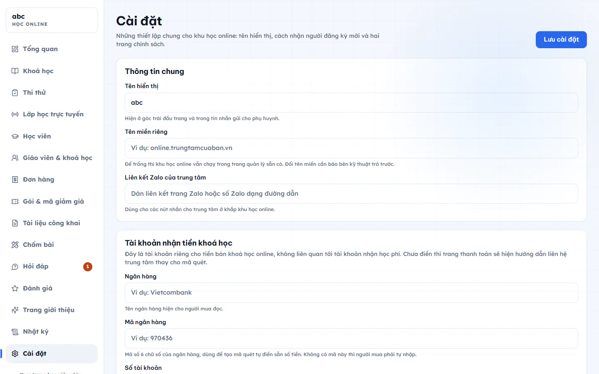

# Cài đặt học online

Trang này chứa các thiết lập chung của khu học online: tên hiển thị, nơi nhận tiền khoá học, cách nhận người đăng ký mới, kết nối Zoom, thông báo và hai trang chính sách. Chỉ Quản trị viên và Quản lý chi nhánh vào được.

::: steps
1. Vào **Học online → Cài đặt**.
2. Sửa các mục bên dưới.
3. Bấm **Lưu cài đặt** (có ở đầu và cuối trang). Hệ thống báo "Đã lưu cài đặt".
:::

Riêng kết nối Zoom có nút lưu riêng (xem phần Kết nối Zoom).

## Thông tin chung

- **Tên hiển thị**: hiện ở góc trái đầu trang và trong tin nhắn gửi cho phụ huynh.
- **Tên miền riêng**: để trống thì khu học online vẫn chạy trong trang quản lý sẵn có. Đổi tên miền cần báo bên kỹ thuật trỏ trước.
- **Liên kết Zalo của trung tâm**: dùng cho các nút nhắn cho trung tâm ở khắp khu học online.

## Tài khoản nhận tiền khoá học

Người mua khoá chuyển khoản vào tài khoản này.

- **Ngân hàng**: tên ngân hàng hiện cho người mua đọc.
- **Mã ngân hàng**: mã 6 chữ số của ngân hàng, dùng để tạo mã quét có sẵn số tiền. Không có mã này thì người mua phải tự nhập số tiền.
- **Số tài khoản** và **Tên chủ tài khoản** (viết in hoa không dấu, đúng như trên sao kê).
- **Ảnh mã quét tự tải lên**: không bắt buộc. Chỉ cần khi ngân hàng không tạo được mã quét tự động. Khi đó người mua tự ghi mã đơn vào nội dung chuyển khoản.

## Người đăng ký mới

- **Phải được duyệt mới học được**: bật thì người lạ đăng ký xong phải chờ trung tâm duyệt. Tắt thì họ mua khoá được ngay.
- **Tự lưu vào danh sách khách quan tâm**: bật thì mỗi người đăng ký từ ngoài được thêm vào danh sách khách quan tâm để tư vấn viên gọi lại.

## Kết nối Zoom

Mục **Lớp LIVE (Zoom)** cho phép hệ thống tự tạo phòng học khi giáo viên đặt buổi trực tuyến. Cần tài khoản Zoom trả phí (từ gói Pro), vì gói miễn phí bị cắt 40 phút mỗi buổi.

::: steps
1. Trên trang dành cho nhà phát triển của Zoom, tạo hai ứng dụng: một ứng dụng kiểu **Server-to-Server OAuth** và một ứng dụng kiểu **Meeting SDK**.
2. Điền đủ 6 ô: **Account ID**, **Client ID**, **Client Secret**, **SDK Client ID**, **SDK Client Secret** và **Secret Token (Event Subscriptions)**.
3. Ô chỉ đọc bên dưới là đường dẫn nhận sự kiện từ Zoom. Bấm **Sao chép**, dán vào phần **Event Subscriptions** của ứng dụng Zoom để hệ thống ghi nhận người vào lớp và bản ghi hình.
4. Bấm **Lưu kết nối**.
5. Bấm **Kiểm tra kết nối**. Nếu đúng, hệ thống báo "Kết nối OK" kèm email của tài khoản Zoom.
:::

Bấm **Xem hướng dẫn lấy 6 ô trên** để xem hướng dẫn từng bước ngay trên trang. Nhờ người phụ trách kỹ thuật làm bước này nếu bạn không quen.

Lần đầu bắt buộc điền đủ 6 ô. Khi đã kết nối, bạn chỉ điền ô muốn đổi, ô để trống là giữ nguyên. Nếu chưa bật nhận sự kiện từ Zoom, trang sẽ cảnh báo là điểm danh và bản ghi hình sẽ không tự ghi.

Bấm **Ngắt kết nối** để gỡ. Các buổi đã có phòng vẫn giữ đường dẫn cũ để học viên vào bằng ứng dụng Zoom. Hệ thống sẽ không tự tạo phòng mới, không nhúng phòng và không tự ghi tham dự hay bản ghi hình cho tới khi kết nối lại.

::: tip Mẹo
Chưa kết nối Zoom cũng không sao. Bài trực tuyến vẫn dán đường dẫn Zoom, Meet hoặc nền tảng khác bằng tay.
:::

## Thông báo cho học viên

Mục **Thông báo cho học viên** gom toàn bộ tin của khu học online. Công tắc **Bật thông báo khu học online** là công tắc tổng: tắt thì im toàn bộ tin bên dưới, dù từng mục vẫn đang bật. Tắt ở đây chỉ tắt tin của khu học online, tin học phí, điểm danh, nhận xét buổi học ở phần quản lý trung tâm vẫn chạy bình thường.

Các công tắc từng loại tin (mặc định đều bật):

| Công tắc | Khi nào gửi |
| --- | --- |
| **Bài giảng mới, video được cập nhật** | Thêm bài mới hoặc thay video của bài cũ. Sửa mỗi tên bài thì không gửi. |
| **Bài tập về nhà và tài liệu mới** | Bài có thêm bài tập hoặc tệp tải về. Chỉ báo lần đầu của mỗi bài. |
| **Thầy cô đã chấm bài** | Chấm xong bài tự luận, báo riêng cho em nộp bài, kèm điểm. |
| **Thông báo trung tâm tự gửi** | Cho phép gửi tin tự soạn ở nút **Gửi thông báo** trong khoá học. |
| **Nhắc sắp đứt chuỗi ngày học** | Mỗi 19h, học viên có chuỗi từ 3 ngày trở lên mà hôm nay chưa học. |
| **Có người trả lời câu hỏi** | Có người trả lời câu học viên hỏi dưới bài học. |
| **Cấp tài khoản học online** | Cấp tài khoản cho học sinh đang học tại trung tâm, báo phụ huynh kèm tên đăng nhập và mật khẩu. |
| **Đã nhận tiền, khoá học mở** | Tiền chuyển khoản về, báo người mua khoá đã vào học được. |

## Báo cho nhân viên

Mục **Báo cho nhân viên** báo cho người trong trung tâm khi có việc mới. Tin hiện trong mục thông báo và trên app điện thoại của người nhận. Mục này cũng chịu công tắc tổng ở trên.

- **Có người đăng ký chờ duyệt**: báo Quản trị viên và Quản lý chi nhánh. Chỉ có tác dụng khi đang bật **Phải được duyệt mới học được**.
- **Đơn chuyển khoản chưa khớp tiền**: người mua chuyển không đủ số tiền thì đơn nằm chờ đối soát và khoá chưa mở. Báo để vào xem sao kê rồi xác nhận.

- **Học viên nộp bài tự luận**: báo thầy cô được phân công khoá đó để vào chấm. Khoá chưa phân công ai thì báo Quản trị viên và Quản lý chi nhánh.
- **Học viên đặt câu hỏi**: báo thầy cô phụ trách khoá, cũng theo quy tắc trên.

## Điều khoản và chính sách hoàn tiền

Hai trang chính sách mỗi trang gồm **Tiêu đề trang** và **Nội dung**. Điều khoản sử dụng: mỗi ý một đoạn, cách nhau một dòng trống. Chính sách hoàn tiền: nên nói rõ trong bao nhiêu ngày và học tới đâu thì còn được hoàn.

## Câu hỏi thường gặp

::: details Tôi tắt công tắc tổng rồi, các công tắc nhỏ còn lưu không?
Còn. Bạn vẫn chỉnh trước được, bật lại công tắc tổng là chạy đúng như đã chọn.
:::

::: details Giáo viên có vào được trang này không?
Không. Giáo viên và Trợ giảng không thấy mục **Cài đặt**.
:::

::: details Quên bấm Lưu cài đặt thì sao?
Thay đổi không được giữ. Phần Zoom thì lưu riêng bằng nút **Lưu kết nối**.
:::
