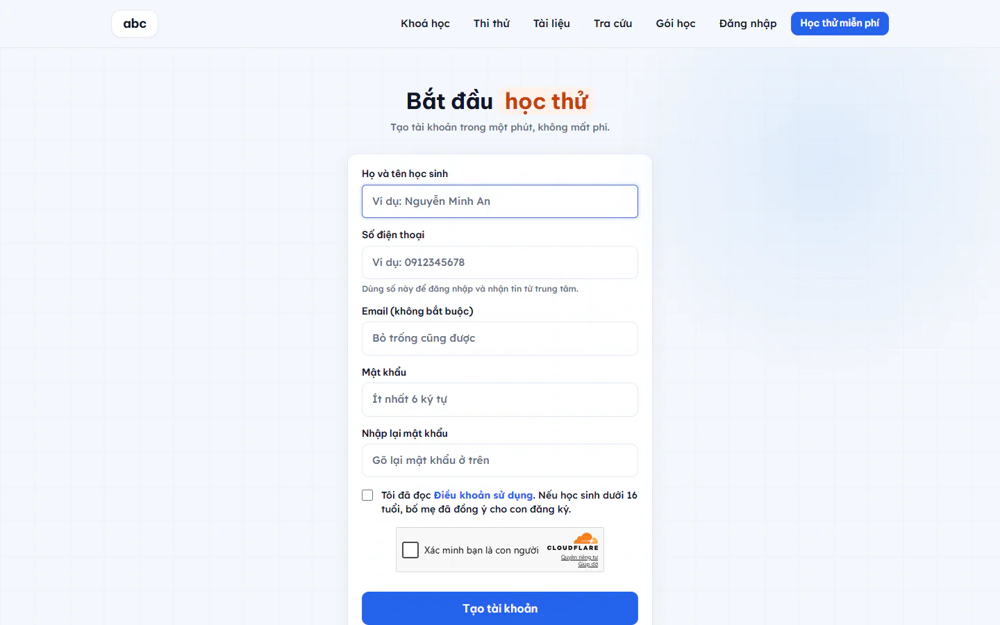

# Học viên học online từ A đến Z

Khu học online là trang riêng cho học viên: đăng ký tài khoản, học bài giảng, làm bài tập, xem lịch và theo dõi tiến bộ của mình. Học viên có thể là học sinh tự đăng ký hoặc phụ huynh đăng ký cho con. Khu này cần gói mở rộng **Học online**.

## Đăng ký tài khoản

Trang đăng ký có tiêu đề **Bắt đầu học thử**. Tạo tài khoản mất khoảng một phút và không mất phí.

::: steps
1. Mở trang đăng ký của trung tâm và điền **Họ và tên học sinh** (ít nhất 2 ký tự).
2. Nhập **Số điện thoại**. Bạn có thể gõ 0912345678, 0912.345.678 hoặc +84912345678.
3. Ô **Email (không bắt buộc)** có thể để trống. Nếu điền, email phải đúng dạng.
4. Đặt **Mật khẩu** (ít nhất 6 ký tự) rồi gõ lại ở ô **Nhập lại mật khẩu**.
5. Tích ô xác nhận: bạn đã đọc **Điều khoản sử dụng**, và nếu học sinh dưới 16 tuổi thì bố mẹ đã đồng ý cho con đăng ký.
6. Nếu trang có ô xác nhận người thật (thường ghi **Xác minh bạn là con người**), tích vào ô này và chờ ô báo thành công. Chưa xong mà bấm **Tạo tài khoản**, trang nhắc hoàn thành ô xác nhận "Tôi không phải máy".
7. Bấm **Tạo tài khoản**.
:::

Ô xác nhận điều khoản là bắt buộc. Thiếu ô này, hệ thống không tạo tài khoản.

Sau khi bấm **Tạo tài khoản** có hai trường hợp:

- Trung tâm không yêu cầu duyệt: bạn được đưa thẳng vào **Bàn học**.
- Trung tâm yêu cầu duyệt: màn hình báo **Đã nhận đăng ký của bạn**. Bạn chờ trung tâm duyệt rồi mới đăng nhập được. Trong lúc chờ, bạn vẫn xem được danh sách khoá học.

::: tip Mẹo
Điều kiện "phải được duyệt mới học được" là công tắc của trung tâm, mặc định bật. Quản trị viên chỉnh ở mục **Cài đặt** trong khu quản trị Học online, ô **Phải được duyệt mới học được**.
:::

## Đăng nhập

Trang **Đăng nhập** nhận **Số điện thoại** và **Mật khẩu**. Chưa có tài khoản thì bấm **Đăng ký** ở cuối trang.

Quên mật khẩu thì liên hệ trung tâm để được cấp lại. Trang không có nút tự đặt lại mật khẩu.

## Bàn học

**Bàn học** là trang đầu sau khi đăng nhập. Trang có:

- Lời chào và số ngày học liên tiếp.
- Thẻ khoá đang học, nút **Học tiếp ngay** (hoặc **Bắt đầu ngay** nếu chưa học bài nào).
- Bốn số liệu: **Điểm kinh nghiệm**, **Khoá đang học**, **Bài đã hoàn thành**, **Ngày học liên tiếp**.
- Mục **Lớp trực tuyến của tôi** khi có buổi học trực tiếp sắp tới.
- Thẻ từng khoá kèm tiến độ và bảng xếp hạng tuần của khoá.
- Các huy hiệu đã nhận.

Menu của khu học gồm: **Bàn học**, **Khoá học**, **Lịch học**, **Điểm & thành tích**, **Đơn hàng**, **Thông tin cá nhân**. Mục **Đánh giá thầy cô** chỉ hiện khi trung tâm bật tính năng này (mặc định tắt), xem [Đánh giá thầy cô](../hoc-tap/danh-gia-thay-co.md).

## Mua khoá học

::: steps
1. Vào **Khoá học** và chọn khoá bạn muốn.
2. Nếu có mã giảm giá, nhập vào ô **Mã giảm giá (nếu có)**.
3. Bấm **Mua khoá học**. Hệ thống tạo đơn và hiện màn **Chuyển khoản để mở khoá học**.
4. Chuyển khoản theo thông tin trên màn hình. Khi nhận được tiền, màn hình đổi thành **Đã nhận được tiền!** và khoá học mở cho bạn.
:::

Nhiều khoá có vài bài học thử miễn phí. Bạn xem thử các bài này trước khi quyết định mua.

Đơn có thể ở các trạng thái: **Chờ chuyển khoản**, **Đã thanh toán**, **Trung tâm đang kiểm** (khoản tiền cần trung tâm kiểm lại), **Đã huỷ**, **Đã hoàn tiền**. Xem lại các đơn ở **Đơn hàng**.

## Học một bài

Mở khoá từ **Bàn học**, bấm vào bài để vào trang bài học. Dưới video có các tab **Bài tập**, **Tài liệu**, **Ghi chú bài học** và **Hỏi đáp**. Bài là đề thi thì tab **Bài tập** bị ẩn, câu hỏi nằm ngay trong phòng thi.

Phía dưới có dòng **Điều kiện hoàn thành**, cho bạn biết còn thiếu gì:

- Xem đủ phần trăm video thầy cô đặt (ví dụ **Xem ≥80% video**), kèm số phần trăm bạn đang đạt.
- Làm hết bài tập nếu thầy cô bắt buộc.
- Bài chỉ có câu tự luận: chờ thầy cô chấm.
- Bài không có video và không có bài tập: chỉ cần mở bài. Với buổi học trực tiếp, bạn vào lớp hoặc mở lại bài khi buổi học đã kết thúc.

Khi đủ điều kiện, bài tự được tính là xong và bạn nhận điểm thưởng. Nút chuyển sang bài kế tiếp hiện ngay trong dòng này.

Tab **Hỏi đáp** để đăng câu hỏi cho thầy cô về đúng bài đang học.

::: warning Lưu ý
Mỗi bài chỉ cộng điểm một lần. Xem lại bài cũ không cộng thêm.
:::

## Lịch học của tôi

Trang **Lịch học** hiển thị thời khoá biểu theo tuần, bắt đầu từ thứ Hai. Dùng nút **Tuần trước** và **Tuần sau** để chuyển tuần.

Có hai loại lịch:

- Lịch lớp do trung tâm xếp. Bạn chỉ xem, bấm vào buổi để mở bài và vào lớp.
- Lịch riêng do bạn tự thêm.

Để thêm lịch riêng, bấm **Thêm** ở ngày muốn thêm, điền **Tên lịch** (tối đa 120 ký tự, ví dụ Ôn Toán) và **Ngày và giờ bắt đầu**, rồi bấm **Thêm**. Để xoá, bấm biểu tượng xoá cạnh lịch riêng đó. Lịch lớp không xoá được.

## Điểm và thành tích

Trang **Điểm & thành tích** cho biết bạn đang ở cấp nào, còn bao nhiêu điểm lên cấp tiếp theo, và các huy hiệu đã nhận.

### Điểm kinh nghiệm và cấp bậc

Mỗi bài học xong cộng số điểm thầy cô đặt cho bài đó. Có 5 cấp:

| Cấp | Tên | Từ điểm |
|---|---|---|
| 1 | Mới bắt đầu | 0 |
| 2 | Chăm chỉ | 300 |
| 3 | Vững vàng | 700 |
| 4 | Xuất sắc | 1.200 |
| 5 | Kiện tướng | 2.000 |

### Chuỗi ngày học

Học ngày nào cũng được ghi nhận để giữ chuỗi. Chuỗi không cộng điểm riêng, chỉ để theo dõi nhịp học.

### Huy hiệu

| Huy hiệu | Cách nhận |
|---|---|
| Bước đầu tiên | Học xong bài đầu tiên |
| Chăm chỉ | Học xong 10 bài |
| Bền bỉ | Học xong 50 bài |
| Tuần đều đặn | Học liên tục 7 ngày |
| Tháng kiên trì | Học liên tục 30 ngày |
| Xong khoá | Hoàn thành trọn một khoá học |
| Điểm tuyệt đối | Làm đúng hết một bài trắc nghiệm từ 5 câu trở lên |

## Thông tin cá nhân

Trang **Thông tin cá nhân** có các tab: **Khoá của tôi**, **Đơn đã đặt**, **Thông báo** và **Mật khẩu**. Đổi mật khẩu ở tab **Mật khẩu**.

## Thi thử, tra cứu và hỏi bài

- Làm đề thi thử, xem bảng xếp hạng từng đề: [Phòng thi thử](phong-thi.md).
- Phụ huynh tra nhanh tiến độ của con bằng số điện thoại: [Tra cứu bằng số điện thoại](tra-cuu.md).
- Hỏi bài bằng trợ lý AI trên app điện thoại: [Gia sư AI](gia-su-ai.md).

## Câu hỏi thường gặp

::: details Tôi đăng ký xong nhưng không đăng nhập được?
Có thể trung tâm đang chờ duyệt tài khoản. Bạn chờ trung tâm duyệt, hoặc bấm **Nhắn Zalo cho trung tâm** ở màn báo đã nhận đăng ký (nút này hiện khi trung tâm có cài Zalo).
:::

::: details Tôi xem hết video rồi mà bài chưa tính là xong?
Xem dòng **Điều kiện hoàn thành** dưới video. Có thể bạn còn thiếu bài tập bắt buộc hoặc chưa đạt đủ phần trăm video.
:::

::: details Học sinh dưới 16 tuổi có tự đăng ký được không?
Được, nhưng khi tích ô xác nhận, bố mẹ phải đã đồng ý cho con đăng ký.
:::
