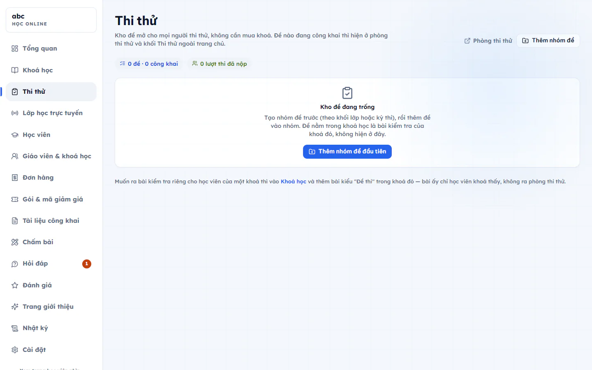

# Kho đề thi thử

Kho đề là nơi để mọi người thi thử mà không cần mua khoá. Đề nào đang công khai thì hiện ở phòng thi thử và khối Thi thử ngoài trang chủ. Đề nằm trong một khoá học là bài kiểm tra của khoá đó, không hiện ở kho này.

Kho đề là của chung, nên giáo viên nào cũng soạn được, không cần được gán khoá.

## Tạo nhóm đề

Đề được xếp trong nhóm, ví dụ theo khối lớp hoặc theo kỳ thi.

::: steps
1. Vào **Học online → Thi thử**.
2. Bấm **Thêm nhóm đề** (hoặc **Thêm nhóm đề đầu tiên** nếu kho còn trống).
3. Nhập **Tên nhóm**, bấm **Thêm nhóm**.
:::

Bấm biểu tượng bút cạnh tên nhóm để đổi tên, biểu tượng thùng rác để xoá. Nhóm còn đề bên trong thì chưa xoá được: xoá hết đề hoặc chuyển đề sang nhóm khác trước.

## Thêm đề

::: steps
1. Ở nhóm cần thêm, bấm **Thêm đề vào nhóm này**. Hộp **Thêm đề thi thử** hiện ra.
2. Chọn **Định dạng đề** (xem bảng dưới).
3. Nhập **Tên đề**.
4. Với đề tự do, nhập **Thời gian làm bài (phút)** từ 5 đến 180.
5. Bấm **Tạo đề**. Đề tạo xong ở trạng thái đang soạn.
:::

| Định dạng | Mô tả |
| --- | --- |
| Đề tự do | Một đồng hồ, bạn tự đặt số câu. |
| HSA | Đánh giá năng lực ĐHQGHN: 150 câu, 195 phút, 150 điểm. |
| TSA | Đánh giá tư duy Bách khoa Hà Nội: 100 câu, 150 phút, 100 điểm. |

Đề HSA và TSA có 3 phần đúng chuẩn kỳ thi, mỗi phần một đồng hồ riêng, làm xong phần nào khoá phần đó. Khi soạn câu, bạn chọn câu thuộc phần nào (và chủ đề, với phần Khoa học của HSA). Phòng thi vẫn mở được khi số câu chưa đủ chuẩn, thẻ đề sẽ ghi "rút gọn".

## Soạn câu hỏi cho đề

Bấm vào tên đề ở cột bên trái để mở biểu mẫu **Thông tin đề thi thử**. Bạn điền **Tên đề**, **Ảnh bìa đề** (dán đường dẫn ảnh tỉ lệ 16:9, bỏ trống sẽ dùng ô màu mặc định), **Nhóm đề**, giới thiệu đề, thời gian, số lượt làm bài, giờ mở và đóng đề, rồi bấm **Lưu đề**.

Cách thêm câu hỏi giống bài trong khoá, gồm soạn tay, Excel, ngân hàng câu hỏi hoặc AI đọc Word, PDF, ảnh. Xem chi tiết ở [Bài học, video và bài tập](bai-hoc-va-bai-tap.md).

Phần cài đặt riêng của đề thi thử:

- **Công khai trong phòng thi thử**: bật thì ai cũng thấy và vào thi được (cần tài khoản để lưu điểm). Tắt là đang soạn, chỉ mình thấy.
- **Điểm đạt (%)**: để trống là chỉ báo điểm, không báo Đạt hay Chưa đạt.
- **Cho xem lại đáp án sau khi nộp**: tắt khi đề còn dùng cho đợt thi sau.

## Công khai hoặc ẩn đề

Cạnh mỗi đề ở danh sách có nút bấm nhanh để công khai hoặc ẩn đề. Đề chưa có câu hỏi thì chưa công khai được. Bấm **Xem trang đề** trong biểu mẫu để xem đúng trang người lạ nhìn thấy, hoặc bấm **Phòng thi thử** ở đầu trang để mở phòng thi.

Phía trên danh sách có số đề, số đề công khai và số lượt thi đã nộp.

::: danger Không thể hoàn tác
Bấm **Xoá đề** sẽ mất luôn câu hỏi, mọi lượt thi và bảng xếp hạng của đề. Muốn tạm giấu thì chỉ cần tắt **Công khai trong phòng thi thử**.
:::

## Câu hỏi thường gặp

::: details Tôi bật công khai nhưng đề không hiện ở phòng thi thử?
Đề chưa có câu hỏi thì chưa hiện ở phòng thi thử dù đã bật công khai. Thêm câu hỏi trước.
:::

::: details Có bắt buộc đăng nhập mới thi thử được không?
Ai cũng thấy đề công khai và vào thi được, nhưng cần tài khoản để lưu điểm.
:::
