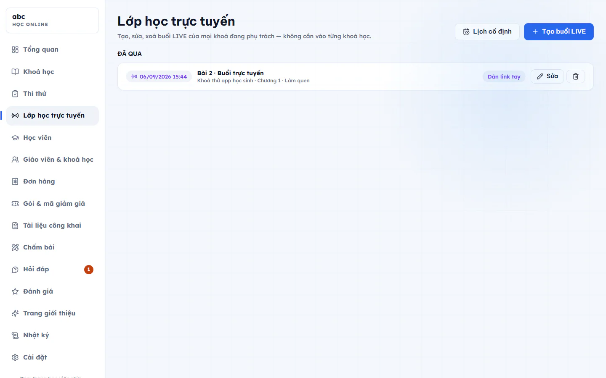
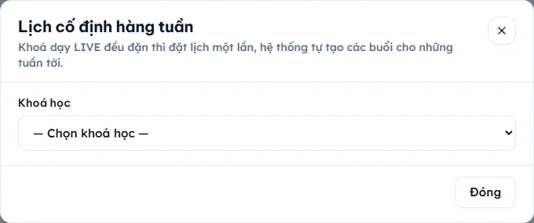

# Lớp học trực tuyến (LIVE)

Trang **Lớp học trực tuyến** gom mọi buổi LIVE của các khoá bạn phụ trách vào một nơi, để tạo, sửa, xoá mà không phải mở từng khoá. Mỗi buổi LIVE thật ra là một bài học kiểu **Buổi học trực tuyến** nằm trong một chương, nên học viên vẫn thấy nó trong lộ trình khoá.

## Xem danh sách buổi LIVE

Vào **Học online → Lớp học trực tuyến**. Các buổi chia ba nhóm: **Hôm nay**, **Sắp tới**, **Đã qua**. Mỗi dòng cho biết giờ học, tên buổi, khoá và chương, cùng trạng thái phòng:

- **Zoom tự tạo**: phòng do hệ thống tạo.
- **Dán link tay**: bạn tự dán đường dẫn phòng học.
- **Chưa có phòng**: buổi chưa có phòng.

## Tạo một buổi LIVE

::: steps
1. Bấm **Tạo buổi LIVE**, hộp **Tạo buổi LIVE mới** hiện ra.
2. Chọn **Khoá học**.
3. Chọn **Chương**. Muốn tạo chương mới, chọn **+ Chương mới…** rồi nhập **Tên chương mới**.
4. Nhập **Tên buổi học**, chọn **Giờ bắt đầu**.
5. Nếu trung tâm đã kết nối Zoom, công tắc **Tự tạo phòng Zoom** được bật sẵn. Tắt công tắc thì nhập **Đường dẫn phòng học** (Zoom, Meet hoặc nền tảng khác).
6. Bấm **Tạo buổi LIVE** ở cuối hộp. Hệ thống báo "Đã tạo buổi LIVE".
:::

Muốn sửa, bấm **Sửa** ở cuối dòng. Muốn xoá, bấm biểu tượng thùng rác rồi xác nhận.

::: danger Không thể hoàn tác
Xoá buổi LIVE thì phòng Zoom (nếu có) cũng bị xoá theo.
:::

::: warning Lưu ý
Chưa bật **Tự tạo phòng Zoom** thì bắt buộc nhập đường dẫn phòng học, nếu không hệ thống nhắc nhập.
:::

## Lịch cố định hàng tuần

Khoá dạy LIVE đều đặn (ví dụ T3 và T5 lúc 19:30) thì đặt lịch một lần, hệ thống tự tạo các buổi cho những tuần tới.

::: steps
1. Bấm **Lịch cố định** ở đầu trang. Hộp **Lịch cố định hàng tuần** hiện ra.
2. Chọn **Khoá học**.

   

3. Bấm **Thêm slot**, chọn thứ (CN, T2 đến T7) và giờ, phút bắt đầu. Thêm nhiều slot nếu một tuần học nhiều buổi.
4. Chọn **Sinh buổi cho** 2, 4, 8 hoặc 12 tuần tới.
5. Nhập **Tiền tố tên buổi**. Tên buổi sẽ là tiền tố cộng ngày, ví dụ "Buổi LIVE 26/08".
6. Chọn **Buổi sinh ra nằm ở chương** (có thể tạo chương mới).
7. Nếu trung tâm đã kết nối Zoom, bật **Tự tạo phòng Zoom cho từng buổi** nếu muốn.
8. Bấm **Lưu lịch & sinh buổi** cho số tuần đã chọn. Hoặc bấm **Chỉ lưu lịch** nếu chưa muốn tạo buổi.
:::

Sau khi sinh xong, hệ thống báo đã tạo bao nhiêu buổi và bỏ qua bao nhiêu buổi trùng giờ đã có, nên bấm lại nhiều lần không sinh buổi trùng.

## Kết nối Zoom

Để hệ thống tự tạo phòng, Quản trị viên kết nối tài khoản Zoom trả phí của trung tâm ở [Cài đặt học online](cai-dat.md). Chưa kết nối thì buổi LIVE vẫn dùng được, bạn dán đường dẫn phòng bằng tay.

## Xem ai đã tham dự

Mở buổi LIVE trong khoá, sau giờ bắt đầu sẽ có bảng **Tham dự buổi này** với cột Học viên, Vào lúc, Ra lúc và Số phút. Bảng này chỉ ghi nhận khi Zoom đã được kết nối đủ (kể cả bước nhận sự kiện từ Zoom, xem [Cài đặt học online](cai-dat.md)).

## Câu hỏi thường gặp

::: details Giáo viên có thấy buổi LIVE của khoá người khác không?
Trang chỉ hiện buổi của các khoá bạn phụ trách.
:::

::: details Dùng Google Meet được không?
Được. Tắt **Tự tạo phòng Zoom** và dán link Meet vào **Đường dẫn phòng học**. Bảng tham dự tự động chỉ có với phòng Zoom tự tạo.
:::
