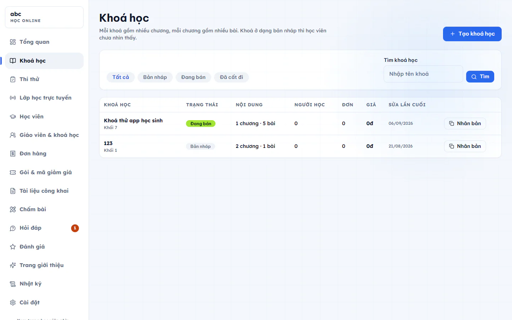
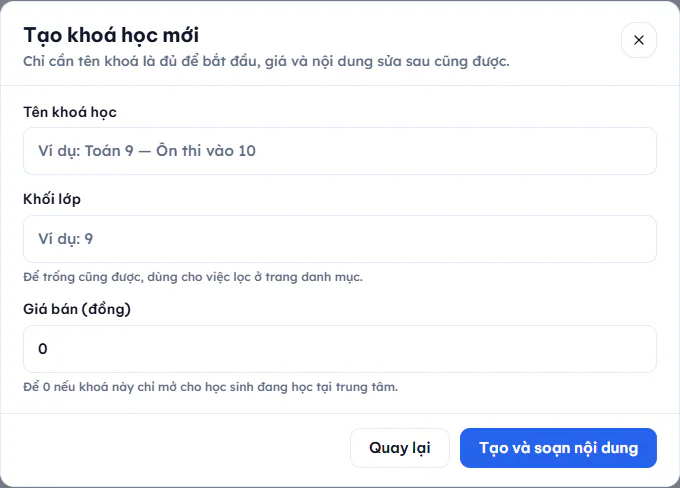

# Tạo khoá học và chương

Mỗi khoá gồm nhiều chương, mỗi chương gồm nhiều bài. Khoá ở dạng bản nháp thì học viên chưa nhìn thấy, nên bạn cứ soạn thoải mái rồi mới phát hành.

## Tạo khoá mới

::: steps
1. Vào **Học online → Khoá học**.
2. Bấm **Tạo khoá học**, hộp **Tạo khoá học mới** hiện ra.
3. Nhập **Tên khoá học** (bắt buộc, ít nhất 2 ký tự).
4. Nhập **Khối lớp** nếu muốn. Có thể để trống, ô này dùng để lọc ở trang danh mục.
5. Nhập **Giá bán (đồng)**. Để 0 nếu khoá chỉ mở cho học sinh đang học tại trung tâm.
6. Bấm **Tạo và soạn nội dung**. Hệ thống đưa bạn thẳng vào màn soạn khoá.
:::

Khi giáo viên hoặc trợ giảng tạo khoá, khoá tự được gán cho chính người đó.

Danh sách khoá có thể lọc theo **Tất cả**, **Bản nháp**, **Đang bán**, **Đã cất đi**, hoặc tìm theo tên ở ô **Tìm khoá học**. Mỗi dòng cho biết số chương, số bài, số người học, số đơn, giá và ngày sửa gần nhất.

## Thêm chương

::: steps
1. Mở khoá, ở tab **Soạn nội dung** bấm **Thêm chương** dưới cột **Chương và bài học**.
2. Nhập **Tên chương**, bấm **Thêm chương**.
3. Muốn đổi tên hoặc đặt ngày mở, bấm vào tên chương, hộp **Sửa chương** hiện ra. Ô **Ngày mở chương** để trống nghĩa là mở ngay. Đặt ngày thì trước ngày đó học viên thấy chương nhưng chưa vào được. Bấm **Lưu**.
4. Kéo dòng chương hoặc dòng bài để đổi thứ tự. Bài chỉ đổi chỗ được trong chương của nó.
:::

Thêm bài vào chương: xem [Bài học và bài tập](bai-hoc-va-bai-tap.md).

::: warning Lưu ý khi xoá chương
Chương còn bài bên trong thì chưa xoá được. Xoá hết bài rồi mới xoá được chương trống.
:::

## Cài đặt khoá

Bấm **Cài đặt khoá** ở đầu trang khoá để sửa:

- **Tên khoá học**, **Câu giới thiệu ngắn**, **Khối lớp**, **Ảnh đại diện** (dán đường dẫn ảnh), **Mô tả chi tiết** (hiện ở trang bán khoá).
- **Giá bán (đồng)**, **Giá khuyến mãi (đồng)** (để trống nếu không giảm giá), **Học trong bao nhiêu tháng** (từ 1 đến 120, để trống nghĩa là học mãi không hết hạn).
- **Học tuần tự**: bật thì phải xong bài trước mới mở được bài sau.
- **Lớp được vào học miễn phí**: tick các lớp. Học sinh đang học các lớp này vào được khoá mà không phải mua.
- **Giáo viên phụ trách**: chỉ Quản trị viên và Quản lý chi nhánh thấy phần này. Chỉ người được tick mới soạn, sửa được khoá và thấy danh sách học viên. Bỏ tick là thu quyền ngay.

Bấm **Lưu cài đặt** để lưu.

## Phát hành và ngừng bán

Ở đầu trang khoá, bấm **Phát hành khoá** để khoá lên kệ. Muốn đưa về bản nháp, bấm **Ngừng bán**.

Hai liên kết cạnh đó giúp bạn kiểm tra: **Xem như học viên** mở phòng học thật (có đủ video, tài liệu, đề bài), **Trang bán khoá** mở trang người mua nhìn thấy.

## Người học và Bảng điểm

Trang khoá có ba tab:

- **Soạn nội dung**: chương và bài.
- **Người học**: danh sách người đang học khoá, kèm lần học cuối.
- **Bảng điểm**: điểm từng học viên theo từng bài và điểm trung bình.

## Gửi thông báo cho học viên của khoá

Khi khoá đang ở trạng thái đang bán, bấm **Gửi thông báo**. Nhập **Tiêu đề** và **Nội dung** (tối đa 1000 ký tự), bấm **Gửi ngay**. Tin tới mọi học viên đang học khoá, cả người đã mua lẫn học sinh của lớp gắn với khoá.

::: danger Không thể hoàn tác
Tin đã gửi không thu lại được. Đọc kỹ trước khi bấm **Gửi ngay**.
:::

Tin này chịu công tắc thông báo ở [Cài đặt học online](cai-dat.md).

## Nhân bản và xoá khoá

- Bấm **Nhân bản** ở cuối dòng khoá để tạo bản sao. Bản sao ở dạng bản nháp và mở ngay ra để bạn sửa.
- Muốn xoá, vào **Cài đặt khoá** rồi bấm **Xoá khoá học**.

::: danger Không thể hoàn tác
Xoá khoá là mất toàn bộ chương, bài và câu hỏi. Khoá đã có người mua thì hệ thống không cho xoá. Khi đó hãy bấm **Ngừng bán** để ẩn khoá khỏi học viên.
:::

## Câu hỏi thường gặp

::: details Khoá đã phát hành rồi có sửa được nội dung không?
Được. Bạn vẫn soạn và sửa chương, bài như bình thường. Muốn ẩn khoá khỏi học viên thì bấm **Ngừng bán**.
:::

::: details Giáo viên có xoá được khoá của mình không?
Giáo viên xoá được khoá mình được gán, với điều kiện khoá chưa có người mua.
:::
