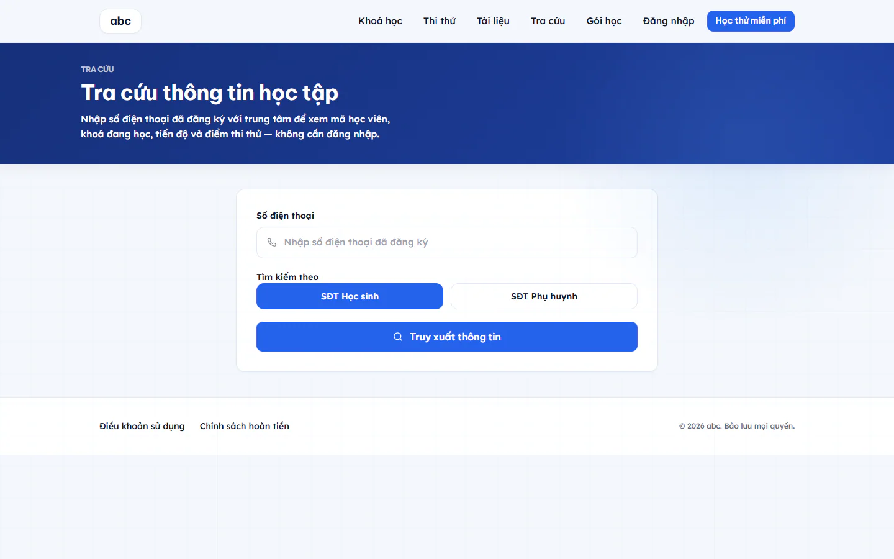

# Tra cứu thông tin học tập bằng số điện thoại

Trang **Tra cứu** giúp phụ huynh xem con đang học khoá nào và đã học tới đâu mà không cần nhớ tài khoản. Bạn chỉ cần số điện thoại đã đăng ký với trung tâm.

## Tra cứu

::: steps
1. Mở trang **Tra cứu** từ thanh trên cùng của khu học online.
2. Nhập **Số điện thoại**. Số có thể gõ có chấm, khoảng trắng hoặc đầu +84.
3. Ở **Tìm kiếm theo**, chọn **SĐT Học sinh** hoặc **SĐT Phụ huynh**, tuỳ số bạn đã nhập là của ai.
4. Bấm **Truy xuất thông tin**.
:::

## Kết quả

Mỗi học viên tìm thấy hiện một thẻ gồm:

- Tên và **Mã học viên**.
- Số ngày học liên tiếp (nếu có).
- Từng khoá đang học: số bài đã xong trên tổng số bài và phần trăm tiến độ.
- **Thi thử tốt nhất**: điểm của lượt thi thử có tỉ lệ đúng cao nhất.

Chỉ những học viên có tài khoản đã được duyệt mới hiện ra. Tài khoản chưa vào khoá nào sẽ có dòng nhắc nhắn trung tâm để được xếp khoá.

Nếu không có kết quả, trang báo **Chưa tìm thấy hồ sơ nào theo số này**. Bạn thử lại với số của người còn lại (phụ huynh hoặc học sinh), nhắn Zalo cho trung tâm, hoặc bấm **Đăng ký tài khoản mới**.

::: warning Lưu ý
Mỗi mạng được tra tối đa 10 lần mỗi phút. Trang chỉ cho xem thông tin học tập cơ bản, không cho đổi mật khẩu hay đổi thông tin tài khoản.
:::

## Câu hỏi thường gặp

::: details Tôi cần đăng nhập mới tra cứu được không?
Không. Trang tra cứu mở công khai, chỉ cần số điện thoại.
:::

::: details Tôi muốn xem kỹ hơn thì làm thế nào?
Đăng nhập vào khu học để xem đầy đủ khoá học, điểm và huy hiệu. Xem [Học viên học online từ A đến Z](hoc-vien.md).
:::
