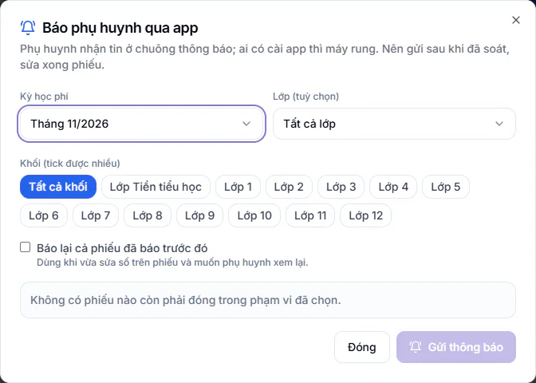
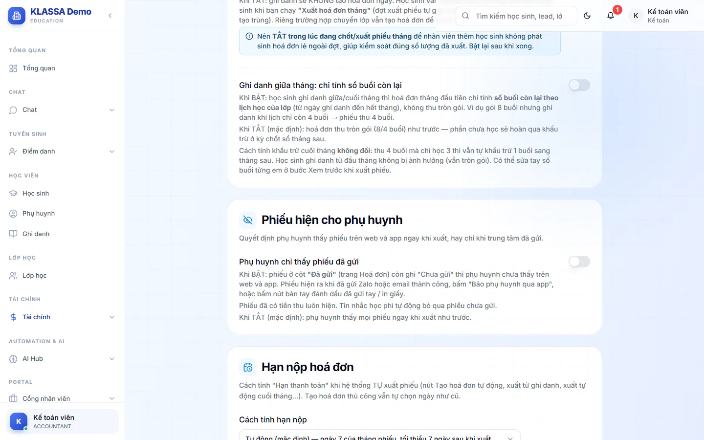

# Phụ huynh xem hoá đơn và nhận báo

Phụ huynh xem hoá đơn trên web hoặc app của trung tâm. Bài này nói về ba việc: chủ động báo phụ huynh có hoá đơn mới, quyết định lúc nào phụ huynh được thấy phiếu, và tin tự động khi trung tâm đã nhận tiền.

## Báo phụ huynh qua app

Khi bạn vừa tạo phiếu, hệ thống không tự báo phụ huynh qua chuông và app. Bạn soát và sửa phiếu xong mới bấm gửi, nên phụ huynh không nhận nhầm số.

::: steps
1. Vào **Tài chính → Kế toán → Hoá đơn chi tiết**, bấm **Báo phụ huynh qua app**. Hộp cùng tên hiện ra.
2. Chọn **Kỳ học phí**.
3. Lọc thêm nếu cần: **Lớp (tuỳ chọn)** và **Khối (tick được nhiều)**. Để trống là lấy tất cả.
4. Xem dòng tóm tắt **Sẽ báo ... phiếu**. Hệ thống chỉ chọn các phiếu còn phải đóng, và cho biết có bao nhiêu phiếu đã báo trước đó (bị bỏ qua) hoặc chưa có tài khoản phụ huynh (không gửi được).
5. Xem bảng bên dưới: mỗi học sinh có trạng thái **Sẽ báo · máy rung** (phụ huynh có cài app), **Sẽ báo · chỉ ở chuông** (chỉ thấy trong chuông thông báo) hoặc **Chưa có tài khoản**. Bấm vào một dòng để xem đúng tin em đó sẽ nhận.
6. Bấm **Gửi thông báo (n phiếu)**.
:::

Tin có nội dung dạng "Hoá đơn học phí tháng 9/2026 của con Nguyễn Minh An đã được phát hành, số tiền ...". Phụ huynh bấm vào tin là mở mục học phí trên app.

Vừa sửa số trên một phiếu đã báo và muốn phụ huynh xem lại? Tích ô **Báo lại cả phiếu đã báo trước đó**.

## Phụ huynh chỉ thấy phiếu đã gửi

Mặc định, phụ huynh thấy mọi phiếu ngay khi phiếu được tạo. Nếu bạn muốn soát xong mới cho thấy, bật công tắc này.

::: steps
1. Vào **Tài chính → Kế toán → Cấu hình tài chính**.
2. Tìm mục **Phiếu hiện cho phụ huynh**.
3. Bật **Phụ huynh chỉ thấy phiếu đã gửi**. Công tắc lưu ngay.
:::

Khi bật:

- Phiếu ở cột **Đã gửi** còn ghi **Chưa gửi** thì phụ huynh chưa thấy trên web và app.
- Phiếu hiện ra khi đã gửi Zalo hoặc email thành công, khi bạn bấm **Báo phụ huynh qua app**, hoặc khi bạn đánh dấu đã gửi tay hoặc in giấy.
- Phiếu đã có tiền thu luôn hiện.
- Tin nhắc học phí tự động bỏ qua phiếu chưa gửi.

Công tắc này **mặc định tắt**. Bật lên là phụ huynh không thấy phiếu cho đến khi bạn gửi, nên nhớ bấm gửi sau khi soát.

## Báo phụ huynh khi trung tâm đã nhận học phí

Mỗi lần trung tâm nhận tiền học phí (chuyển khoản tự khớp, kế toán ghi tay), phụ huynh nhận thông báo trong app, kèm báo trên điện thoại. Tin nêu rõ số tiền vừa nhận và học phí kỳ đó đã đóng đủ hay còn thiếu bao nhiêu.

- Đóng đủ: tiêu đề **Trung tâm đã nhận đủ học phí**.
- Còn thiếu: tiêu đề **Trung tâm đã nhận học phí**, kèm số còn thiếu.
- Khoản thu bằng 0 hoặc âm thì không báo.

Tính năng này **mặc định bật**. Quản trị viên tắt hoặc bật ở **Cài đặt → Tổng quan**, tab **Cấu hình**, mục **Điểm danh**, thẻ **Báo phụ huynh đã nhận học phí**. Sau khi đổi, bấm **Lưu cài đặt báo đã nhận học phí**.

## Câu hỏi thường gặp

::: details Phụ huynh chưa có tài khoản thì sao?
Hệ thống không báo được cho phiếu đó, hộp **Báo phụ huynh qua app** sẽ ghi **Chưa có tài khoản**. Bạn gửi qua [Zalo](gui-hoa-don-zalo.md) hoặc email thay thế. Cách tạo tài khoản xem [Phụ huynh](../hoc-sinh/phu-huynh.md).
:::

::: details Bật công tắc thì phiếu cũ đã tạo có bị ẩn không?
Có. Mọi phiếu còn ghi **Chưa gửi** sẽ ẩn với phụ huynh, trừ phiếu đã có tiền thu. Gửi lại hoặc đánh dấu đã gửi để hiện.
:::
