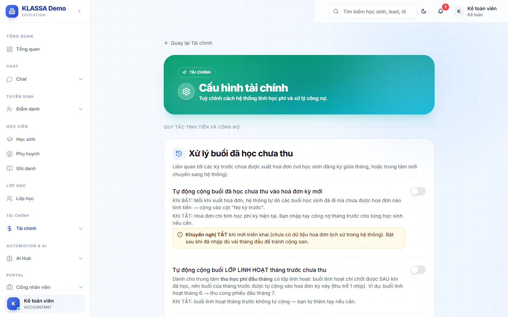

# Cấu hình tài chính

Trang này gom các công tắc ảnh hưởng đến cách hệ thống tính tiền và xuất hoá đơn. Đa số trung tâm chỉ cần chỉnh một lần khi bắt đầu dùng, sau đó giữ nguyên.

Vào **Tài chính → Kế toán → Cấu hình tài chính**. Cài đặt lưu **theo từng cơ sở**. Mọi công tắc lưu ngay khi bạn gạt, có thông báo "Đã lưu cấu hình". Tài khoản chưa gắn với cơ sở nào không lưu được, hãy nhờ Quản trị viên gắn cơ sở.

::: tip Mẹo
Các công tắc có chữ "mặc định" bên dưới đã được đặt sẵn giá trị phù hợp với đa số trung tâm. Chưa hiểu rõ thì cứ để nguyên.
:::

## Quy tắc tính tiền

### Xử lý buổi đã học chưa thu

Liên quan đến các kỳ trước chưa được xuất hoá đơn, ví dụ học sinh đăng ký giữa tháng hoặc trung tâm mới chuyển sang dùng phần mềm.

- **Tự động cộng buổi đã học chưa thu vào hoá đơn kỳ mới** (mặc định tắt). Khi bật, mỗi lần xuất hoá đơn hệ thống dò các buổi học sinh đã đi mà chưa phiếu nào tính tiền, rồi cộng vào cột nợ kỳ trước. Khi tắt, phiếu chỉ tính học phí kỳ hiện tại. Nên để tắt lúc mới triển khai, bật sau khi đã có vài tháng dữ liệu để tránh cộng oan.
- **Chỉ tính buổi chưa thu TỪ ngày**: các buổi trước ngày này coi như đã thanh toán ngoài hệ thống. Ví dụ đặt 01/06/2026 thì em nghỉ hè tháng 6 sẽ không bị truy thu các buổi từ đầu năm khi xuất phiếu tháng 7. Để trống là tính tất cả.
- **Tự động cộng buổi LỚP LINH HOẠT tháng trước chưa thu** (mặc định tắt). Dành cho trung tâm thu đầu tháng có lớp linh hoạt: buổi linh hoạt chỉ chốt được sau khi đã học nên được cộng vào phiếu kỳ sau.
- **Lớp linh hoạt: chỉ thu TRỄ 1 nhịp (không thu buổi tháng này)** (mặc định tắt). Bật khi trung tâm thu đầu tháng nhưng không phải lúc nào cũng xuất phiếu đúng ngày 1.
- **Buổi bù lớp linh hoạt tính là "đã đi"** (mặc định tắt). Bật nếu trung tâm coi lớp linh hoạt là buổi bù cho lớp thường: buổi bù được tính là đã đi nên không bị hoàn tiền buổi vắng.
- **Buổi lớp linh hoạt hưởng ưu đãi của học sinh** (mặc định tắt). Bật thì dòng buổi linh hoạt được giảm theo ưu đãi học sinh đang hưởng ở lớp chính cùng môn.

### Trừ ngày nghỉ khỏi hoá đơn

Công tắc **Tự động trừ ngày nghỉ khỏi hoá đơn đầu kỳ** (mặc định tắt). Khi bật, hoá đơn thu trước đối chiếu lịch học của lớp với lịch nghỉ và trừ số buổi rơi vào ngày nghỉ.

Ví dụ gói 8 buổi một tháng, 200.000đ một buổi. Tháng 9 có 1 buổi trùng ngày Quốc khánh nên phiếu ra 7 x 200.000 = 1.400.000đ, kèm ghi chú buổi nghỉ. Chỉ áp cho ngày nghỉ có cách xử lý **Không bù**. Nút **Quản lý lịch nghỉ** dẫn tới [Ngày nghỉ lễ](../cai-dat/ngay-nghi-le.md).

### Hoá đơn thu sau theo buổi đã học

Công tắc **Tự động tạo hoá đơn thu sau vào đầu tháng kế tiếp** (mặc định bật), áp cho gói thu sau. Khi bật, đầu mỗi tháng hệ thống tự xuất phiếu cho học sinh dùng gói thu sau theo số buổi đã đi. Khi tắt, bạn tự bấm **Tạo hoá đơn thu sau**, xem [Tạo hoá đơn](tao-hoa-don.md).

### Tự động tạo hoá đơn khi ghi danh

- **Tự động tạo hoá đơn mỗi khi ghi danh học sinh vào lớp** (mặc định bật). Mỗi lần thêm học sinh vào lớp, hệ thống tạo ngay phiếu tháng hiện tại. Khi tắt, ghi danh không ra phiếu, phiếu được tạo ở đợt xuất hoá đơn tháng. Nên tắt tạm trong lúc đang chốt hoặc xuất phiếu tháng để không phát sinh phiếu lẻ ngoài đợt, xong thì bật lại.
- **Ghi danh giữa tháng: chỉ tính số buổi còn lại** (mặc định tắt). Bật thì phiếu tháng đầu chỉ tính số buổi còn lại theo lịch lớp, không thu tròn gói. Khi tắt, phiếu thu tròn gói và phần chưa học được hoàn qua khấu trừ ở tháng sau.

### Hạn nộp hoá đơn

Ô **Cách tính hạn nộp** quyết định hạn thanh toán của phiếu do hệ thống tự xuất:

- **Tự động (mặc định)**: ngày 7 của tháng phiếu, tối thiểu 7 ngày sau khi xuất.
- **Ngày cố định hàng tháng**: nhập ngày từ 1 đến 28. Nếu xuất phiếu sau ngày đó thì hạn là ngày xuất phiếu.
- **Số ngày sau khi xuất phiếu**: nhập từ 0 đến 90. Ví dụ 7 ngày thì phiếu xuất 11/07 có hạn 18/07.

Thay đổi chỉ áp cho phiếu tạo sau khi lưu. Phiếu đã xuất giữ hạn cũ, muốn đổi thì sửa từng phiếu. Phiếu tạo tay vẫn tự chọn ngày.

### Phụ thu thêm trên hoá đơn

Công tắc **Bật phụ thu trên hoá đơn** (mặc định tắt) cộng một khoản cố định vào mọi hoá đơn mới, ví dụ phí cơ sở vật chất. Khi bật, điền **Tên phụ thu (hiện trên phiếu)** (tối đa 60 ký tự) và **Số tiền phụ thu (VNĐ)**. Phiếu đã tạo không đổi.

Bên dưới có bảng **Mẫu khoản phụ thu**: danh mục phí đặt tên sẵn (giáo trình, phí thi thử...) để chọn nhanh khi sửa phụ thu trên từng hoá đơn. Bấm **Thêm mẫu**, điền **Tên khoản phí**, **Số tiền (VNĐ)**, **Mô tả (không bắt buộc)**, rồi **Thêm mẫu**. Công tắc **Đang dùng** bật tắt từng mẫu. Hoá đơn chỉ lưu tên và số tiền tại lúc chọn, nên sửa hoặc xoá mẫu không đổi hoá đơn cũ. Thu sách hoặc phí riêng lẻ ngoài hoá đơn học phí thì dùng [Phiếu phụ thu](phieu-phu-thu.md).

## Phiếu hiện cho phụ huynh

Công tắc **Phụ huynh chỉ thấy phiếu đã gửi** (mặc định tắt). Cách hoạt động ở [Phụ huynh xem hoá đơn và nhận báo](bao-phu-huynh.md).

## Nội dung hiển thị cho phụ huynh

- **Thông tin học phí hiển thị**: hai ô **Quy định chung** và **Chính sách ưu đãi**, mỗi dòng một ý, hiện ở cuối trang Học phí. Bấm **Lưu thông tin học phí**.
- **Cơ cấu học phí (tab Tổng quan)**: gạt **Hiện khối "Cơ cấu học phí"**, điền **Phụ đề**, các thẻ giá theo dạng `giá | nhãn | huy hiệu` (mỗi dòng một thẻ, huy hiệu có thể bỏ trống) và **Chính sách ưu đãi**. Bấm **Lưu cơ cấu học phí**. Đây chỉ là nội dung giới thiệu, không phải gói thật và không ảnh hưởng tính tiền.
- **Mẫu email hoá đơn**: sửa phần chữ của email gửi hoá đơn: **Tiêu đề email**, **Lời mở đầu**, **Lời kết**, **Chân trang**. Dùng được các biến `[ten_trung_tam]`, `[ten_hoc_sinh]`, `[so_hoa_don]`, `[ky]`. Bảng môn học, tổng tiền, mã QR do hệ thống tự dựng. Bấm **Lưu mẫu email**.

## Câu hỏi thường gặp

::: details Đổi cấu hình có làm đổi hoá đơn đã xuất không?
Không. Mọi thay đổi chỉ áp cho hoá đơn tạo sau đó.
:::

::: details Tôi là Quản lý chi nhánh, đổi cấu hình có ảnh hưởng cơ sở khác không?
Không. Cài đặt lưu theo cơ sở của tài khoản bạn.
:::
