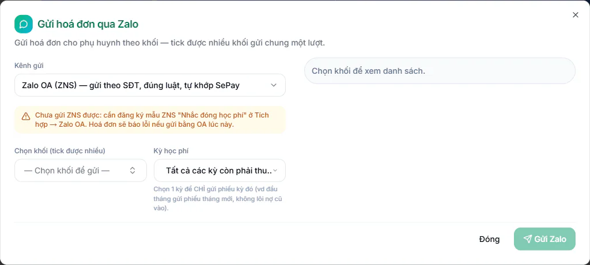

# Gửi hoá đơn qua Zalo

Sau khi soát hoá đơn xong, bạn gửi cho phụ huynh qua Zalo: một học sinh, nhiều học sinh đã chọn, hoặc cả một đến nhiều khối trong một lượt. Ảnh hoá đơn đã kèm mã QR chuyển khoản khi còn nợ, phụ huynh quét là trả được.

Trước khi gửi, trung tâm cần kết nối Zalo. Xem [Zalo cá nhân](../tich-hop/zalo-ca-nhan.md) và [Zalo OA](../tich-hop/zalo-oa.md).

## Ba chỗ để bắt đầu gửi

Vào **Tài chính → Kế toán → Hoá đơn chi tiết**, bạn có:

- **Gửi Zalo theo khối**: gửi cả khối, tick được nhiều khối.
- Menu **Thao tác khác** ở cuối mỗi dòng, chọn **Gửi qua Zalo**: gửi một hoá đơn.
- Tick nhiều dòng trong bảng rồi bấm **Gửi Zalo (n)**: gửi các hoá đơn đã chọn.

Cạnh nút gửi theo khối còn có **Lịch sử gửi Zalo** để xem lại các đợt đã gửi.

## Gửi hoá đơn theo khối

::: steps
1. Bấm **Gửi Zalo theo khối**, hộp **Gửi hoá đơn qua Zalo** hiện ra.
2. Ở **Kênh gửi**, chọn **Zalo cá nhân** (gửi ảnh hoặc tin từ nick của nhân viên, miễn phí) hoặc **Zalo OA (ZNS)** (gửi theo số điện thoại phụ huynh bằng mẫu "Nhắc đóng học phí" đã duyệt). Ô này chỉ hiện khi trung tâm đã kết nối Zalo OA, và kênh mở sẵn theo lựa chọn kênh gửi mà trung tâm đã đặt ở phần kết nối Zalo. Kênh OA không gửi ảnh. Nếu mẫu chưa đăng ký, hộp báo vàng nhắc cần đăng ký mẫu ZNS "Nhắc đóng học phí" trước, nếu không phiếu gửi sẽ báo lỗi. Với kênh OA, bỏ qua các bước 5 đến 7 (hộp không có các ô đó).
3. Ở **Chọn khối (tick được nhiều)**, tick các khối cần gửi.
4. Ở **Kỳ học phí**, chọn một tháng để chỉ gửi phiếu tháng đó, hoặc chọn **Tất cả các kỳ còn phải thu (gom cả nợ cũ)**.
5. (Chỉ kênh **Zalo cá nhân**) Ở **Gửi từ nick**, chọn nick gửi. **Tự động** nghĩa là nick nào đang trò chuyện với phụ huynh đó thì dùng nick đó.
6. (Chỉ kênh **Zalo cá nhân**) Ở **Gửi đến**, chọn **Phụ huynh** (gửi từng người) hoặc **Nhóm lớp Zalo** (gửi vào nhóm của lớp, chỉ gửi được ảnh).
7. (Chỉ kênh **Zalo cá nhân**) Chọn tab **Gửi ảnh hoá đơn** hoặc **Gửi tin nhắn**, soạn lời nhắn (xem mục dưới).
8. Soát **Danh sách sẽ gửi**, bỏ tick người không muốn gửi, rồi bấm **Gửi Zalo (n)**.
:::

Khi gửi, hộp **Đang gửi hoá đơn qua Zalo...** hiện tiến độ, số **thành công**, **lỗi** và **còn lại**. Hệ thống gửi lần lượt và giãn cách giữa các tin để Zalo không coi là spam. Cần ngừng giữa chừng thì bấm **Dừng gửi**; lần mở lại, người đã nhận được tự bỏ qua.

## Soạn lời nhắn

Ô **Ghi chú kèm ảnh** (tab ảnh) hoặc **Nội dung tin nhắn** (tab tin nhắn) dùng được các biến sau, hệ thống tự điền cho từng học sinh:

| Biến | Thay bằng |
|---|---|
| `[ten_hoc_sinh]` | Tên học sinh |
| `[ten_lop_hoc]` | Tên lớp |
| `[so_tien]` | Số tiền phải đóng |
| `[han_thanh_toan]` | Hạn thanh toán |
| `[so_hoa_don]` | Số hoá đơn |

Bấm **Xem trước mẫu** để xem tin của một học sinh. Bấm **Đặt làm mặc định** để dùng lời nhắn này cho các lần sau, **+ Lưu mẫu** để lưu thành mẫu đặt tên, chia sẻ cho cả chi nhánh. Có thể đính thêm một ảnh ở **Ảnh gửi kèm (tuỳ chọn)**; ảnh này gửi sau cùng.

## Ai bị bỏ qua và vì sao

Trước khi gửi, hộp cho biết bao nhiêu phiếu **sẽ gửi** và bao nhiêu **bỏ qua**. Một người bị bỏ qua khi:

- Phụ huynh có Zalo nhưng **chưa kết bạn với nick gửi**. Bấm **Gửi lời mời** để mời trước, khi phụ huynh đồng ý thì gửi ảnh được.
- Chưa tìm thấy Zalo phụ huynh. Xin số Zalo thật rồi cập nhật hồ sơ phụ huynh.
- Kênh OA mà phụ huynh không có số điện thoại.
- Gửi vào nhóm mà lớp chưa gắn nhóm Zalo.
- Phiếu **đã gửi Zalo trước đó**. Hộp có ô tick **Bỏ qua ... hoá đơn ĐÃ GỬI Zalo trước đó**. Bỏ tick nếu muốn gửi lại.
- Bạn bỏ tick người đó bằng tay.

Gửi xong, cửa sổ kết quả liệt kê danh sách những người **Bỏ qua** (ghi rõ là CHƯA gửi) theo từng lý do. Bấm **Sao chép** để dán vào nhóm nhân viên và chia việc xử lý tay.

## Lịch sử các đợt gửi

Mỗi lần bấm gửi cho từ 2 người nhận trở lên là một đợt. Bấm **Lịch sử gửi Zalo** để xem 50 đợt gần nhất, mỗi đợt có nhãn **đang gửi**, **đã dừng**, **lỗi** hoặc **xong**. Mở một đợt để thấy số **thành công**, **lỗi**, **bỏ qua** và **chưa tới lượt**, cùng nút sao chép danh sách cần xử lý.

Cột **Đã gửi** trong bảng hoá đơn cho biết phiếu nào đã gửi bằng kênh nào. Phiếu bạn gửi ngoài phần mềm (Messenger riêng, in giấy đưa trực tiếp) thì bấm biểu tượng đánh dấu ở cột này, chọn kênh, để hệ thống ghi lại là đã gửi. Bộ lọc **Tất cả**, **Đã gửi**, **Chưa gửi** phía trên bảng giúp tìm phiếu còn sót.

::: tip Mẹo
Đầu tháng, chọn **Kỳ học phí** là tháng mới thay vì "Tất cả các kỳ" để phiếu nợ cũ không bị gửi lẫn.
:::

::: warning Lưu ý
Phiếu mà rà soát tự động đã đánh dấu "Cần xem" sẽ có cảnh báo khi bạn gửi. Nên kiểm tra lại phiếu đó trước khi gửi phụ huynh.
:::

## Câu hỏi thường gặp

::: details Phụ huynh có cần quét QR rồi mới được ghi nhận tiền không?
Ảnh chỉ giúp phụ huynh chuyển đúng số tiền và nội dung. Muốn tiền chuyển khoản tự khớp vào hoá đơn, trung tâm cần kết nối ngân hàng, xem [Kết nối ngân hàng](../tich-hop/ngan-hang.md).
:::

::: details Phụ huynh có thấy phiếu ngay khi tôi tạo không?
Mặc định là có. Nếu bạn muốn chỉ hiện sau khi gửi, xem [Phụ huynh xem hoá đơn và nhận báo](bao-phu-huynh.md).
:::
