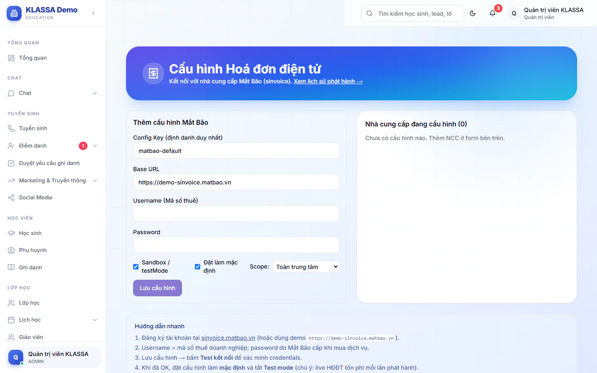
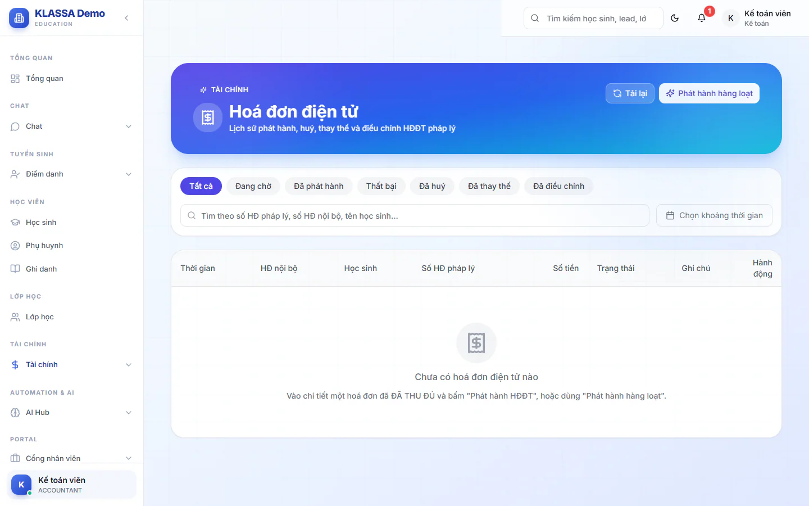

# Hoá đơn điện tử

Hoá đơn điện tử là hoá đơn có giá trị pháp lý, theo quy định của cơ quan thuế. Phụ huynh hoặc doanh nghiệp cần hoá đơn đỏ thì trung tâm phát hành từ ngay trong phần mềm, không phải mở thêm cổng của nhà cung cấp. Phiếu học phí thông thường vẫn dùng bình thường, chỉ phát hành hoá đơn điện tử khi có người yêu cầu.

Tính năng này cần **gói mở rộng Hoá đơn điện tử**. Nếu trung tâm chưa mua, trang chỉ hiện thẻ nâng cấp. Mua hoặc bật gói ở **Cài đặt → Plugin Marketplace**.

::: warning Lưu ý
Mỗi lần phát hành thật sẽ tốn một lượt phát hành ở nhà cung cấp Mắt Bão. Hãy kiểm tra kỹ trước khi bấm, và thử ở chế độ thử nghiệm trước.
:::

## Kết nối nhà cung cấp

Việc này làm một lần, do Quản trị viên hoặc Quản lý chi nhánh thực hiện.

::: steps
1. Đăng ký tài khoản dịch vụ hoá đơn điện tử của Mắt Bão (có bản thử nghiệm để tập trước). Tên đăng nhập là mã số thuế của doanh nghiệp, mật khẩu do Mắt Bão cấp.
2. Trong phần mềm, vào **Cài đặt → Hoá đơn điện tử**. Trang có tiêu đề **Cấu hình Hoá đơn điện tử**.
3. Ở khung **Thêm cấu hình Mắt Bão**, điền **Config Key** (tên gọi riêng bạn tự đặt, không trùng cấu hình khác), **Base URL** (địa chỉ dịch vụ do nhà cung cấp cấp), **Username (Mã số thuế)** và **Password**.
4. Tích **Sandbox / testMode** nếu đang dùng bản thử nghiệm. Tích **Đặt làm mặc định** để dùng cấu hình này khi phát hành.
5. Chọn phạm vi: **Toàn trung tâm** hoặc chỉ cơ sở hiện tại, rồi bấm **Lưu cấu hình**.
6. Ở danh sách **Nhà cung cấp đang cấu hình**, bấm **Test kết nối** để kiểm tra tài khoản. Báo "Kết nối OK" là dùng được.
:::

Mỗi cấu hình trong danh sách có nhãn **MẶC ĐỊNH**, **TEST MODE** hoặc **TẮT**, và các nút **Test kết nối**, **Đặt làm mặc định**, **Tắt** hoặc **Bật**, **Xoá**. Khi đã chạy ổn, hãy đặt làm mặc định và tắt chế độ thử nghiệm.

## Phát hành hoá đơn điện tử cho một hoá đơn

Chỉ hoá đơn đã **Đã thanh toán** đủ mới phát hành được.

::: steps
1. Vào **Tài chính → Kế toán → Hoá đơn chi tiết**, mở **Chi tiết hóa đơn** của phiếu đã thu đủ.
2. Bấm **Phát hành HĐĐT**.
3. Xác nhận ở hộp hỏi. Thành công sẽ có thông báo "Đã phát hành HĐĐT thành công".
:::

Sau khi phát hành, hoá đơn bị khoá: không sửa được nữa. Muốn sửa phải huỷ hoá đơn điện tử trước.

## Xem lịch sử và xử lý sau phát hành

Vào **Tài chính → Hoá đơn điện tử**. Bảng liệt kê **Thời gian**, **HĐ nội bộ**, **Học sinh**, **Số HĐ pháp lý**, **Số tiền**, **Trạng thái** và **Ghi chú**. Gõ vào ô tìm theo số hoá đơn pháp lý, số hoá đơn nội bộ hoặc tên học sinh. Bấm **Tải lại** để lấy trạng thái mới.

Trạng thái có thể là **Đang chờ**, **Đã phát hành**, **Thất bại**, **Đã huỷ**, **Đã thay thế**, **Đã điều chỉnh**. Bấm dấu ba chấm ở cuối dòng:

- **Xem chi tiết**: xem trạng thái, số pháp lý và lỗi nếu có.
- Với hoá đơn **Đã phát hành**: **Tải PDF** và **Gửi email** (nhập địa chỉ người nhận).
- Với hoá đơn **Đã phát hành**, nếu bạn là Quản trị viên, Quản lý chi nhánh hoặc Kế toán: **Điều chỉnh**, **Thay thế**, **Huỷ**.

| Việc cần làm | Khi nào | Cần nhập |
|---|---|---|
| **Huỷ** | Phát hành nhầm hoàn toàn | **Lý do huỷ** (bắt buộc) |
| **Thay thế** | Cần phát hành lại hoá đơn khác thay cho hoá đơn cũ | **Lý do thay thế** (bắt buộc) |
| **Điều chỉnh** | Sai số tiền nhưng giữ hoá đơn gốc | Chọn **Tăng** hoặc **Giảm** |

Nút **Phát hành hàng loạt** cho phép phát hành tối đa 50 hoá đơn một lượt bằng cách nhập danh sách mã hoá đơn, mỗi mã một dòng. Với đa số trường hợp, phát hành từng hoá đơn như trên là dễ kiểm soát hơn.

::: tip Mẹo
Hoá đơn **Thất bại** thường do thông tin kết nối sai hoặc nhà cung cấp từ chối. Mở **Xem chi tiết** để đọc lý do, sửa cấu hình rồi phát hành lại.
:::

## Câu hỏi thường gặp

::: details Mọi hoá đơn học phí đều phải phát hành hoá đơn điện tử à?
Không. Việc này tuỳ chọn, chỉ làm khi phụ huynh hoặc doanh nghiệp yêu cầu hoá đơn pháp lý.
:::

::: details Tôi không thấy menu Hoá đơn điện tử trong Cài đặt?
Mục này chỉ hiện cho Quản trị viên và Quản lý chi nhánh, và cần trung tâm đã có gói mở rộng.
:::
