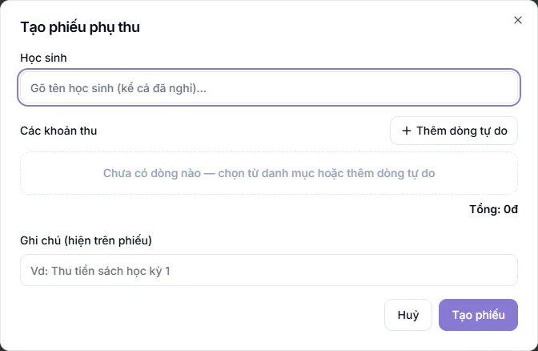
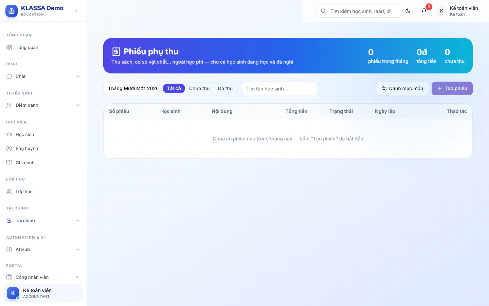

# Phiếu phụ thu

Phiếu phụ thu dùng để thu những khoản **ngoài học phí**: tiền sách, giáo trình, cơ sở vật chất, phí thi thử. Phiếu dùng được cho cả học sinh đang học và học sinh đã nghỉ.

Phiếu phụ thu tách hẳn hoá đơn học phí. Nó **không** vào công nợ, không tự khớp với tiền chuyển khoản và không có tin nhắc nợ. Phiếu chỉ có một cờ **Đã thu** hoặc **Chưa thu** do bạn đánh dấu tay.

## Lập một phiếu phụ thu

::: steps
1. Vào **Tài chính → Phiếu phụ thu**, bấm **Tạo phiếu**. Hộp **Tạo phiếu phụ thu** hiện ra.
2. Ở **Học sinh**, gõ tên học sinh (tìm được cả em đã nghỉ) rồi chọn. Chọn nhầm thì bấm **Đổi**.
3. Thêm các khoản thu. Có hai cách:
   - Bấm một món ở **Chọn nhanh từ danh mục** để thêm dòng có sẵn tên và giá.
   - Bấm **Thêm dòng tự do** rồi nhập tay.
4. Mỗi dòng gồm **Mô tả** (bắt buộc), **Đơn vị**, số lượng (tối thiểu 1) và đơn giá (từ 0 trở lên). Có thể bấm biểu tượng xoá để bỏ một dòng.
5. Điền **Ghi chú (hiện trên phiếu)** nếu cần, ví dụ "Thu tiền sách học kỳ 1".
6. Bấm **Tạo phiếu**. Hệ thống cấp **Số phiếu** và báo "Đã tạo phiếu ...".
:::

Phiếu cần ít nhất một dòng và mọi dòng phải có mô tả, nếu không hệ thống sẽ nhắc.

## Quản lý danh mục món

Món hay thu thì lưu vào danh mục để chọn nhanh cho lần sau.

::: steps
1. Ở trang **Phiếu phụ thu**, bấm **Danh mục món**.
2. Nhập **Tên món** (ví dụ sách Toán), **Đơn vị** (quyển) và **Đơn giá**, bấm dấu **+**.
3. Dùng nút **Tắt** hoặc **Bật** để ẩn hoặc hiện món, nút xoá để bỏ món.
:::

Phiếu chỉ lưu tên và giá tại lúc lập, nên đổi giá món trong danh mục không làm đổi phiếu cũ.

## Theo dõi, đánh dấu đã thu và in phiếu

Trang liệt kê phiếu theo tháng. Chọn tháng ở ô đầu, lọc **Tất cả**, **Chưa thu**, **Đã thu**, hoặc gõ tên vào **Tìm tên học sinh…**. Ba số ở đầu trang cho biết số phiếu trong tháng, tổng tiền và số phiếu chưa thu.

Mỗi dòng có các cột **Số phiếu**, **Học sinh**, **Nội dung**, **Tổng tiền**, **Trạng thái**, **Ngày lập** và các thao tác:

- Bấm nhãn **Chưa thu** hoặc **Đã thu** để đổi trạng thái. Hệ thống báo "Đã đánh dấu ĐÃ THU" hoặc "Đã chuyển về CHƯA THU".
- **In / PDF**: mở phiếu để in hoặc tải PDF, kèm số tiền bằng chữ. Phiếu in lấy tên, địa chỉ, số điện thoại, thông tin ngân hàng và dòng chân trang từ mẫu của trung tâm, xem [Mẫu hoá đơn](mau-hoa-don.md).
- **Sửa**: đổi nội dung phiếu, bấm **Lưu thay đổi**.
- **Xoá**: xoá phiếu.

::: danger Không thể hoàn tác
Phiếu đã xoá không khôi phục được. Nếu chỉ lập sai, hãy bấm **Sửa**.
:::

::: tip Mẹo
Thu tiền sách cho cả lớp thì lập từng phiếu theo học sinh. Danh mục món giúp mỗi phiếu chỉ mất vài giây.
:::

## Câu hỏi thường gặp

::: details Phiếu phụ thu có nằm trong hoá đơn học phí không?
Không. Phiếu này nằm riêng, không đi vào hoá đơn học phí hay công nợ. Nếu cần ghi khoản phụ vào chính hoá đơn học phí, xem mục phụ thu ở Cấu hình tài chính.
:::

::: details Khác gì với mục Mẫu khoản phụ thu trong Cấu hình tài chính?
Mẫu khoản phụ thu ở [Cấu hình tài chính](cai-dat.md) dùng để thêm khoản phụ thu vào một hoá đơn học phí. Phiếu phụ thu ở đây là phiếu thu riêng, không gắn với hoá đơn học phí.
:::
