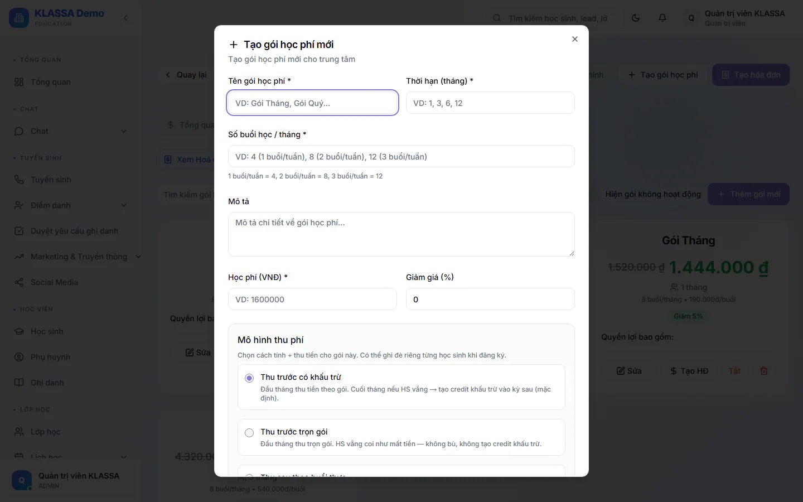

# Gói học phí và cách thu tiền

Gói học phí quy định học sinh đóng bao nhiêu cho mỗi tháng và **thu theo cách nào**. Cách thu quyết định hoá đơn đầu tháng có thu tiền hay không, và buổi học sinh nghỉ được xử lý ra sao. Chọn đúng chế độ ngay từ đầu sẽ đỡ phải sửa hoá đơn về sau.

## Trang Học phí có gì

Vào **Tài chính → Học phí**. Trang có ba tab:

- **Tổng quan**: bốn thẻ **Tổng doanh thu**, **Doanh thu tháng**, **Hóa đơn chưa thu**, **Tỷ lệ thu phí**; khối **Cơ cấu học phí** (nội dung hiển thị do trung tâm tự soạn, xem [Cấu hình tài chính](cai-dat.md)); danh sách **Hóa đơn gần đây** và biểu đồ **Xu hướng doanh thu 5 tháng gần đây**. Thẻ **Doanh thu tháng** tính theo tiền thực thu trong tháng, không có mục tiêu doanh thu cài sẵn. Ở biểu đồ xu hướng, tháng thu cao nhất trong 5 tháng là mốc đầy thanh, các tháng còn lại so với tháng đó.
- **Gói học phí**: các thẻ gói, nơi tạo, sửa, bật tắt gói. Quản trị viên và Quản lý chi nhánh làm được các việc này. Kế toán xem được gói và bấm **Tạo HĐ** để lập hoá đơn từ gói, nhưng không tạo, sửa hay bật tắt gói được.
- **Thanh toán**: ghi nhận tiền thu, xem [Ghi nhận thanh toán](thu-chi.md). Cuối tab có khối **Hướng dẫn thanh toán** kèm tên thương hiệu. Phần **Thông tin chuyển khoản** của khối này (**Ngân hàng**, **STK**, **Chủ TK**, **Nội dung**) lấy từ [Mẫu hoá đơn](mau-hoa-don.md) đã lưu, chỉ Quản trị viên và Quản lý chi nhánh thấy, và ẩn đi khi trung tâm chưa nhập số tài khoản.

Ở đầu trang có thêm nút **Tạo gói học phí**, **Tạo hóa đơn**, **Xem Hoá đơn** (mở danh sách hoá đơn) và **Quản lý Tài chính**. Nút **Tạo gói học phí** chỉ hiện với Quản trị viên và Quản lý chi nhánh.

## Tạo một gói học phí

Chỉ Quản trị viên và Quản lý chi nhánh tạo được gói. Kế toán không thấy các nút tạo gói.

::: steps
1. Vào **Tài chính → Học phí**, bấm **Tạo gói học phí** (hoặc mở tab **Gói học phí** rồi bấm **Thêm gói mới**). Hộp **Tạo gói học phí mới** hiện ra.
2. Điền **Tên gói học phí**, ví dụ "Gói Tháng".
3. Điền **Thời hạn (tháng)**, nhập 1.
4. Điền **Số buổi học / tháng**, ví dụ 8 (2 buổi mỗi tuần).
5. Điền **Học phí (VNĐ)** của cả tháng, ví dụ 1600000. Nếu có giảm riêng cho gói, nhập **Giảm giá (%)** từ 0 đến 100.
6. Ở mục **Mô hình thu phí**, chọn một trong ba chế độ (giải thích bên dưới).
7. Bấm **Tạo gói học phí** ở cuối hộp. Các ô bắt buộc có dấu sao: tên gói, thời hạn, số buổi mỗi tháng và học phí.
:::

Cuối hộp có công tắc **Trạng thái hoạt động** (bật là dùng được ngay) và khung **Tính toán tự động** cho biết đơn giá mỗi buổi bằng học phí chia số buổi. Ví dụ 1.600.000đ chia 8 buổi là 200.000đ một buổi.

::: warning Lưu ý
Ô **Thời hạn (tháng)** chỉ để hiển thị trên thẻ gói, không làm thay đổi cách tính hoá đơn. Gói 3, 6 hoặc 12 tháng trả một lần chưa có trong phần mềm, vì vậy đừng tạo gói như vậy ở đây.
:::

## Ba chế độ thu

Các ví dụ dưới đây dùng gói 8 buổi một tháng, giá 1.600.000đ (200.000đ một buổi), học sinh Nguyễn Minh An lớp Toán 9A1.

### Thu trước có khấu trừ (mặc định)

Đầu tháng thu đủ tiền gói. Cuối tháng, buổi nào học sinh vắng được **trừ vào hoá đơn tháng sau**.

- Tháng 9: phiếu thu 1.600.000đ. An chỉ đi 6 buổi, vắng 2 buổi.
- Tháng 10: phiếu của An được trừ 2 buổi, tức 400.000đ.
- Nếu An đi nhiều hơn số buổi đã đóng (học dư), tháng sau phiếu có thêm một dòng phụ thu theo đơn giá buổi.

### Thu trước trọn gói

Đầu tháng thu đủ tiền gói, **vắng coi như mất tiền**: không hoàn, không trừ sang tháng sau. Hợp với trung tâm có chính sách "đã đóng là giữ chỗ".

- Tháng 9: phiếu thu 1.600.000đ, An vắng 2 buổi.
- Tháng 10: phiếu không có khoản trừ nào cho 2 buổi vắng đó.

### Thu sau theo buổi thực

**Không thu đầu tháng.** Cuối tháng, tiền bằng số buổi đã học nhân đơn giá, nhân hệ số của loại buổi: buổi học online tính 50%, buổi hỗ trợ miễn phí tính 0%.

- Tháng 9: An đi 6 buổi thường, tiền là 6 x 200.000 = 1.200.000đ.
- Nếu 1 trong 6 buổi là buổi online, tiền là 5 x 200.000 + 100.000 = 1.100.000đ.

Chế độ này không xuất hoá đơn đầu tháng. Số buổi một tháng của gói chỉ để tham khảo. Cách tạo phiếu cuối tháng xem ở [Tạo hoá đơn](tao-hoa-don.md).

::: tip Mẹo
Trên thẻ gói, chế độ thu trước có khấu trừ không hiện nhãn gì. Hai chế độ còn lại hiện nhãn **Thu trọn gói** hoặc **Thu sau buổi thực** để bạn nhìn là biết.
:::

## Đổi chế độ thu cho riêng một học sinh

Một học sinh có thể thu khác chế độ của gói. Khi ghi danh (hoặc sửa ghi danh), ở mục **Mô hình thu phí**, tích **Ghi đè cho HS này** rồi chọn chế độ mong muốn. Cách ghi danh xem [Ghi danh](../hoc-sinh/ghi-danh.md).

## Ưu đãi anh chị em và học nhiều môn

Ưu đãi gắn vào từng ghi danh của học sinh, không nằm trong gói. Khi ghi danh, nếu em đủ điều kiện, form ghi danh gợi ý sẵn mức giảm (ví dụ "Ưu đãi anh chị em, giảm 25%"). Hai ưu đãi phổ biến:

- **Ưu đãi anh chị em, 25%**: nhà có n con đang học thì có n trừ 1 suất giảm, gắn cho bé nào cũng được. Anh chị em chỉ học lớp linh hoạt không được tính là đang học.
- **Ưu đãi học nhiều môn, 5%**: học sinh học từ 2 môn chính thức trở lên thì mọi môn đều giảm 5%. Hai lớp cùng một môn chỉ tính là một môn, lớp linh hoạt không tính là môn.

Mỗi ghi danh chỉ nhận **một ưu đãi cao nhất**, không cộng dồn, và không đè lên mức giảm 50% hoặc 100%. Danh sách chương trình và mức giảm do trung tâm đặt ở mục quản lý khuyến mãi của phần Kế toán: **Tài chính → Kế toán → Quản lý khuyến mãi**.

## Sửa, tắt và xoá gói

Trên mỗi thẻ gói có các nút:

- **Sửa**: mở lại hộp để đổi thông tin, bấm **Cập nhật** để lưu. Nút này hiện với Quản trị viên và Quản lý chi nhánh.
- **Tạo HĐ**: mở hộp **Tạo hóa đơn** với gói này. Cả Kế toán cũng dùng được nút này.
- **Tắt** hoặc **Bật**: gói tắt sẽ ẩn khỏi danh sách (bật công tắc **Hiện gói không hoạt động** để xem lại). Nút này hiện với Quản trị viên và Quản lý chi nhánh.
- Nút thùng rác: xoá gói, có hỏi lại trước khi xoá. Nút này chỉ hiện với Quản trị viên.

::: danger Không thể hoàn tác
Gói đã xoá không lấy lại được. Gói đã có học sinh dùng thì nên bấm **Tắt** thay vì xoá.
:::

## Câu hỏi thường gặp

::: details Đổi chế độ thu của gói có làm đổi hoá đơn đã xuất không?
Không. Hoá đơn đã tạo giữ nguyên. Chế độ mới áp dụng cho các hoá đơn tạo sau đó.
:::

::: details Học sinh học bù ở lớp khác thì tính thế nào?
Máy tính hoá đơn có đối chiếu buổi học theo cả môn, nên buổi học bù cùng môn được trừ vào phần vắng. Với lớp linh hoạt, có công tắc riêng trong [Cấu hình tài chính](cai-dat.md).
:::
