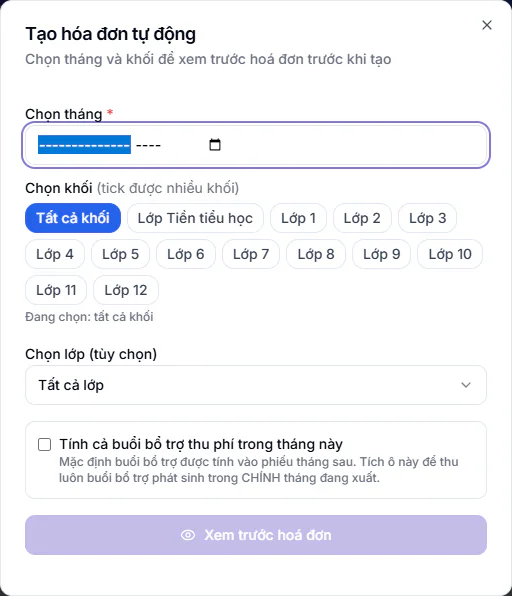
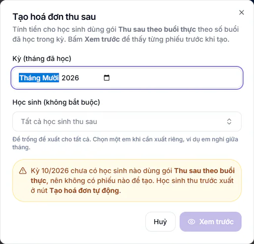

# Tạo hoá đơn học phí

Hoá đơn là phiếu báo học phí gửi phụ huynh mỗi tháng. Có ba cách tạo, tuỳ việc bạn cần làm:

- **Tạo hoá đơn tự động**: xuất phiếu cho cả tháng, theo một hoặc nhiều khối. Dùng cho đợt xuất phiếu đầu tháng.
- **Tạo hoá đơn thu sau**: tính tiền cho học sinh dùng gói thu sau, theo số buổi đã học.
- **Tạo hóa đơn**: tạo tay cho một học sinh khi cần xử lý riêng.

Hai nút tạo tự động và thu sau nằm ở **Tài chính → Kế toán → Hoá đơn chi tiết** (tiêu đề trang là **Quản lý Hoá đơn**). Nút **Tạo hóa đơn** nằm ở **Tài chính → Học phí**. Chế độ thu của từng gói xem ở [Gói học phí và cách thu tiền](quan-ly-hoc-phi.md).

## Tạo hoá đơn tự động cho cả khối

::: steps
1. Vào **Tài chính → Kế toán → Hoá đơn chi tiết**, bấm **Tạo hoá đơn tự động**.
2. Chọn **Chọn tháng** (bắt buộc). Hộp báo vàng chỉ hiện sau khi bạn chọn tháng, và chỉ khi tháng liền trước chưa khoá sổ. Vẫn xuất phiếu bình thường được, khấu trừ buổi vắng do hệ thống tự tính.
3. Ở **Chọn khối**, bấm vào các khối cần xuất. Tick được nhiều khối cùng lúc. Không chọn khối nào nghĩa là **Tất cả khối**.
4. Nếu chỉ muốn một lớp, chọn ở **Chọn lớp (tùy chọn)**.
5. Tích ô **Tính cả buổi bổ trợ thu phí trong tháng này** nếu muốn thu luôn buổi bổ trợ phát sinh trong chính tháng đang xuất. Mặc định buổi bổ trợ được tính vào phiếu tháng sau.
6. Bấm **Xem trước hoá đơn**. Hệ thống chỉ tính, chưa ghi gì.
7. Soát danh sách (xem mục dưới), rồi bấm **Xác nhận tạo ... hoá đơn**.
:::

Muốn soát nhanh các em chưa có phiếu trong tháng hiện tại, bấm **Rà soát phiếu chưa tạo**. Hộp tạo tự động mở sẵn tháng này và tự chạy bước xem trước.

### Bước xem trước: chọn từng học sinh

Bảng xem trước liệt kê từng học sinh với các cột **Khối**, **Môn học (Lớp)**, **Buổi**, **Học phí**, **Khấu trừ**, **Còn nợ** và **Tổng cộng**. Bạn có thể:

- **Bỏ tick** học sinh chưa muốn xuất phiếu. Ô tick ở đầu bảng chọn hoặc bỏ cả danh sách. Số hoá đơn và tổng giá trị ở các thẻ phía trên đổi theo.
- **Sửa số buổi** của dòng lớp thường (từ 0 đến số buổi của gói). Cột tiền tính lại ngay đúng như khi tạo thật.
- Xem hai nhóm đặc biệt: **Bỏ qua (đã tồn tại)** là em đã có phiếu tháng này, và **Chưa có buổi (linh hoạt)** là em học lớp linh hoạt chưa có buổi nào trong kỳ, sẽ được tính khi có buổi. Hai nhóm này không phải lỗi. Mục **Lỗi** chỉ hiện các trường hợp thật sự không tạo được.

Sau khi bấm **Xác nhận tạo**, hộp **Đang tạo hoá đơn...** hiện tiến độ. Đừng đóng trang. Cần dừng giữa chừng thì bấm **Dừng tạo hoá đơn**. Hệ thống tạo theo từng lượt nhỏ nên các lượt đã xong vẫn còn, bạn bấm tạo lại sau để làm nốt phần còn thiếu.

::: tip Mẹo
Nên xuất theo từng khối để dễ soát. Xuất xong, soát phiếu rồi mới gửi cho phụ huynh, xem [Gửi hoá đơn qua Zalo](gui-hoa-don-zalo.md).
:::

### Nợ cũ được gộp sang phiếu mới

Học sinh còn nợ phiếu kỳ trước thì khoản nợ đó được cộng vào cột **Còn nợ** (nợ kỳ trước) của phiếu mới. Phiếu cũ chuyển sang trạng thái **Đã gộp**, để phụ huynh chỉ phải đóng một phiếu và công nợ không bị đếm hai lần. Nếu bạn xoá phiếu mới, phiếu cũ tự mở lại.

### Khấu trừ và học dư

Phiếu mới tự tính khoản trừ cho các buổi vắng của tháng trước, và phụ thu nếu em học nhiều hơn số buổi đã đóng. Hai khoản này hiện ở cột **Khấu trừ** và trên phiếu.

### Hạn nộp

Hạn thanh toán của phiếu tạo tự động lấy theo cách bạn đặt ở [Cấu hình tài chính](cai-dat.md) (mục **Hạn nộp hoá đơn**). Mặc định là ngày 7 của tháng phiếu, tối thiểu 7 ngày sau khi xuất.

## Lớp linh hoạt: tiền theo từng em

Với buổi của lớp linh hoạt, người lo học phí nhập số tiền riêng cho từng học sinh. Số tiền này là căn cứ để tính phiếu.

::: steps
1. Vào **Điểm danh** và mở buổi học của lớp linh hoạt.
2. Kéo xuống mục **Học phí buổi này (từng em)**.
3. Nhập số tiền em phải đóng cho riêng buổi này. Nhập **0** nếu em được miễn buổi này.
4. Bấm **Lưu học phí**.
:::

Em nào chưa được nhập riêng thì máy tính theo giá ghi danh của em. Buổi học online chỉ tính 50% số đã nhập, buổi hỗ trợ miễn phí luôn là 0đ. Nếu buổi đã nằm trên một phiếu, dòng **Đã lên phiếu** hiện ra và phiếu đó không tự đổi, bạn cần sửa riêng.

## Tạo hoá đơn thu sau

Dành cho học sinh dùng gói **Thu sau theo buổi thực**. Hệ thống có thể tự xuất vào đầu tháng kế tiếp (công tắc ở [Cấu hình tài chính](cai-dat.md)); nếu tắt, bạn tự bấm nút. Nút này cũng có ở trang [Khoá sổ kỳ](../ke-toan/khoa-so-ky.md), nơi Quản trị viên và Kế toán đều dùng được.

::: steps
1. Ở trang **Hoá đơn chi tiết**, bấm **Tạo hoá đơn thu sau**.
2. Chọn **Kỳ (tháng đã học)**. Có thể chọn một học sinh ở **Học sinh (không bắt buộc)**, để trống là tất cả học sinh thu sau.
3. Bấm **Xem trước**. Hộp **Xem trước hoá đơn thu sau** cho thấy số phiếu **Sẽ tạo**, **Tổng tiền** và danh sách **Bỏ qua** kèm lý do.
4. Soát xong bấm **Tạo ... hoá đơn**. Muốn sửa lại thì bấm **Quay lại**.
:::

::: warning Lưu ý
Nếu chọn tháng chưa kết thúc, hệ thống chỉ tính các buổi đã học đến hôm nay. Em đã có phiếu kỳ đó sẽ bị bỏ qua ở lần xuất cả tháng sau, nên chỉ dùng cách này cho học sinh nghỉ giữa tháng.
:::

## Tạo hoá đơn tay cho một học sinh

::: steps
1. Bấm **Tạo hóa đơn** (ở trang Học phí) hoặc **Tạo HĐ** trên thẻ một gói học phí. Hộp **Tạo hóa đơn học phí** hiện ra.
2. Chọn **Hình thức tạo hóa đơn**:
   - **Theo gói học phí 1 môn, đầy đủ khấu trừ (khuyên dùng)**: chọn học sinh, kỳ và một môn.
   - **Nhiều môn, đầy đủ khấu trừ**: chọn học sinh, kỳ và tick các môn.
   - **Theo gói học phí (1 mục), thu đơn giản, KHÔNG khấu trừ**: chọn học sinh, lớp, gói và hạn thanh toán. Chỉ thu giá gói trừ giảm giá, không tính khoản trừ vắng, nợ kỳ trước hay phụ thu.
   - **Tùy chỉnh nhiều mục**: nhập kỳ (dạng 2026-09) và từng mục thu gồm mô tả, số lượng, đơn giá.
3. Điền các ô có dấu sao, có thể thêm **Ghi chú**.
4. Bấm **Tạo hóa đơn**. Hộp **Đã tạo hoá đơn thành công** hiện ra, chọn **Mở phiếu ngay** để kiểm tra hoặc **Để sau**.
:::

## Câu hỏi thường gặp

::: details Em đã có phiếu tháng này mà bấm tạo tự động thì sao?
Em đó rơi vào nhóm **Bỏ qua (đã tồn tại)**, không bị tạo trùng.
:::

::: details Ghi danh học sinh mới có tự ra phiếu không?
Có, mặc định bật. Hệ thống tạo phiếu tháng hiện tại ngay khi ghi danh. Bạn có thể tắt và chọn tính phần buổi còn lại của tháng ở [Cấu hình tài chính](cai-dat.md).
:::

::: details Tạo nhầm phiếu thì làm sao?
Xoá hoặc sửa phiếu trong danh sách hoá đơn, xem [Công nợ](../ke-toan/cong-no.md) về hậu quả với sổ nợ. Xoá phiếu cũng xoá các khoản thanh toán đi kèm, nên cân nhắc kỹ.
:::
