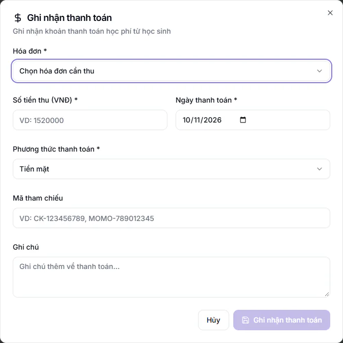
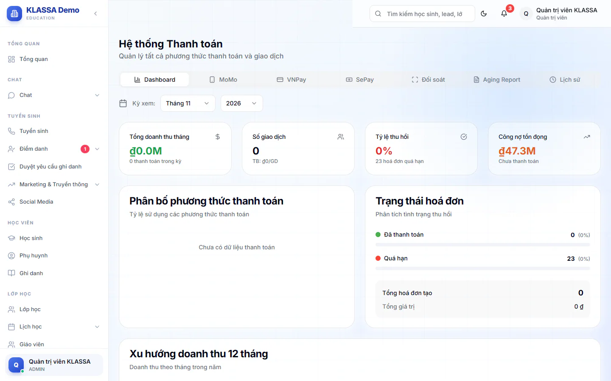

# Ghi nhận thanh toán

Khi phụ huynh đóng tiền mặt hoặc chuyển khoản mà hệ thống chưa tự nhận, bạn ghi nhận thanh toán vào hoá đơn tương ứng. Hoá đơn sẽ chuyển sang **Đã thanh toán** hoặc **Thanh toán một phần** theo số tiền thu.

## Ghi nhận một khoản thu

::: steps
1. Vào **Tài chính → Học phí**, mở tab **Thanh toán**, bấm **Ghi nhận thanh toán**. Cách nhanh hơn là bấm biểu tượng **Ghi nhận thanh toán** ở cuối dòng hoá đơn trong **Tài chính → Kế toán → Hoá đơn chi tiết**; cách này hộp mở sẵn đúng hoá đơn đó, nên không có ô **Hóa đơn** để chọn và bạn làm tiếp từ bước 3.
2. Ở **Hóa đơn**, chọn hoá đơn cần thu. Chọn xong, khung xanh mới hiện ra với mã hoá đơn, học sinh, gói học phí, tổng tiền, đã thanh toán và **Còn lại**. Khi chưa chọn thì chưa có khung này.
3. Điền **Số tiền thu (VNĐ)** và **Ngày thanh toán** (hai ô bắt buộc).
4. Chọn **Phương thức thanh toán**: **Tiền mặt**, **Chuyển khoản ngân hàng**, **MoMo** hoặc **VNPay**.
5. Nếu có, điền **Mã tham chiếu** (ví dụ mã giao dịch chuyển khoản) và **Ghi chú**.
6. Bấm **Ghi nhận thanh toán**, kiểm tra lại ở hộp **Xác nhận ghi nhận thanh toán**, rồi bấm **Xác nhận ghi nhận**.
:::

Số tiền phải lớn hơn 0. Hoá đơn đã thanh toán đủ sẽ có cảnh báo và không ghi thêm được.

### Phụ huynh đóng dư

Nếu số tiền lớn hơn số còn nợ, hệ thống chặn lại để tránh gõ nhầm. Nếu phụ huynh cố ý đóng dư, tích ô **Cho phép thu dư → chuyển phần dư thành credit**. Hoá đơn được thu đủ, phần dư thành credit của học sinh để trừ vào kỳ sau.

Ví dụ: hoá đơn còn nợ 1.600.000đ, phụ huynh đóng 1.800.000đ. Hoá đơn thu 1.600.000đ, học sinh Nguyễn Minh An có 200.000đ credit.

::: tip Mẹo
Nếu trung tâm đã kết nối ngân hàng, tiền chuyển khoản có đúng mã hoá đơn trong nội dung sẽ tự khớp, bạn không phải ghi tay. Xem [Kết nối ngân hàng](../tich-hop/ngan-hang.md).
:::

Mỗi lần ghi nhận, phụ huynh có thể nhận tin báo trung tâm đã nhận học phí. Xem [Phụ huynh xem hoá đơn và nhận báo](bao-phu-huynh.md).

## Trang Thanh toán

Vào **Tài chính → Thanh toán** (tiêu đề **Hệ thống Thanh toán**). Trang có các tab. Bốn tab **MoMo**, **VNPay**, **SePay** và **Đối soát** chỉ hiện với vai được sửa thu chi:

| Tab | Dùng để |
|---|---|
| **Dashboard** | Xem **Tổng doanh thu tháng**, **Số giao dịch**, **Tỷ lệ thu hồi**, **Công nợ tồn đọng**, cơ cấu phương thức và xu hướng 12 tháng. Chọn **Kỳ xem** ở đầu tab. |
| **MoMo**, **VNPay** | Lưu thông tin kết nối với hai cổng này. |
| **SePay** | Kết nối ngân hàng nhận tiền tự động, xem [Kết nối ngân hàng](../tich-hop/ngan-hang.md). |
| **Đối soát** | Xem giao dịch ngân hàng và khớp tay những giao dịch chưa khớp. |
| **Aging Report** | Danh sách hoá đơn quá hạn theo mức độ. |
| **Lịch sử** | Mọi giao dịch đã thu, có tìm kiếm và lọc. |

### Đối soát giao dịch ngân hàng

Giao dịch có nội dung chứa mã hoá đơn sẽ tự khớp. Giao dịch nào không khớp hiện nhãn **Chưa khớp**. Để khớp tay:

::: steps
1. Vào **Tài chính → Thanh toán**, tab **Đối soát**. Lọc **Chưa khớp** nếu cần.
2. Bấm **Khớp** ở giao dịch cần xử lý. Hộp **Khớp thủ công giao dịch** hiện thông tin giao dịch.
3. Nhập mã hoá đơn, tên hoặc mã học sinh vào ô tìm hoá đơn rồi bấm tìm.
4. Chọn hoá đơn đúng, bấm **Khớp**. Nếu số tiền lệch, hệ thống ghi rõ **Thừa ... → Tạo credit** hoặc **Thiếu ... → TT một phần**.
:::

### Aging Report và Lịch sử

**Aging Report** xếp hoá đơn quá hạn theo số ngày: đến 7 ngày là **Mới**, trên 7 ngày là **Cảnh báo**, trên 14 là **Quá hạn**, trên 30 là **Nghiêm trọng**. Có ô tìm theo tên, mã học sinh, mã hoá đơn, số điện thoại, nút **Xuất CSV** và **Làm mới**.

Tab **Lịch sử** lọc theo **Tìm kiếm**, **Phương thức**, **Từ ngày**, **Đến ngày**, và có nút **Xuất CSV**.

::: warning Lưu ý về MoMo và VNPay
Hai tab này hiện chỉ để lưu thông tin kết nối. Phụ huynh chưa có nút nào trong app hoặc web để trả bằng MoMo hay VNPay. Với tiền chuyển khoản, hãy dùng SePay hoặc ghi nhận tay. Chọn **MoMo** hoặc **VNPay** ở hộp ghi nhận thanh toán chỉ để ghi lại cách phụ huynh đã trả.
:::

## Câu hỏi thường gặp

::: details Ghi nhầm số tiền thì sao?
Mở **Chi tiết hóa đơn** của phiếu đó, trong danh sách thanh toán có nút xoá khoản thanh toán (hiện với phiếu chưa thu đủ), có hỏi lại trước khi xoá. Xoá xong ghi nhận lại số đúng. Việc này ảnh hưởng công nợ, nên đối chiếu ở [Công nợ](../ke-toan/cong-no.md). Khoản đã xoá không lấy lại được.
:::

::: details Thu phụ phí sách, cơ sở vật chất có ghi ở đây không?
Không. Khoản ngoài học phí dùng [Phiếu phụ thu](phieu-phu-thu.md).
:::
