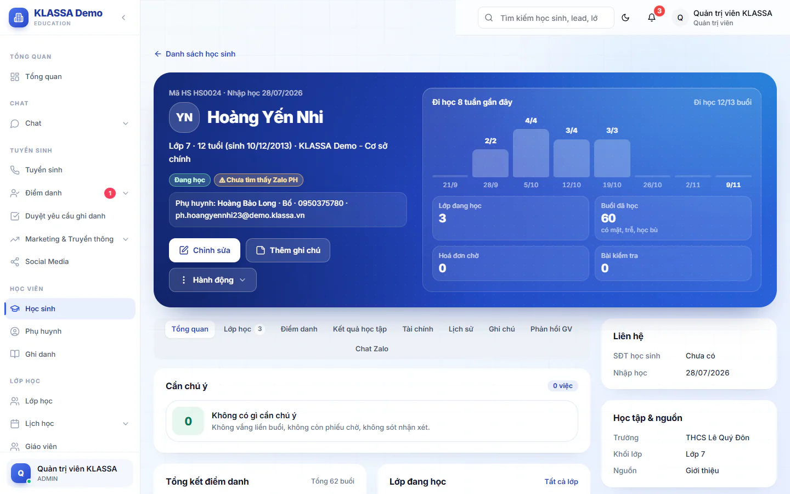

# Hồ sơ học sinh

Hồ sơ gom mọi thứ về một em vào một trang: lớp đang học, điểm danh, kết quả, phiếu học phí, ghi chú của trung tâm và cả khung chat Zalo với phụ huynh. Bạn dùng trang này khi cần gọi phụ huynh, kiểm tra tình hình học của em, hoặc sửa thông tin.

## Mở hồ sơ

::: steps
1. Vào **Học viên → Học sinh**.
2. Bấm tên học sinh hoặc nút **Chi tiết** ở cuối dòng.
:::

Đầu trang cho biết tên, mã, trạng thái, nhãn Zalo của phụ huynh (**Zalo PH**, **Chưa có SĐT PH** hoặc **Chưa tìm thấy Zalo PH**) và phụ huynh chính kèm quan hệ, số điện thoại, email. Bên phải là biểu đồ **Đi học 8 tuần gần đây** và vài số tổng quan như tỉ lệ đi học.

Giáo viên và trợ giảng chỉ mở được hồ sơ của em thuộc lớp mình phụ trách.

## Các tab trong hồ sơ

| Tab | Nội dung |
| --- | --- |
| **Tổng quan** | Thẻ **Cần chú ý** (vắng liền buổi, phiếu học phí đang chờ, buổi đi học còn sót nhận xét), **Tổng kết điểm danh**, **Lớp đang học**, **Hoạt động gần đây**. |
| **Lớp học** | Các lớp đang học và toàn bộ lượt ghi danh của em. Bấm tên lớp để mở lớp. |
| **Điểm danh** | Lịch sử điểm danh của em theo tháng. |
| **Kết quả học tập** | Kết quả các bài kiểm tra của em. |
| **Tài chính** | Danh sách **Phiếu học phí** gần nhất: số phiếu, kỳ, tổng tiền, đã thu, còn nợ, hạn, trạng thái. Tab này chỉ hiện với Quản trị viên, Quản lý chi nhánh, Quản lý và Kế toán. |
| **Lịch sử** | Lịch sử hoạt động theo ngày, bấm **Xem thêm** để mở thêm ngày cũ. |
| **Ghi chú** | Ghi chú CRM về em, xem bên dưới. |
| **Phản hồi GV** | Phản hồi của giáo viên về em. |
| **Chat Zalo** | Trò chuyện với phụ huynh qua Zalo ngay trong hồ sơ. |

## Thêm ghi chú về học sinh

Ghi chú để lưu trao đổi với phụ huynh, sự kiện đặc biệt hoặc lưu ý nội bộ.

::: steps
1. Trong hồ sơ, bấm **Thêm ghi chú**, hộp **Thêm ghi chú CRM** hiện ra.
2. Viết **Nội dung** (bắt buộc, tối đa 2000 ký tự).
3. Muốn giấu bớt, tích **Ghi chú riêng tư**. Ghi chú riêng tư chỉ Quản trị viên và Quản lý chi nhánh xem được. Ghi chú thường thì lễ tân và giáo viên đều xem được.
4. Lưu ghi chú.
:::

Quản trị viên và Quản lý chi nhánh còn xoá được ghi chú bằng biểu tượng thùng rác cạnh ghi chú. Vai được thêm ghi chú: Quản trị viên, Quản lý chi nhánh, Lễ tân, Giáo viên, Trợ giảng.

## Sửa hồ sơ

::: steps
1. Trong hồ sơ, bấm **Chỉnh sửa** (hoặc biểu tượng cây bút ở danh sách). Trang **Chỉnh sửa học sinh** hiện ra.
2. Sửa **Thông tin học sinh**: họ tên, số điện thoại, ngày sinh, khối lớp, trường, trạng thái, học lực, địa chỉ.
3. Sửa **Thông tin phụ huynh**: họ tên, số điện thoại, email, mối quan hệ.
4. Sửa môn học quan tâm và **Ghi chú** nếu cần.
5. Bấm **Cập nhật học sinh**.
:::

Các ô có dấu * là bắt buộc: họ tên và khối của em, họ tên và số điện thoại của phụ huynh. Hồ sơ chưa có phụ huynh thì điền thông tin phụ huynh ở đây, hệ thống sẽ tạo và gắn phụ huynh cho em. Cần có số điện thoại phụ huynh thì mới tạo được.

::: tip Mẹo
Sửa số điện thoại phụ huynh xong, hệ thống tự tìm lại Zalo theo số mới, nhãn **Chưa tìm thấy Zalo PH** sẽ biến mất nếu tìm ra. Nếu vẫn không thấy, hãy xin số Zalo thật của phụ huynh.
:::

### Khi phụ huynh dùng chung cho nhiều em

Phụ huynh được nhận ra bằng số điện thoại hoặc email, nên anh chị em dùng chung một phụ huynh. Khi bạn sửa số hoặc email phụ huynh, hệ thống có thể hiện cảnh báo:

- **Cảnh báo: Phụ huynh đã tồn tại**: số hoặc email mới đã thuộc phụ huynh của em khác. Bấm **Xác nhận gộp chung** thì các em sẽ dùng chung phụ huynh đó; bấm **Hủy** để quay lại sửa.
- **Cảnh báo: Tách phụ huynh**: phụ huynh hiện tại đang dùng chung cho em khác, nếu đổi thì em này tách ra có phụ huynh riêng, các em còn lại giữ nguyên. Bấm **Xác nhận tách** để đồng ý.

::: warning Lưu ý
Lưu hồ sơ mà không đổi **Trạng thái** thì không đụng tới các lớp đã ghi danh. Lớp đã huỷ không tự bật lại. Chỉ khi bạn đổi trạng thái từ **Tạm nghỉ** về **Đang học** thì hệ thống mới khôi phục các lớp bị huỷ lúc tạm nghỉ, xem [Tạm nghỉ, mở lại và xoá học sinh](nghi-hoc.md).
:::

## Nút Hành động

Quản trị viên và Quản lý chi nhánh có thêm nút **Hành động** với các việc: **Chuyển lớp học** (xem [Chuyển lớp](../lop-hoc/len-lop-chuyen-lop.md)), **Tạm nghỉ học sinh** hoặc **Mở lại học sinh**, **Xóa học sinh**.

## Câu hỏi thường gặp

::: details Tại sao tôi không thấy tab Tài chính?
Tab này chỉ dành cho Quản trị viên, Quản lý chi nhánh, Quản lý và Kế toán.
:::

::: details Muốn cấp tài khoản đăng nhập cho học sinh thì làm ở đâu?
Làm ở trang danh sách, xem [Tài khoản học sinh](tai-khoan-hoc-sinh.md).
:::
