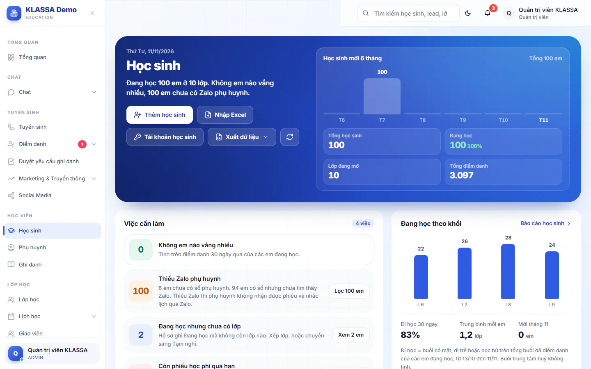

# Danh sách học sinh

Trang này là nơi bạn tìm một học sinh, xem em đang học lớp nào, phụ huynh là ai và việc nào cần làm trước. Đầu trang còn có thẻ **Việc cần làm** để bạn thấy ngay những em có vấn đề.

## Mở danh sách và tìm một học sinh

::: steps
1. Vào **Học viên → Học sinh**.
2. Gõ vào ô tìm kiếm phía trên bảng (chữ mờ trong ô là **Tìm tên, mã, SĐT học sinh / phụ huynh**): tên, mã học sinh, số điện thoại của em hoặc của phụ huynh.
3. Muốn thu hẹp, dùng các nút lọc **Khối**, **Lớp**, hoặc bấm các thẻ trạng thái: **Tất cả**, **Đang học**, **Tạm nghỉ**, **Đình chỉ**, **Đã tốt nghiệp**, **Chuyển trường**.
4. Bấm **Bỏ lọc** để quay về danh sách đầy đủ.
:::

Quản trị viên có thêm bộ lọc **Cơ sở** khi trung tâm có nhiều hơn một cơ sở. Các vai khác chỉ thấy học sinh trong phạm vi của mình. Giáo viên và trợ giảng chỉ thấy học sinh thuộc lớp mình phụ trách. Quản trị viên có thể tắt hẳn quyền xem trang này của giáo viên và trợ giảng ở **Cài đặt**, mục **Môn học**, phần **Quyền truy cập trang Học sinh** (mặc định bật).

Danh sách xếp theo ngày tạo hồ sơ, mới nhất trước. Nút **Bảng** và **Thẻ** ở phần **Kiểu xem** đổi cách hiển thị, nội dung giống nhau.

## Đọc từng dòng

Mỗi dòng cho biết mã học sinh, tên, khối, cơ sở, số điện thoại, các lớp đang học, phụ huynh chính, trạng thái và tỉ lệ **Đi học 30 ngày**. Cột **Nhập học** là ngày tạo hồ sơ.

Dưới trạng thái có thể có nhãn về Zalo của phụ huynh:

| Nhãn | Ý nghĩa |
| --- | --- |
| **Zalo PH** kèm tên | Đã tìm thấy Zalo của phụ huynh theo số điện thoại. |
| **Chưa có SĐT PH** | Hồ sơ chưa có số điện thoại phụ huynh. |
| **Chưa tìm thấy Zalo PH** | Có số điện thoại nhưng không tìm ra Zalo theo số đó. |

Em đang học mà không có lớp nào hiện nhãn **Chưa xếp lớp**.

## Thẻ Việc cần làm

Thẻ này gom bốn việc, mỗi việc có nút để lọc đúng nhóm em liên quan:

- **Vắng nhiều, cần gọi phụ huynh**: em vắng liền 2 buổi gần nhất ở một lớp, hoặc vắng từ 3 buổi trong 14 ngày qua. Bấm **Xem từng em** để lọc.
- **Thiếu Zalo phụ huynh**: bấm nút **Lọc ... em**. Thiếu Zalo thì phụ huynh không nhận được phiếu và nhắc lịch qua Zalo.
- **Đang học nhưng chưa có lớp**: hồ sơ ghi **Đang học** nhưng không còn lớp nào. Hãy [ghi danh](ghi-danh.md) vào lớp, hoặc chuyển em sang **Tạm nghỉ**.
- **Còn phiếu học phí quá hạn**: chỉ hiện với vai được xem tiền học phí. Bấm **Mở báo cáo nợ** để xem từng phiếu.

Bên cạnh ô tìm kiếm có nút lọc **Thiếu Zalo PH** kèm số em, chỉ tính các em đang học.

## Các nút trên đầu trang

- **Thêm học sinh**: mở form tạo hồ sơ. Xem [Tạo hồ sơ học sinh](tao-moi.md). Có ở vai được thêm học sinh.
- **Nhập Excel**: nhập nhiều em một lần. Xem [Nhập dữ liệu hàng loạt từ Excel](../tai-khoan/nhap-du-lieu-hang-loat.md).
- **Tài khoản học sinh**: cấp tài khoản đăng nhập cho học sinh. Xem [Tài khoản học sinh](tai-khoan-hoc-sinh.md). Chỉ Quản trị viên và Quản lý chi nhánh thấy.
- **Xuất dữ liệu**: xuất đúng danh sách đang lọc. Chọn **Xuất Excel (CSV)** để tải tệp, hoặc **Sao chép Google Sheets** để dán vào bảng tính. Chỉ Quản trị viên và Quản lý chi nhánh thấy.
- Biểu tượng làm mới tải lại số liệu.

::: tip Mẹo
Muốn xuất danh sách một lớp, lọc theo **Lớp** trước rồi mới bấm **Xuất dữ liệu**. Mỗi lần xuất tối đa 5.000 em, nếu dài hơn hãy lọc bớt rồi xuất lại.
:::

## Mở hồ sơ hoặc sửa nhanh

Bấm tên học sinh hoặc nút **Chi tiết** để mở [hồ sơ học sinh](chi-tiet.md). Biểu tượng cây bút ở cuối dòng mở trang sửa hồ sơ, chỉ hiện với vai được sửa học sinh.

## Câu hỏi thường gặp

::: details Em vừa nghỉ nhưng vẫn còn trong danh sách?
Danh sách mặc định hiện **Tất cả** trạng thái. Bấm thẻ **Đang học** nếu chỉ muốn xem các em đang theo học.
:::

::: details Tại sao tôi không thấy nút Xuất dữ liệu?
Chỉ Quản trị viên và Quản lý chi nhánh được xuất danh sách. Nhờ họ xuất giúp nếu bạn cần.
:::
