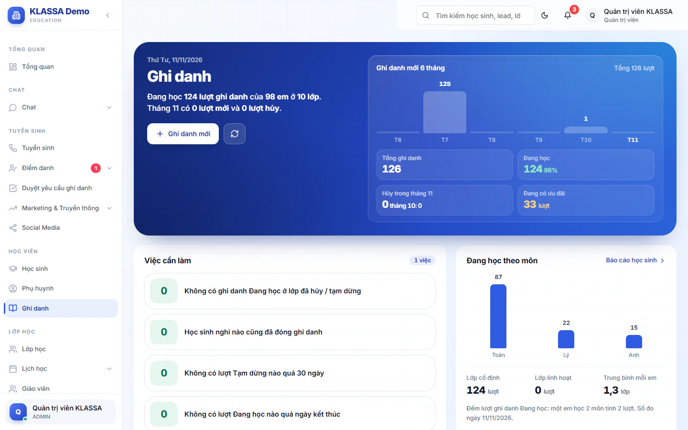
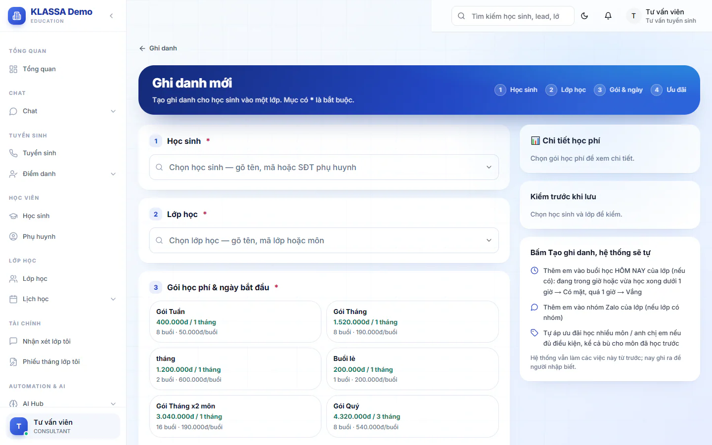

# Ghi danh học sinh vào lớp

Ghi danh là bước xếp một học sinh vào một lớp, chọn gói học phí và ưu đãi. Từ lượt ghi danh này hệ thống mới tính học phí và đưa em vào danh sách điểm danh của lớp. Mỗi em học nhiều lớp thì có nhiều lượt ghi danh.

Mục **Ghi danh** trên menu hiện với Quản trị viên, Quản lý chi nhánh, Quản lý và Kế toán. Kế toán chỉ xem, không tạo hay sửa. Lễ tân, giáo viên và trợ giảng không có mục này trên menu. Lễ tân vẫn ghi danh trực tiếp được ở trang lớp: vào **Lớp học**, mở lớp, bấm **Thêm học sinh** (xem [Chi tiết lớp](../lop-hoc/chi-tiet.md)). Lễ tân không mở được trang **Ghi danh** dù gõ thẳng đường dẫn.

## Xem danh sách ghi danh

::: steps
1. Vào **Học viên → Ghi danh**.
2. Dùng ô **Tìm ghi danh** (tên, mã học sinh, số điện thoại, tên hoặc mã lớp), các thẻ trạng thái và các nút lọc **Khối**, **Lớp**, **Gói học phí**, **Ưu đãi**, **Cơ sở**.
3. Bấm biểu tượng chi tiết hoặc cây bút ở cuối dòng để xem hay sửa một lượt ghi danh.
:::

Các thẻ trạng thái ghi danh là **Tất cả**, **Đang học**, **Tạm dừng**, **Tạm ngưng**, **Hoàn thành**, **Hủy bỏ**. Thẻ **Tạm ngưng** chỉ hiện khi đang có lượt như vậy. Cột **Giảm giá** chỉ hiện với vai được xem tiền.

Đầu trang có thẻ **Việc cần làm** báo những lượt ghi danh bất thường, mỗi việc có nút để lọc đúng nhóm:

- Lớp đã hủy hoặc tạm dừng mà ghi danh vẫn **Đang học**.
- Học sinh không còn **Đang học** (nghỉ, tốt nghiệp...) mà ghi danh vẫn **Đang học**.
- Ghi danh **Tạm dừng** quá 30 ngày chưa cập nhật: nên hỏi phụ huynh học tiếp hay nghỉ hẳn.
- Ngày kết thúc đã qua mà ghi danh vẫn **Đang học**.
- Học sinh **Đang học** chưa có lượt ghi danh nào.

## Ghi danh mới

::: steps
1. Ở trang **Ghi danh**, bấm **Ghi danh mới**. Trang **Ghi danh mới** có bốn bước. Thanh bước ở đầu trang ghi tắt là **Học sinh**, **Lớp học**, **Gói & ngày**, **Ưu đãi**.
2. Bước **Học sinh**: gõ tên, mã hoặc số điện thoại phụ huynh rồi chọn em. Chỉ em đang ở trạng thái **Đang học** mới chọn được.
3. Bước **Lớp học**: tìm theo tên lớp, mã lớp hoặc môn, chọn lớp trong nhóm **LỚP CỐ ĐỊNH** hoặc **LỚP LINH HOẠT**. Chỉ lớp đang hoạt động mới hiện trong danh sách. Lớp em đang học hoặc đã đủ sĩ số thì bị khoá, không chọn được.
4. Bước **Gói học phí & ngày bắt đầu**: chọn gói và ngày bắt đầu (bắt buộc). Mục **Buổi đầu theo lịch lớp** cho biết buổi học đầu tiên của em. Thiếu học sinh, lớp, gói hoặc ngày bắt đầu thì hệ thống báo "Vui lòng điền đầy đủ thông tin bắt buộc".
5. Bước **Ưu đãi & cách thu**: chọn **Chương trình giảm học phí riêng** nếu có, và chọn cách thu riêng cho em này nếu khác với gói.
6. Viết **Ghi chú** nếu cần, rồi bấm **Tạo ghi danh**.
:::

::: warning Gói mẫu có sẵn ở trung tâm mới
Trung tâm mới đã có sẵn vài gói học phí mẫu (tên như **Buổi lẻ**, **Gói Tuần**, **Gói Tháng**, **Gói Quý**) với giá chưa phải của trung tâm bạn. Giá mỗi buổi được tính từ giá gói chia cho số buổi mỗi chu kỳ, nên chọn nhầm gói mẫu thì phiếu ra sai tiền. Trước khi ghi danh em đầu tiên, hãy xem lại hoặc tắt các gói mẫu ở [Gói học phí và chế độ thu](../hoc-phi/quan-ly-hoc-phi.md).
:::

Khung bên phải cho bạn kiểm tra trước khi lưu: em đang học, chưa học lớp này, lớp còn chỗ. Khung **Chi tiết học phí** (chỉ vai được xem tiền) cho thấy giá gói, giảm giá và tổng cộng.

Khi lưu xong, hộp **Ghi danh thành công!** liệt kê những gì hệ thống đã làm. Hệ thống tự:

- tạo phiếu học phí tháng này, nếu phần cấu hình tài chính đang bật việc tự tạo phiếu khi ghi danh (xem [Cấu hình tài chính](../hoc-phi/cai-dat.md));
- thêm em vào buổi học hôm nay của lớp nếu có: đang trong giờ hoặc vừa học xong dưới 1 giờ thì ghi **Có mặt**, quá 1 giờ thì ghi **Vắng**;
- thêm em vào nhóm Zalo của lớp, nếu lớp có nhóm;
- áp ưu đãi học nhiều môn hoặc anh chị em nếu em đủ điều kiện.

::: tip Mẹo
Nếu em đủ điều kiện ưu đãi anh chị em hoặc học nhiều môn, hệ thống hiện một gợi ý màu xanh để bạn bấm chọn. Khi bạn chọn một chương trình, hệ thống kiểm tra điều kiện. Nếu chưa đủ điều kiện, đó chỉ là thông báo, bạn vẫn tạo được ghi danh.
:::

### Ưu đãi và cách thu

- Chọn **Tuỳ chỉnh** để tự nhập giảm giá: chọn loại **Phần trăm (%)** hoặc **Số tiền (VNĐ)**, điền **Giá trị giảm** và **Diễn giải giảm giá (sẽ hiện trên hoá đơn)**.
- Mục **Mô hình thu phí** có ô **Ghi đè cho HS này**. Tích ô này nếu em thu khác với gói, rồi chọn một trong ba cách: **Thu trước có khấu trừ**, **Thu trước trọn gói**, **Thu sau theo buổi thực**. Không tích thì em thu theo cách mặc định của gói.

Cách tính và cấu hình gói xem ở [Gói học phí và chế độ thu](../hoc-phi/quan-ly-hoc-phi.md).

## Sửa ghi danh và đổi trạng thái

::: steps
1. Mở **Học viên → Ghi danh**, bấm biểu tượng cây bút ở dòng cần sửa. Trang **Chỉnh sửa ghi danh** hiện ra.
2. Ở mục **Trạng thái**, chọn một trong các lựa chọn:
   - **Đang học**: đi học bình thường.
   - **Tạm dừng (HS xin nghỉ)**: em xin nghỉ một thời gian.
   - **Tạm ngưng (treo do nợ phí)**: chỉ làm tay, bắt buộc điền **Lý do tạm ngưng** và ngày tạm ngưng.
   - **Hoàn thành**: học xong khoá hoặc hết năm học.
   - **Hủy bỏ**: không học lớp này nữa.
3. Đổi **Gói học phí**, chương trình giảm giá hoặc **Ghi chú** nếu cần, rồi bấm **Lưu thay đổi**.
:::

::: warning Lưu ý
Đổi gói học phí không tự sửa phiếu đã xuất trong tháng. Nếu tháng này đã có phiếu theo gói cũ, hộp **Tháng này đã xuất phiếu theo gói cũ** hiện ra. Bạn chọn **Giữ nguyên gói** hoặc xác nhận đổi, rồi nhờ kế toán sửa tay từng phiếu hoặc huỷ phiếu để xuất lại.
:::

Hệ thống không tự treo lớp khi học sinh nợ phí. Tạm ngưng chỉ có khi bạn đặt tay.

## Xoá ghi danh

Ở trang **Chỉnh sửa ghi danh**, bấm **Xóa ghi danh** rồi xác nhận **Xóa**. Ghi danh không bị xoá hẳn mà chuyển sang **Hủy bỏ** với ngày kết thúc là hôm nay. Lịch sử điểm danh và phiếu cũ vẫn giữ.

Không xoá được khi học sinh còn hoá đơn chưa thanh toán hoặc mới thanh toán một phần, kể cả hoá đơn của lớp khác. Nếu việc xoá làm các môn còn lại hết đủ điều kiện ưu đãi học nhiều môn, hệ thống hỏi bạn chọn **Giữ nguyên ưu đãi cho phụ huynh** hay **Gỡ ưu đãi đó**.

## Chi tiết một lượt ghi danh

Bấm biểu tượng chi tiết để xem: học sinh và phụ huynh, lớp, thời gian (ngày bắt đầu, ngày kết thúc, lý do tạm ngưng), ưu đãi và cách thu, các phiếu học phí của lượt này và điểm danh lớp này trong 30 ngày.

## Khi em chuyển lớp hoặc lên lớp

Việc chuyển lớp và lên lớp không làm ở đây. Xem [Lên lớp và chuyển lớp](../lop-hoc/len-lop-chuyen-lop.md). Em xin duyệt học thêm môn từ phụ huynh thì xem [Duyệt yêu cầu ghi danh](duyet-yeu-cau-ghi-danh.md).

## Câu hỏi thường gặp

::: details Tại sao tôi không chọn được em trong bước Học sinh?
Chỉ em ở trạng thái **Đang học** mới chọn được. Nếu em đang **Tạm nghỉ**, hãy mở lại ở [hồ sơ học sinh](nghi-hoc.md) trước.
:::

::: details Tại sao lớp bị mờ, không chọn được?
Lớp đó đã đủ sĩ số, hoặc em đang học lớp đó rồi. Nếu em đang học, mở lượt cũ để sửa thay vì tạo thêm.
:::
