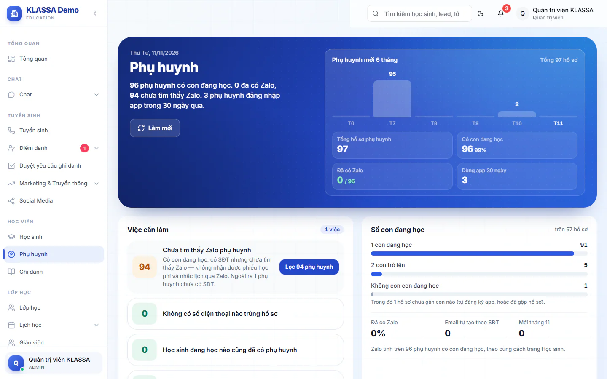

# Danh sách phụ huynh

Trang này giúp bạn tìm phụ huynh, liên lạc ngay với họ và dọn các hồ sơ có vấn đề (thiếu Zalo, trùng số điện thoại, email gõ sai). Phụ huynh không tạo ở đây: hồ sơ phụ huynh được tạo khi bạn [thêm học sinh](tao-moi.md), và một phụ huynh có thể có nhiều con.

## Mở danh sách và tìm phụ huynh

::: steps
1. Vào **Học viên → Phụ huynh**.
2. Gõ vào ô **Tìm phụ huynh**: tên, số điện thoại, email phụ huynh hoặc tên con.
3. Bấm một thẻ nhóm để lọc: **Tất cả**, **Có con đang học**, **Không còn con đang học**, **Chưa tìm thấy Zalo**.
4. Lọc thêm bằng **Số con** (**Chưa có con**, **1 con**, **2 con**, **3 con trở lên**), **Lớp của con** hoặc **Cơ sở** (cơ sở chỉ hiện với Quản trị viên khi có nhiều cơ sở).
5. Bấm **Bỏ lọc** để xem lại toàn bộ.
:::

Danh sách xếp theo ngày tạo, mới nhất trước. Nút **Bảng** và **Thẻ** ở **Kiểu xem** đổi cách hiển thị.

## Đọc từng dòng

Mỗi dòng có: tên phụ huynh và quan hệ với em, nhãn **Dùng app** nếu phụ huynh đã đăng nhập app trong 30 ngày qua, số điện thoại và email, các con (bấm tên con để xem nhanh học sinh), tình trạng Zalo, cơ sở và ngày tạo.

Email có nhãn tự tạo nghĩa là hệ thống tạo theo số điện thoại để phụ huynh đăng nhập, không gửi thư được. Muốn gửi email, hãy nhập email thật vào hồ sơ.

## Liên lạc nhanh

Cột **Liên lạc** có các biểu tượng: nhắn tin, mở Zalo, gọi điện, gửi email và xem nhanh. Bấm biểu tượng nhắn tin, gọi hoặc email để mở ứng dụng tương ứng trên thiết bị của bạn. Bấm biểu tượng xem nhanh để mở khung thông tin phụ huynh gồm liên hệ, nghề nghiệp, nơi làm việc, địa chỉ và các con.

## Thẻ Việc cần làm

| Việc | Ý nghĩa và cách xử lý |
| --- | --- |
| **Chưa tìm thấy Zalo phụ huynh** | Phụ huynh có con đang học, có số điện thoại nhưng không tìm thấy Zalo, nên không nhận được phiếu học phí và nhắc lịch qua Zalo. Bấm **Lọc ... phụ huynh** rồi xin số Zalo thật. |
| **Một số điện thoại nằm ở nhiều hồ sơ** | Thường là trùng hồ sơ. Bấm **Xem ... số** để lọc. |
| **Học sinh đang học chưa có phụ huynh** | Bấm tên em để mở trang sửa và thêm phụ huynh. |
| **Email gõ sai đuôi** | Ví dụ gõ sai tên miền email. Phụ huynh đăng nhập app bằng email này nên gõ sai thì không vào được. Bấm **Xem ... hồ sơ** để lọc. |

## Sửa thông tin phụ huynh

Trang này chỉ để xem và liên lạc, không sửa trực tiếp. Muốn sửa số điện thoại, email, họ tên, hoặc gộp hay tách phụ huynh của anh chị em, bạn sửa ở hồ sơ học sinh.

::: steps
1. Bấm biểu tượng xem nhanh ở dòng phụ huynh.
2. Cuối khung bấm **Mở trang sửa của** tên con.
3. Sửa phần **Thông tin phụ huynh** rồi bấm **Cập nhật học sinh**. Xem [Hồ sơ học sinh](chi-tiet.md).
:::

Nút này chỉ hiện nếu vai của bạn sửa được hồ sơ học sinh.

::: warning Lưu ý
Số điện thoại là tên đăng nhập của phụ huynh. Khi đổi số, hãy báo phụ huynh biết để họ đăng nhập bằng số mới.
:::

## Câu hỏi thường gặp

::: details Phụ huynh quên mật khẩu thì làm sao?
Trang này không có chức năng đặt lại mật khẩu. Xem hướng dẫn ở phần [Cổng phụ huynh](../cong-phu-huynh/gioi-thieu.md) hoặc nhờ Quản trị viên hỗ trợ ở [Người dùng](../cai-dat/nguoi-dung.md).
:::

::: details Một phụ huynh có hai con học thì có hai hồ sơ không?
Không. Hai em dùng chung một phụ huynh khi cùng số điện thoại hoặc email. Con của phụ huynh hiện ở cột các con.
:::
