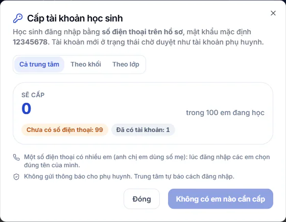

# Tài khoản đăng nhập cho học sinh

Học sinh có tài khoản riêng để vào khu học: Học vui, luyện đề, thời khoá biểu, đánh giá thầy cô, gia sư AI và các tính năng dành cho em. Em đăng nhập bằng **số điện thoại ghi trên hồ sơ học sinh**, không cần email. Trang này nói cách cấp tài khoản, duyệt và hướng dẫn em vào học.

## Tài khoản được tạo như thế nào

- Học sinh mới được tạo có số điện thoại đúng dạng và đang ở trạng thái **Đang học** thì hệ thống tự cấp tài khoản.
- Thêm hoặc đổi số điện thoại trong hồ sơ của em chưa có tài khoản cũng tự cấp. Sửa hồ sơ mà không đụng tới số điện thoại thì không cấp mới.
- Với em đã có tài khoản, đổi tên hoặc số điện thoại trong hồ sơ thì tài khoản đổi theo. Em đăng nhập bằng số mới.
- Hồ sơ nào đã có từ trước và chưa có tài khoản thì bạn cấp hàng loạt như dưới đây.

Mật khẩu mặc định là **12345678**. Tài khoản mới ở trạng thái chờ duyệt như tài khoản phụ huynh. Hệ thống không gửi thông báo cho phụ huynh, nên trung tâm tự báo cách đăng nhập cho em.

## Cấp tài khoản hàng loạt

::: steps
1. Vào **Học viên → Học sinh**, bấm **Tài khoản học sinh**. Hộp **Cấp tài khoản học sinh** hiện ra. Chỉ Quản trị viên và Quản lý chi nhánh thấy nút này.
2. Bấm một trong ba tab: **Cả trung tâm**, **Theo khối** hoặc **Theo lớp**. Chọn **Khối** hoặc **Lớp** nếu cần.
3. Xem con số **Sẽ cấp** và các nhãn lý do những em chưa cấp được.
4. Bấm nút **Cấp ... tài khoản** ở dưới cùng (số em hiện ngay trong nút). Nếu **Sẽ cấp** bằng 0, nút ghi **Không có em nào cần cấp** và không bấm được.
:::

Chỉ các em đang học được tính. Những em bị bỏ qua hiện kèm lý do:

| Nhãn | Cách xử lý |
| --- | --- |
| **Đã có tài khoản** | Không cần làm gì. |
| **Chưa có số điện thoại** | Thêm số vào [hồ sơ học sinh](chi-tiet.md), hệ thống tự cấp. |
| **Số điện thoại sai dạng** | Sửa lại số điện thoại trong hồ sơ. |
| **Số điện thoại đã dùng cho 5 học sinh** | Một số điện thoại chỉ dùng cho tối đa 5 em. Em thứ 6 cần dùng số khác. |
| **Không ở trạng thái đang học** | Chỉ cấp cho em **Đang học**. |
| **Trùng tài khoản cũ, cần xử lý tay** | Nhờ Quản trị viên kiểm tra tài khoản cũ cùng mã học sinh. |

Hồ sơ ghi hai số thì hệ thống lấy số đầu tiên làm tên đăng nhập.

## Duyệt tài khoản

Tài khoản mới chưa vào được cho tới khi được duyệt.

::: steps
1. Sau khi cấp xong, Quản trị viên bấm **Duyệt tài khoản ngay** để mở trang duyệt đã lọc sẵn vai Học sinh. Hoặc vào **Quản trị hệ thống → Quản lý Đăng ký** và lọc vai **Học sinh**.
2. Duyệt từng tài khoản hoặc dùng **Phê duyệt hàng loạt**. Xem [Duyệt đăng ký người dùng](../cai-dat/duyet-dang-ky-nguoi-dung.md).
:::

Duyệt ở đây thì ở **Học online** cũng tự đổi theo, và ngược lại. Quản lý chi nhánh cấp được tài khoản nhưng không duyệt.

## Học sinh đăng nhập

::: steps
1. Học sinh mở trang đăng nhập.
2. Ở ô **Email hoặc số điện thoại**, nhập số điện thoại trên hồ sơ. Nhập mật khẩu.
3. Vào được khu học của học sinh.
:::

Nếu một số điện thoại dùng chung cho nhiều em (anh chị em dùng số của mẹ) và các em cùng mật khẩu, màn hình hỏi **Bạn là ai?**. Em chọn đúng tên của mình để vào học. Xem thêm [Đăng nhập](../tai-khoan/dang-nhap.md).

::: warning Lưu ý
Mật khẩu mặc định giống nhau cho mọi em. Hãy dặn em đổi mật khẩu sau lần đăng nhập đầu, xem [Đổi mật khẩu](../tai-khoan/doi-mat-khau.md). Em sẽ không bị buộc đổi.
:::

## Câu hỏi thường gặp

::: details Em quên số điện thoại đăng nhập?
Em dùng số điện thoại đang ghi trên hồ sơ. Mở [hồ sơ học sinh](chi-tiet.md) để xem hoặc sửa số.
:::

::: details Vì sao em đăng nhập báo sai thông tin?
Kiểm tra tài khoản đã được duyệt chưa, số điện thoại trên hồ sơ có đúng không, và em có gõ đúng mật khẩu không.
:::

::: details Cấp tài khoản có báo cho phụ huynh không?
Không. Trung tâm tự báo cách đăng nhập cho em hoặc phụ huynh.
:::
