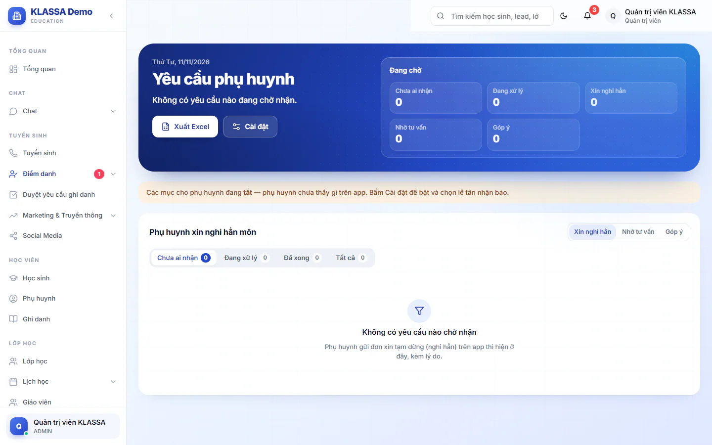

# Yêu cầu phụ huynh

Phụ huynh có thể gửi ba loại yêu cầu từ ứng dụng: xin cho con nghỉ hẳn một môn, nhờ tư vấn học thêm môn khác, và góp ý. Trang này gom các yêu cầu đó để một người nhận, gọi phụ huynh và chốt kết quả. Tính năng này cần gói mở rộng **Cổng Phụ huynh**.

::: warning Lưu ý
Cả ba loại yêu cầu mặc định tắt. Quản trị viên bật từng loại ở nút **Cài đặt** của trang này (xem bên dưới). Chưa bật thì phụ huynh không thấy lối gửi. Phần phụ huynh gửi yêu cầu xem ở [Cổng phụ huynh](../cong-phu-huynh/gioi-thieu.md).
:::

## Mở trang và xem yêu cầu

::: steps
1. Vào **Điểm danh → Yêu cầu phụ huynh**.
2. Bấm một trong ba nút chuyển loại: **Xin nghỉ hẳn**, **Nhờ tư vấn**, **Góp ý**.
3. Bấm một thẻ trạng thái bên dưới: **Chưa ai nhận**, **Đang xử lý**, **Đã xong**, **Tất cả**. Mỗi thẻ có kèm số yêu cầu.
:::

Khối **Đang chờ** ở đầu trang cho biết số yêu cầu **Chưa ai nhận**, **Đang xử lý** và số yêu cầu còn mở của từng loại. Mỗi yêu cầu hiện tên học sinh, phụ huynh, lớp hoặc môn liên quan, lý do, ngày muốn nghỉ (với đơn nghỉ), kênh phụ huynh muốn được liên hệ (**Gọi điện** hoặc **Zalo**) và trạng thái. Phụ huynh tự huỷ yêu cầu thì hiện **Phụ huynh đã huỷ**.

## Nhận và xử lý một yêu cầu

Yêu cầu mới được báo ngay cho quản lý và cho các lễ tân do Quản trị viên chọn. Ai bấm nhận trước thì phụ trách.

::: steps
1. Bấm **Tôi nhận** ở yêu cầu muốn xử lý. Yêu cầu chuyển sang **Đang xử lý**.
2. Gọi hoặc nhắn phụ huynh theo kênh họ chọn.
3. Bấm **Chốt kết quả**, chọn một kết quả, ghi chú (tuỳ chọn) rồi xác nhận.
:::

Chỉ người đã nhận, hoặc quản lý, mới chốt được kết quả. Hai nút **Hồ sơ học sinh** và **Mở lead** (với yêu cầu tư vấn) đi thẳng tới hồ sơ liên quan.

### Kết quả theo từng loại

| Loại | Kết quả | Hệ thống làm gì |
| --- | --- | --- |
| **Xin nghỉ hẳn** | **Nghỉ hẳn** | Giáo viên lớp được báo. Hệ thống **không tự huỷ ghi danh**. |
| **Xin nghỉ hẳn** | **Ở lại học tiếp** | Giáo viên lớp được báo là em tiếp tục học. |
| **Nhờ tư vấn** | **Đã đăng ký học thêm** | Lead chuyển sang "Đã chốt (môn bổ sung)", tính cho người nhận. |
| **Nhờ tư vấn** | **Chưa đăng ký** | Lead chuyển sang "Đã mất". |
| **Góp ý** | **Đã phản hồi phụ huynh** | Lời nhắn của bạn hiện cho phụ huynh trong mục Góp ý. |
| **Góp ý** | **Đã ghi nhận** | Trung tâm ghi nhận, không cần trả lời riêng. Ghi chú bạn nhập (nếu có) cũng hiện cho phụ huynh. |

::: warning Lưu ý
Khi chọn **Nghỉ hẳn**, bạn phải tự vào [hồ sơ học sinh](chi-tiet.md) và [huỷ ghi danh](ghi-danh.md) lớp đó như bình thường. Hệ thống không làm thay.
:::

Với yêu cầu **Nhờ tư vấn**, khi bấm **Tôi nhận** hệ thống tự tạo một lead cho em và đặt bạn làm người phụ trách. Xem [Tuyển sinh](../tuyen-sinh/danh-sach-lead.md).

Góp ý về giáo viên chỉ quản lý thấy. Lễ tân và giáo viên được góp ý không nhìn thấy.

## Cài đặt (Quản trị viên)

::: steps
1. Ở trang **Yêu cầu phụ huynh**, bấm **Cài đặt**. Hộp **Cài đặt yêu cầu phụ huynh** hiện ra.
2. Bật hoặc tắt từng loại: **Phụ huynh xin nghỉ hẳn môn**, **Phụ huynh nhờ tư vấn học thêm**, **Phụ huynh góp ý**.
3. Ở mục **Lễ tân nhận báo**, tích những lễ tân sẽ được báo khi có yêu cầu mới. Quản lý luôn được báo, không cần tích.
4. Ở mục **Lý do nghỉ hẳn cho phụ huynh chọn**, thêm hoặc bỏ lý do. Để trống thì phụ huynh thấy danh sách mặc định (ví dụ trùng lịch học, học phí, chuyển nhà hoặc chuyển trường).
5. Bấm **Lưu cài đặt**.
:::

## Xuất danh sách

Quản trị viên và Quản lý chi nhánh có nút **Xuất Excel** để tải danh sách của loại yêu cầu đang xem.

## Câu hỏi thường gặp

::: details Tôi là lễ tân nhưng không có nút Tôi nhận hoặc không nhận được báo?
Bạn cần nằm trong danh sách **Lễ tân nhận báo** do Quản trị viên chọn. Quản lý luôn được báo và luôn nhận được.
:::

::: details Phụ huynh xin nghỉ hẳn có làm em bị huỷ lớp ngay không?
Không. Đơn chỉ là yêu cầu. Việc huỷ ghi danh do nhân viên làm sau khi đã trao đổi với phụ huynh.
:::
