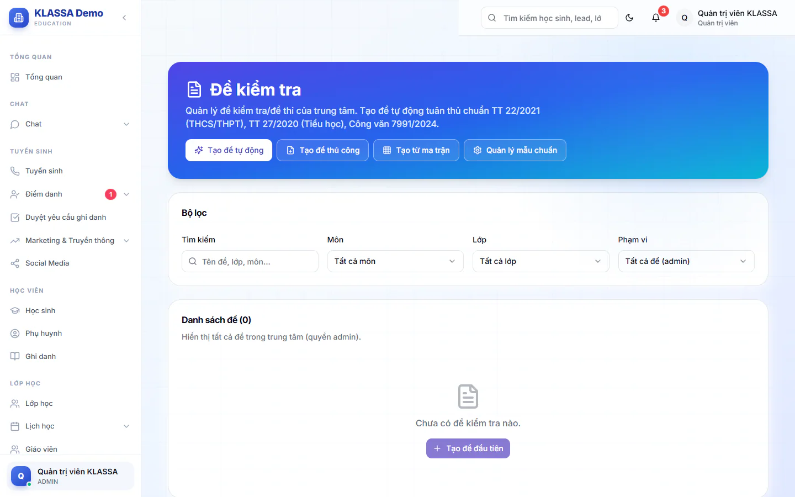
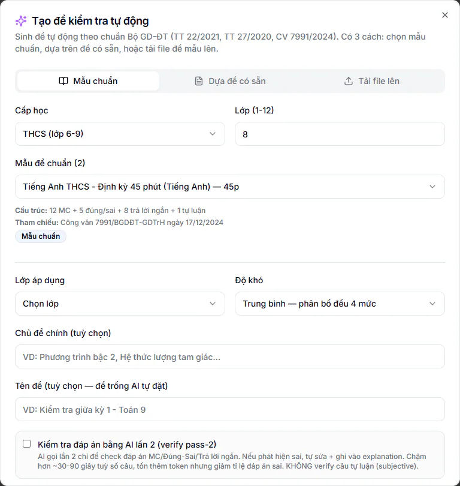
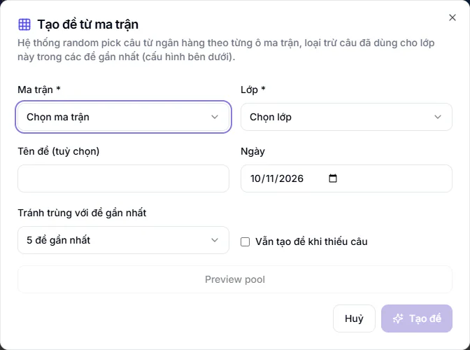

# Đề kiểm tra

Trang này gom mọi đề kiểm tra của trung tâm: soạn đề, in đề, nhập điểm cho cả lớp. Mỗi đề gắn với một lớp. Cách nhập điểm và gửi điểm cho phụ huynh nằm ở bài [Nhập điểm và công bố điểm](cong-bo-diem.md).

## Xem danh sách đề

Vào **Đề kiểm tra → Danh sách đề**.

Bảng có các cột **Tên đề**, **Lớp / Môn**, **Số câu**, **Số điểm**, **Người tạo**, **Ngày**. Đề chưa gửi điểm cho phụ huynh có nhãn **Chưa công bố** cạnh tên. Bấm vào một dòng để mở đề. Khi chưa có đề nào (hoặc bộ lọc không khớp đề nào), trang hiện **Chưa có đề kiểm tra nào.** kèm nút **Tạo đề đầu tiên**, và bảng chỉ xuất hiện khi đã có đề.

Dùng khung **Bộ lọc** (**Tìm kiếm**, **Môn**, **Lớp**) để tìm đề theo tên, môn, lớp.

- Quản trị viên, Quản lý chi nhánh và Quản lý thấy mọi đề, và có thêm ô **Phạm vi** để chọn **Tất cả đề (admin)** hoặc **Chỉ đề của tôi**.
- Giáo viên và Trợ giảng thấy đề do chính mình tạo và đề của các lớp mình được phân công. Chỉ đề do chính mình tạo mới sửa, nhập điểm và công bố được.

## Tạo đề: chọn một trong 3 cách

Đầu trang có 3 nút tạo đề: **Tạo đề tự động**, **Tạo đề thủ công**, **Tạo từ ma trận**. Quản trị viên, Quản lý chi nhánh và Quản lý còn có nút **Quản lý mẫu chuẩn**.

### Cách 1: Tạo đề tự động

Hệ thống nhờ AI soạn câu hỏi theo cấu trúc của mẫu chuẩn (tham chiếu Thông tư 22/2021, Thông tư 27/2020, Công văn 7991/2024). Việc này mất khoảng 30-60 giây.

::: steps
1. Vào **Đề kiểm tra → Danh sách đề**, bấm **Tạo đề tự động**. Hộp **Tạo đề kiểm tra tự động** hiện ra.

   

2. Chọn một trong 3 tab:
   - **Mẫu chuẩn**: chọn **Cấp học** (Tiểu học, THCS, THPT), **Lớp (1-12)** và **Mẫu đề chuẩn**. Hộp hiện cấu trúc của mẫu bạn chọn.
   - **Dựa đề có sẵn**: chọn một đề đã có trong hệ thống làm đề mẫu.
   - **Tải file lên**: tải file đề mẫu (PDF, JPG hoặc PNG, tối đa 10MB).
3. Chọn **Lớp áp dụng** và **Độ khó**. Với 2 tab dùng đề mẫu, có thêm lựa chọn **Tương đương đề mẫu** để giữ nguyên phân bố mức độ của đề mẫu.
4. Nếu muốn, nhập **Chủ đề chính** (ví dụ: Phương trình bậc 2) và **Tên đề**. Để trống tên thì AI tự đặt.
5. Tích **Kiểm tra đáp án bằng AI lần 2** nếu muốn AI rà lại đáp án (chậm hơn 30-90 giây). Bước này không áp dụng cho câu tự luận.
6. Bấm **Tạo đề**.
:::

Ô bắt buộc: **Lớp áp dụng**, cùng với mẫu chuẩn, đề mẫu hoặc file đề mẫu tương ứng với tab bạn chọn.

::: warning Lưu ý
AI có thể sai. Hãy đọc lại từng câu và đáp án trước khi cho học sinh làm. Bạn sửa được từng câu ở tab **Câu hỏi** của đề.
:::

### Cách 2: Tạo đề thủ công

::: steps
1. Bấm **Tạo đề thủ công**. Hộp **Tạo đề thủ công** hiện ra với 2 tab.
2. Tab **Tạo rỗng**: tạo đề chỉ có tên, ngày, thang điểm, chưa có câu hỏi. Dùng khi bạn chỉ cần nhập điểm hoặc muốn nhập câu hỏi sau.
3. Tab **Upload đề lên**: chọn file đề (PDF, JPG hoặc PNG, tối đa 10MB). AI đọc toàn bộ đề và đưa câu hỏi vào hệ thống, mất khoảng 30-60 giây. Tên đề có thể để trống, AI tự đặt.
4. Điền các ô chung bên dưới: **Lớp áp dụng** (bắt buộc), **Tên đề** (bắt buộc ở tab **Tạo rỗng**), **Ngày** (bắt buộc), **Hệ số**, **Điểm tối đa** (phải lớn hơn 0; ở tab **Upload đề lên** có thể để trống), **Ghi chú**.
5. Quyết định ô **Công bố điểm ngay** (xem phần dưới), rồi bấm **Tạo đề rỗng** (tab **Tạo rỗng**) hoặc **Phân tích & Import** (tab **Upload đề lên**).
:::

### Cách 3: Tạo từ ma trận

Hệ thống chọn ngẫu nhiên câu hỏi từ [Ngân hàng câu hỏi](ngan-hang-cau-hoi.md) theo từng ô của một [ma trận đề thi](ma-tran-de-thi.md).

::: steps
1. Bấm **Tạo từ ma trận**. Hộp **Tạo đề từ ma trận** hiện ra.

   

2. Chọn **Ma trận** và **Lớp** (cả hai bắt buộc). Nhập **Tên đề** và **Ngày** nếu muốn.
3. Chọn **Tránh trùng với đề gần nhất**: **5 đề gần nhất**, **3 đề gần nhất** hoặc **Không loại trừ**. Hệ thống không lấy lại câu lớp này đã làm trong các đề gần đây.
4. Bấm **Preview pool** (nút còn mờ cho đến khi bạn chọn xong **Ma trận** và **Lớp**) để xem ngân hàng có đủ câu cho từng ô không. Mỗi dòng cho biết số câu có sẵn trên số câu cần. Phải xem trước thì nút **Tạo đề** mới bấm được.
5. Nếu thiếu câu, bạn có 2 hướng: thêm câu vào ngân hàng, hoặc tích **Vẫn tạo đề khi thiếu câu** (ô thiếu sẽ lấy hết số câu có, đề ra ít câu hơn ma trận). Khi thiếu câu, Quản trị viên, Quản lý chi nhánh và Quản lý còn thấy ô **Bypass duplicate check**, cho phép dùng lại câu đã ra gần đây.
6. Bấm **Tạo đề**.
:::

## Công bố điểm ngay hay để sau

Mặc định đề mới ở trạng thái **Chưa công bố**: phụ huynh chưa thấy điểm và chưa nhận thông báo, dù bạn đã nhập điểm. Bạn kiểm xong rồi mới bấm **Công bố điểm** trong đề. Chi tiết ở bài [Nhập điểm và công bố điểm](cong-bo-diem.md).

Nếu tích **Công bố điểm ngay** khi tạo đề thủ công, phụ huynh thấy điểm và nhận thông báo ngay khi bạn nhập điểm từng em.

## Làm việc trong một đề

Bấm vào đề trong danh sách. Đầu trang đề có các nút:

- **Công bố điểm**: chỉ hiện khi đề còn **Chưa công bố**.
- **Ẩn đáp án** / **Hiện đáp án**: ẩn hoặc hiện đáp án trên màn hình.
- **In / PDF**: in đề. Trong hộp in, bỏ tích "Đầu trang và chân trang" để bản in không bị chèn địa chỉ trang.
- **Thao tác khác**: **Xuất Excel bảng điểm**, **Xuất Word đề + đáp án (.docx)**, **Sửa thông tin đề**, **Sao chép sang lớp khác**, **Sinh mã đề (trộn)**, **Xoá đề**.

Các lệnh **Sửa thông tin đề**, **Sao chép sang lớp khác**, **Sinh mã đề (trộn)** và **Xoá đề** chỉ hiện với người tạo đề, Quản trị viên, Quản lý chi nhánh và Quản lý.

Thân đề có 3 tab: **Chấm điểm**, **Câu hỏi**, **Thống kê**.

### Tab Câu hỏi

Mục **Quản lý câu hỏi** có các nút:

- **Thêm câu**: mở hộp **Thêm câu hỏi**. Chọn **Loại câu** (**Trắc nghiệm 4 đáp án**, **Đúng/Sai 4 ý**, **Trả lời ngắn**, **Tự luận**), **Điểm**, rồi nhập **Nội dung câu hỏi** (bắt buộc). Công thức viết theo kiểu LaTeX trong dấu `$...$`, ô **Xem trước** hiện kết quả. Câu trắc nghiệm cần đủ 4 đáp án A/B/C/D, và **Đáp án đúng** là một chữ cái A, B, C hoặc D. Câu Đúng/Sai nhập chuỗi như TTSS. Có thể chọn **Mức độ** (M1 Nhận biết, M2 Thông hiểu, M3 Vận dụng, M4 Vận dụng cao), thêm hình minh hoạ và **Giải thích / Hướng dẫn chấm**.
- **Thêm từ ngân hàng**: chọn nhiều câu trong ngân hàng (lọc theo chương, mức độ) để chèn vào đề. Câu giữ điểm mặc định của ngân hàng, bạn chỉnh sau được.
- **Lưu vào ngân hàng**: sao chép câu nhập tay trong đề này vào ngân hàng để dùng lại. Chọn **Chương** (bắt buộc), **Mức độ mặc định**, **Chế độ chia sẻ** và các câu cần lưu. Câu trong đề vẫn còn nguyên.

Mỗi câu có 3 nút nhỏ: sinh lại bằng AI (giữ nguyên loại câu, điểm, mức độ), sửa thủ công, xoá. Với câu lấy từ ngân hàng, nút xoá chỉ gỡ câu khỏi đề, câu gốc trong ngân hàng không mất.

### Sinh mã đề (trộn)

Dùng để tạo nhiều mã đề từ một đề gốc, mỗi mã có thứ tự câu hoặc thứ tự đáp án khác nhau, hạn chế quay cóp. Lệnh này chỉ hiện khi đề đã có câu hỏi.

::: steps
1. Bấm **Thao tác khác → Sinh mã đề (trộn)**.
2. Nhập **Số mã đề (1-20)**.
3. Chọn **Trộn thứ tự câu hỏi** và/hoặc **Trộn options A/B/C/D** (phải chọn ít nhất một). Ô **Giữ thứ tự nhóm câu** (chỉ chọn được khi đã tích trộn thứ tự câu) giữ các nhóm câu theo thứ tự Trắc nghiệm, Đúng/Sai, Trả lời ngắn, Tự luận và chỉ trộn trong từng nhóm.
4. Bấm nút ở cuối hộp, ví dụ **Sinh 5 mã đề** (số trong nút là số mã đề bạn nhập).
:::

Các mã đề hiện ở tab **Câu hỏi**. Bấm biểu tượng xem để mở từng mã đề, hoặc biểu tượng xoá để xoá mã đề đó.

### Sao chép sang lớp khác

Dùng khi một đề dùng cho nhiều lớp cùng môn.

::: steps
1. Bấm **Thao tác khác → Sao chép sang lớp khác**.
2. Chọn **Lớp đích** (bắt buộc). Nhập **Tên đề mới** và **Ngày kiểm tra** nếu muốn.
3. Bấm **Sao chép**.
:::

Đề mới có cùng thông tin và câu hỏi. Điểm học sinh và mã đề không được sao chép sang.

### Tab Thống kê

Mục **Phổ điểm** hiện phân bố điểm theo 10 khoảng và số học sinh đã có điểm. Ngưỡng đạt mặc định là nửa thang điểm.

## Chấm bài bằng ảnh

Trong tab **Chấm điểm** có thêm hai công cụ chấm tự động:

- **Chấm bằng AI từ ảnh**: nút **Mở Chấm bài** chuyển sang trang Chấm bài với đề này đã chọn sẵn. Xem bài [Chấm bài kiểm tra bằng AI từ ảnh](cham-bai-ai.md).
- **Chấm phiếu trắc nghiệm (OMR) bằng AI**: tab **In phiếu trả lời** để nhập số câu (1-100) và bấm **Tải phiếu PDF**; tab **Quét phiếu chấm** để tải tối đa 20 ảnh phiếu rồi bấm **Quét bằng AI**. Phiếu có ô **Mã HS** để học sinh điền, AI đọc mã này để gán điểm. Đề cần có câu trắc nghiệm với đáp án A/B/C/D đã nhập sẵn.

## Quản lý mẫu chuẩn

Nút **Quản lý mẫu chuẩn** dành cho Quản trị viên, Quản lý chi nhánh và Quản lý. Đây là nơi quản lý các mẫu cấu trúc đề dùng ở tab **Mẫu chuẩn** của **Tạo đề tự động**.

## Câu hỏi thường gặp

::: details Giáo viên có thấy đề của giáo viên khác không?
Không hẳn. Giáo viên và Trợ giảng thấy đề mình tạo và đề của các lớp mình được phân công, không thấy đề của lớp khác. Quản trị viên, Quản lý chi nhánh và Quản lý thấy tất cả.
:::

::: details Học sinh vắng buổi kiểm tra thì sao?
Để trống ô điểm của em đó. Khi lưu, hệ thống chỉ lưu những em đã có điểm, nên em vắng không có điểm trong đề.
:::

::: details Sửa tên đề, ngày, thang điểm ở đâu?
Bấm **Thao tác khác → Sửa thông tin đề**. Hộp này sửa **Tên đề**, **Ngày**, **Hệ số**, **Điểm tối đa**, **Ghi chú** và trạng thái công bố. Câu hỏi và điểm học sinh không bị ảnh hưởng.
:::
