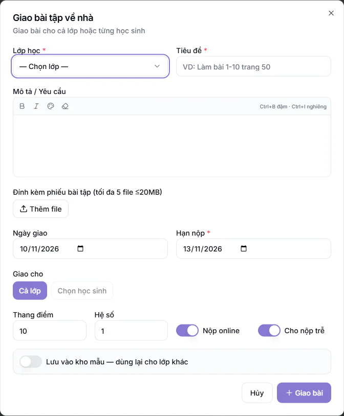

# Giao và chấm bài tập về nhà

Dùng khi bạn muốn giao bài cho lớp, biết em nào đã nộp, nhắc phụ huynh và ghi điểm, nhận xét cho từng em. Tính năng cần gói mở rộng **Cổng Phụ huynh**.

Vào **Bài tập về nhà**. Danh sách cho thấy mỗi bài với tên lớp, hạn nộp, số em **Đã nộp** và **Đã chấm**. Giáo viên và Trợ giảng chỉ giao và chấm bài của lớp mình phụ trách. Quản lý và Quản lý chi nhánh làm được với lớp thuộc cơ sở mình, Quản trị viên làm được mọi lớp.

## Giao bài tập mới

::: steps
1. Vào **Bài tập về nhà**, bấm **Tạo mới**. Hộp **Giao bài tập về nhà** hiện ra.
2. Chọn **Lớp học** và nhập **Tiêu đề** (cả hai bắt buộc). Ví dụ: lớp Toán 9A1, "Làm bài 1-10 trang 50".
3. Viết **Mô tả / Yêu cầu** nếu cần. Có thể đính kèm tối đa 5 file, mỗi file không quá 20MB, ở mục **Đính kèm phiếu bài tập**.
4. Chọn **Ngày giao** (mặc định hôm nay) và **Hạn nộp** (bắt buộc, mặc định sau 3 ngày).
5. Ở mục **Giao cho**, chọn **Cả lớp** (các em đang học trong lớp) hoặc **Chọn học sinh** rồi tích từng em.
6. Đặt **Thang điểm** (mặc định 10) và **Hệ số** (mặc định 1). Hai công tắc **Nộp online** và **Cho nộp trễ** mặc định đều bật.
7. Muốn dùng lại cho lớp khác, bật **Lưu vào kho mẫu - dùng lại cho lớp khác** và chọn **Độ khó**.
8. Bấm **Giao bài**.
:::

Giao xong, phụ huynh của các em được giao nhận thông báo bài tập mới.

## Giao từ kho bài tập mẫu

Ở trang **Bài tập về nhà**, bấm **Từ kho**, tìm và chọn một mẫu. Hộp giao bài mở ra với tiêu đề, mô tả, file đính kèm đã điền sẵn. Bạn chọn lớp, hạn nộp rồi bấm **Giao bài**.

## Theo dõi nộp bài và chấm điểm

Bấm vào một bài trong danh sách để mở chi tiết. Bạn thấy số **Tổng giao**, **Đã nộp**, **Đã chấm** và **Danh sách nộp bài** của từng em với trạng thái **Chưa nộp**, **Đã nộp**, **Nộp trễ**, **Đã chấm**.

::: steps
1. Ở dòng của em cần chấm, bấm **Chấm** (hoặc **Sửa** nếu đã chấm).
2. Xem bài em nộp và file đính kèm.
3. Nhập **Điểm** theo thang của bài (để trống nếu chỉ nhận xét) và viết **Nhận xét**.
4. Bấm **Lưu nhận xét** (hoặc **Lưu nhận xét + điểm**).
:::

Em nộp bài giấy: mở hộp chấm của em đó và bấm **Đánh dấu đã nộp (nộp giấy)**.

### Nhắc, đóng, xoá bài

Ở đầu trang chi tiết có các nút:

- **Nhắc chưa nộp**: gửi nhắc đến phụ huynh của các em đang ở trạng thái **Chưa nộp**. Nếu ai cũng nộp rồi, hệ thống báo "Tất cả đã nộp".
- **Đóng** / **Mở lại**: đóng bài khi hết hạn nhận, mở lại khi cần.
- Nút thùng rác: xoá bài. Hệ thống hỏi "Xoá bài tập này?" trước khi xoá.

::: warning Lưu ý
Bài đã có em nộp thì không xoá được, bạn chỉ **Đóng** bài.
:::

## Kho bài tập mẫu

Trong trang **Bài tập về nhà**, bấm **Quản lý kho** để mở **Kho bài tập mẫu**. Bấm **Tạo mẫu**, điền **Tiêu đề** (bắt buộc), **Mô tả**, **Môn học**, **Độ khó** (**Dễ**, **Trung bình**, **Khó**), đính kèm tối đa 5 file rồi bấm **Tạo**. Có ô tìm và lọc theo môn, độ khó. Mỗi mẫu cho biết đã dùng bao nhiêu lần. Nút thùng rác xoá mẫu. Giáo viên và Trợ giảng chỉ xoá được mẫu do chính mình tạo, Quản trị viên và quản lý xoá được mọi mẫu.

## Câu hỏi thường gặp

::: details Bài tập về nhà khác gì bài kiểm tra chấm bằng AI?
Bài tập về nhà là bài giao hằng ngày, thầy cô chấm tay và ghi điểm theo từng em. Chấm bằng AI dành cho bài kiểm tra giấy, xem [chấm bài AI](cham-bai-ai.md).
:::

::: details Giao nhầm lớp thì sao?
Nếu chưa em nào nộp, xoá bài rồi giao lại. Nếu đã có em nộp, đóng bài và giao bài mới cho đúng lớp.
:::

::: details Tôi không thấy lớp cần giao trong danh sách?
Giáo viên và Trợ giảng chỉ thấy lớp mình đang được phân công. Nhờ quản lý kiểm tra phân công lớp.
:::
