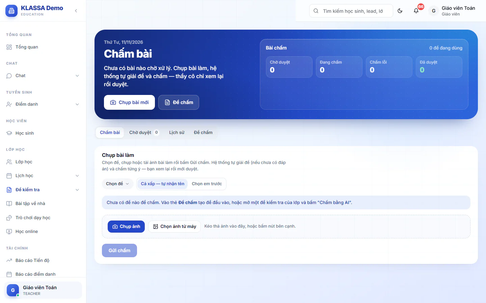
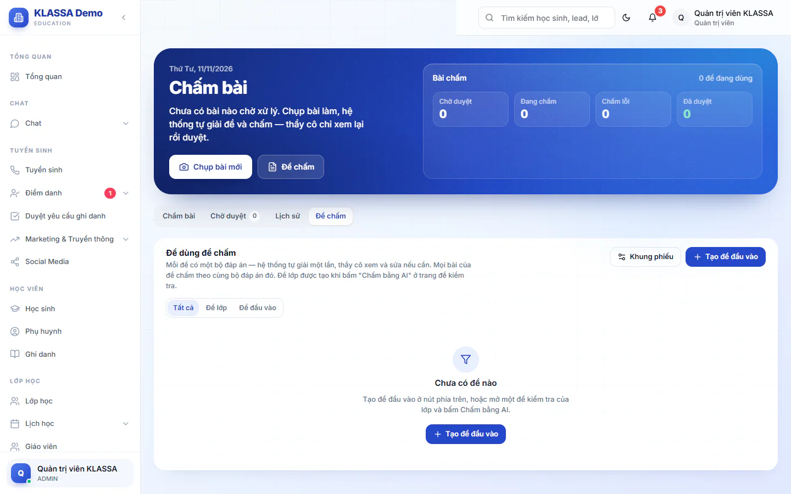

# Chấm bài kiểm tra bằng AI từ ảnh

Dùng khi bạn có một xấp bài kiểm tra giấy và muốn chấm nhanh. Bạn chụp ảnh bài làm, hệ thống tự giải đề (nếu chưa có đáp án) và chấm cả trắc nghiệm lẫn tự luận. Kết quả chỉ chính thức sau khi thầy cô xem lại và bấm **Duyệt**.

Tính năng cần gói mở rộng **AI — Gợi ý & Trợ lý Vận hành** và công tắc **Chấm bài kiểm tra bằng AI** đang bật. Lễ tân, Kế toán, Nhân sự không thấy mục này.

Vào **Đề kiểm tra → Chấm bài AI**. Trang có 4 thẻ: **Chấm bài**, **Chờ duyệt**, **Lịch sử**, **Đề chấm**. Phía trên có các con số **Chờ duyệt**, **Đang chấm**, **Chấm lỗi**, **Đã duyệt** để bạn nắm tình hình.

## Ai làm được gì

| Vai | Chụp và chấm | Sửa, duyệt, chấm lại | Xem **Lịch sử** |
| --- | --- | --- | --- |
| Quản trị viên | Mọi đề | Mọi bài | Toàn bộ |
| Quản lý chi nhánh | Đề thuộc cơ sở mình | Bài thuộc cơ sở mình | Toàn bộ, kể cả cơ sở khác |
| Quản lý | Đề thuộc cơ sở mình | Bài thuộc cơ sở mình | Bài thuộc cơ sở mình |
| Giáo viên, Trợ giảng | Đề của lớp mình dạy, đề đầu vào cùng cơ sở | Bài lớp mình dạy; bài đầu vào do mình chụp, đề do mình tạo hoặc lịch học thử được giao cho mình | Bài mình chụp và bài lớp mình dạy |

Nếu bạn chỉ được xem mà không được sửa, màn bài sẽ báo "Bạn chỉ xem được bài này".

## Chọn đề và gửi ảnh đi chấm

Mỗi lần chấm cần một **đề chấm**. Có hai loại: đề của lớp (tạo từ trang đề kiểm tra) và đề đầu vào (cho học sinh mới làm thử, xem phần **Đề chấm** bên dưới).

::: steps
1. Vào **Đề kiểm tra → Chấm bài AI**, mở thẻ **Chấm bài**.
2. Ở ô **Chọn đề**, chọn đề cần chấm.
3. Chọn **Cách nhận bài**:
   - **Cả xấp - tự nhận tên**: tải liền nhiều ảnh theo đúng thứ tự chụp. Hệ thống đọc tên ghi ở đầu bài rồi tự tách thành từng bài.
   - **Chọn em trước**: chọn học sinh trong lớp (đề lớp) hoặc lịch học thử (đề đầu vào), rồi gửi từng em. Với đề đầu vào, bạn cũng có thể gõ tên em vào ô **…hoặc gõ tên em**.
4. Bấm **Chụp ảnh** (trên điện thoại) hoặc **Chọn ảnh từ máy**. Bạn cũng có thể kéo thả ảnh vào khung.
5. Kiểm tra thứ tự ảnh. Bài có 2 trang thì chụp 2 ảnh liền nhau. Dùng mũi tên để dời ảnh lên trước hoặc ra sau, bấm dấu **X** để bỏ ảnh.
6. Bấm **Gửi chấm**.
:::

Gửi xong là bạn có thể đi làm việc khác, hệ thống chấm ngầm. Ở chế độ **Chọn em trước**, bấm **Xong lượt** sau khi gửi hết các em để theo dõi tiến độ.

::: tip Mẹo
Mỗi lượt nhận tối đa 60 ảnh, định dạng JPG, PNG hoặc WebP. Tệp khác bị bỏ qua. Chụp thẳng, đủ sáng, đủ cả tên ở đầu bài thì hệ thống nhận tên chính xác hơn.
:::

::: warning Lưu ý
Nếu đề chưa có đáp án, hệ thống tự giải khi chấm bài đầu tiên. Lúc đó bài ra kèm dòng "Đáp án do hệ thống tự động giải, chưa kiểm". Hãy mở thẻ **Đề chấm** để xem và sửa đáp án trước khi duyệt hàng loạt.
:::

## Xem lại và duyệt từng bài

Bài chấm xong nằm ở thẻ **Chờ duyệt**. Điểm chỉ vào bảng điểm sau khi bạn duyệt.

::: steps
1. Vào thẻ **Chờ duyệt**, bấm **Xem & duyệt** ở dòng cần xem.
2. Đối chiếu ảnh bài làm (bên trái) với kết quả (bên phải). Ô viền vàng là chỗ hệ thống chưa chắc, cần xem kỹ.
3. Sửa nếu cần. Bạn sửa được chữ cái học sinh chọn, điểm của câu tự luận, nhận xét từng ý, **Nhận xét của thầy cô**. Với bài đầu vào còn có **Lớp đề xuất** và **Lời khuyên xếp lớp**. Tổng điểm đổi theo ngay.
4. Ở khối **Bài này của ai?**, kiểm tra bài đã gắn đúng em chưa. Chọn em trong lớp (đề lớp) hoặc chọn lịch học thử (đề đầu vào). Bạn cũng sửa được **Tên viết trên bài**.
5. Bấm **Lưu** nếu muốn giữ phần sửa, rồi bấm **Duyệt**. Muốn qua bài kế tiếp luôn thì bấm **Duyệt & sang bài sau**.
:::

Sau khi duyệt:

- Bài của lớp: điểm vào bảng điểm. Phụ huynh chỉ thấy khi thầy cô **Công bố điểm** (xem [công bố điểm](cong-bo-diem.md)).
- Bài đầu vào: điểm, nhận xét và lớp đề xuất vào lịch học thử của em đó.

Các nút khác trên màn bài:

- **Chấm lại**: cho bài đang **Chờ duyệt** hoặc **Chấm lỗi**, hệ thống chấm lại từ đầu (mất phần bạn đã sửa chưa lưu).
- **Bỏ duyệt**: đưa bài đã duyệt về lại **Chờ duyệt** để sửa.
- **Xoá bài**: chỉ cho bài **Chờ duyệt** hoặc **Chấm lỗi**, hỏi lại "Xoá hẳn bài này?" trước khi xoá.

### Các cảnh báo trên bài

Bài có cảnh báo là bài cần xem kỹ hơn: **Có ý cần xem kỹ**, **Ảnh mờ, nên chụp lại**, **Chưa rõ tên**, **Trùng tên, cần chọn em**, **Tên không có trong lớp**, **Chấm theo đáp án cũ**.

::: danger Không thể hoàn tác
**Xoá bài** xoá hẳn bài khỏi hệ thống, không khôi phục được.
:::

## Duyệt nhanh nhiều bài

Ở thẻ **Chờ duyệt**, nếu có bài chờ duyệt mà bạn làm được và không có cảnh báo nào, nút **Duyệt N bài không có cờ** hiện ra (N là số bài). Bấm nút, xác nhận **Duyệt** để duyệt một lượt. Bài có cảnh báo phải mở từng bài.

Thẻ này cũng có ô tìm theo tên học sinh, lọc theo **Trạng thái** và theo **Đề**. Bài **Chấm lỗi** có nút **Chấm lại** ngay trên dòng.

## Lịch sử: ai chấm, ai sửa, ai duyệt

Thẻ **Lịch sử** liệt kê mọi bài bạn xem được, kèm cột **Người chụp**. Mở một bài và kéo xuống cuối để xem nhật ký từng lần: ai chụp, hệ thống chấm xong hay lỗi, ai bấm chấm lại, ai sửa ô nào (từ giá trị nào sang giá trị nào), ai gắn hồ sơ, ai duyệt hoặc bỏ duyệt.

## Gửi phiếu kết quả cho phụ huynh

Bài đã duyệt có phiếu kết quả chi tiết từng ý. Trên màn bài có 3 nút: **Tải PDF**, **Tải ảnh**, **Sao chép link**.

Link là một trang riêng, phụ huynh mở xem không cần đăng nhập và có nút tải phiếu. Trang chỉ hiện phiếu của bài đã duyệt, không hiện ảnh bài làm gốc. Hệ thống không tự gửi Zalo, bạn tự dán link vào tin nhắn. Nếu bạn bấm **Bỏ duyệt**, link không mở được nữa cho tới khi bài được duyệt lại.

## Đề chấm

Thẻ **Đề chấm** liệt kê các đề đang dùng để chấm, kèm trạng thái đáp án: **Chưa giải**, **Đang giải…**, **Sẵn sàng**, **Cần sửa**, và số bài chờ duyệt, đã duyệt. Lọc theo **Tất cả**, **Đề lớp**, **Đề đầu vào**.

- **Đề lớp**: mở một đề kiểm tra của lớp và bấm **Chấm bằng AI** ở thẻ "Chấm bằng AI từ ảnh". Đề soạn sẵn trong hệ thống thì lấy luôn câu hỏi và đáp án. Đề không có câu hỏi thì tải ảnh hoặc PDF đề lên một lần để hệ thống giải. Xem thêm [đề kiểm tra](bai-danh-gia.md).
- **Đề đầu vào**: bấm **Tạo đề đầu vào**. Điền **Tên đề** (bắt buộc), **Khối**, **Môn**, **Thang điểm**, tải **Đề** (ảnh hoặc PDF, bắt buộc, đúng thứ tự trang). **Đáp án có sẵn** là tuỳ chọn, không có thì hệ thống tự giải. Phần **Xếp lớp theo điểm** cho biết mức điểm nào đề xuất lớp nào.

Bấm **Mở đề** để xem và sửa đáp án, bấm **Lưu đáp án**. Khi bạn lưu đáp án mới, các bài chưa duyệt của đề tự chấm lại. Trong hộp này còn có **Hệ thống giải lại** (hoặc **Giải đáp án**), **Lưu bảng xếp lớp** (đề đầu vào), thay tệp đề và lưu trữ đề.

Quản trị viên còn có nút **Khung phiếu** để đặt số điện thoại, khẩu hiệu đầu phiếu và câu chân trang cho phiếu kết quả.

## Bật hoặc tắt tính năng

Quản trị viên bật hoặc tắt ở **Cài đặt**, thẻ **AI & Tự động**, mục **Tính năng AI**, công tắc **Chấm bài kiểm tra bằng AI** (mặc định bật). Khi tắt, việc chụp gửi, giải đề và chấm lại báo "Tính năng chấm bài bằng AI đang tắt". Xem lịch sử vẫn được.

## Câu hỏi thường gặp

::: details Điểm có vào bảng điểm ngay khi hệ thống chấm xong không?
Không. Chỉ khi thầy cô bấm **Duyệt** điểm mới vào bảng điểm, và phụ huynh chỉ thấy khi **Công bố điểm**.
:::

::: details Đáp án hệ thống giải sai thì sao?
Mở thẻ **Đề chấm**, bấm **Mở đề**, sửa đáp án rồi bấm **Lưu đáp án**. Các bài chưa duyệt tự chấm lại theo đáp án mới. Bài đã duyệt thì bấm **Bỏ duyệt** rồi **Chấm lại**.
:::

::: details Bài báo "Chấm lỗi" phải làm gì?
Bấm **Chấm lại**. Nếu vẫn lỗi, kiểm tra ảnh có rõ không hoặc đáp án của đề có đang ở trạng thái **Cần sửa** không.
:::

::: details Lễ tân có chấm bài AI được không?
Không. Chỉ Quản trị viên, Quản lý chi nhánh, Quản lý, Giáo viên và Trợ giảng.
:::
