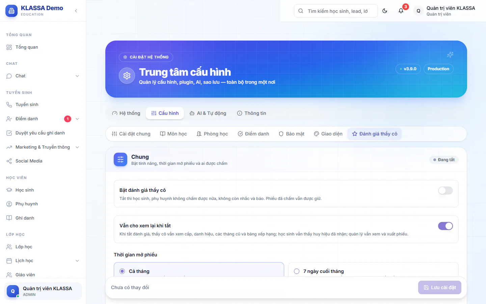

# Đánh giá thầy cô

Mỗi tháng, học sinh chấm sao giáo viên và trợ giảng của lớp mình. Trung tâm dùng kết quả để biết thầy cô nào được quý, còn thầy cô tích điểm để lên cấp và nhận danh hiệu. Thầy cô không bao giờ thấy tên em nào đã chấm.

Tính năng này **mặc định tắt**. Quản trị viên bật ở **Cấu hình hệ thống → Cài đặt**, rồi chọn tab **Cấu hình** và mục **Đánh giá thầy cô**.

## Bật và cài đặt (Quản trị viên)

::: steps
1. Vào **Cấu hình hệ thống → Cài đặt → Tổng quan**, bấm tab **Cấu hình**, chọn **Đánh giá thầy cô**. Từ trang **Đánh giá thầy cô**, bạn cũng bấm được nút **Cài đặt đánh giá**.
2. Trong khối **Chung**, gạt **Bật đánh giá thầy cô**. Hộp xác nhận hiện ra, bấm **Bật**.
3. Chỉnh các khối còn lại nếu cần (bảng dưới).
4. Bấm **Lưu cài đặt** ở thanh dưới cùng. Bấm **Hoàn tác** để bỏ các thay đổi chưa lưu.
:::

| Khối | Bạn chỉnh được |
| --- | --- |
| **Chung** | Bật hoặc tắt; **Vẫn cho xem lại khi tắt**; **Thời gian mở phiếu** (**Cả tháng** hoặc vài ngày cuối tháng, từ 1 đến 28 ngày); **Cho chấm trợ giảng**; **Cho phụ huynh chấm thay**; **Nhắc học sinh và phụ huynh** (nhắc lúc 19:00 những em còn thầy cô chưa chấm) |
| **Nội dung phiếu chấm** | **Chấm theo tiêu chí** (tối đa 6 tiêu chí, mặc định tắt); **Nhãn chọn nhanh** gồm nhãn **Khen** và nhãn **Góp ý** (số nhãn tối đa mỗi phiếu từ 1 đến 12); độ dài lời nhận xét từ 50 đến 2.000 ký tự. Lời nhận xét luôn là tuỳ chọn |
| **Điểm và cấp** | Điểm thầy cô nhận theo số sao của mỗi phiếu; trần điểm mỗi tháng; thưởng tháng đạt chuẩn; bộ tên cấp và ngưỡng điểm từng cấp |
| **Danh hiệu và huy hiệu** | **Ngôi sao tháng**; huy hiệu theo nhãn khen cho thầy cô; huy hiệu cho học sinh; **Sao thưởng** |
| **Ẩn tên và cảnh báo** | Số lượt tối thiểu thầy cô mới thấy kết quả (từ 1 đến 20); báo ngay khi có phiếu thấp; báo khi trung bình tháng của một thầy cô thấp |
| **Phiếu xuất gồm** | Chọn phần in trên phiếu PDF, ảnh và trang tổng hợp Excel |

Giá trị mặc định: điểm mỗi phiếu là 0, 0, 1, 3, 5 cho 1 đến 5 sao; trần 60 điểm mỗi tháng; thầy cô chỉ thấy kết quả khi có ít nhất 3 lượt; báo ngay phiếu từ 2 sao trở xuống (chỉ khi có lời nhận xét).

### Công tắc "Vẫn cho xem lại khi tắt"

Khi tắt tính năng:

- Công tắc này **bật**: chỉ dừng việc chấm, nhắc và báo. Thầy cô vẫn xem cấp, danh hiệu, các tháng cũ và bảng xếp hạng; học sinh vẫn thấy huy hiệu đã nhận; quản lý vẫn xem và xuất phiếu.
- Công tắc này **tắt**: mục này ẩn hết với học sinh, phụ huynh, thầy cô và quản lý chi nhánh. Dữ liệu vẫn được giữ, bật lại là hiện như cũ.

Mặc định công tắc này đang bật.

### Cấp, danh hiệu và huy hiệu

- Thầy cô tích điểm từ các phiếu để lên cấp. Cấp chỉ lên, không tụt. Cấp đầu tiên luôn bắt đầu từ 0 điểm, các ngưỡng sau phải tăng dần.
- Có ba bộ tên cấp mẫu để bấm **Dùng bộ này**: **Hạng thường** (Tân binh, Tận tâm, Được yêu thích, Xuất sắc, Huyền thoại), **Kiểu xếp hạng game** và **Tu tiên**. Bạn cũng tự đặt tên và ngưỡng từ 2 đến 10 cấp.
- **Ngôi sao tháng**: mỗi cơ sở chọn một thầy cô có sao trung bình cao nhất tháng, hiện suốt tháng sau. Thầy cô cần đủ số lượt chấm tối thiểu bạn đặt.
- Thầy cô nhận huy hiệu khi được chọn một nhãn khen đủ số lần (cộng dồn mọi tháng).
- Học sinh nhận huy hiệu góp ý theo số phiếu của chính em. Nếu bạn đặt **Sao thưởng** lớn hơn 0, em chấm đủ thầy cô trong tháng được cộng sao vào số dư đổi quà.

## Học sinh và phụ huynh chấm

Em chấm thầy cô của lớp đang học, khi thầy cô có phân công chính thức trong tháng và em đã có mặt ít nhất một buổi của lớp trong tháng đó. Giáo viên dạy thay không được chấm. Trợ giảng chỉ được chấm khi bạn bật **Cho chấm trợ giảng**.

Phụ huynh vào mục **Đánh giá thầy cô** trong cổng phụ huynh (hoặc app) để chấm giúp con khi bạn bật **Cho phụ huynh chấm thay**. Phiếu vẫn tính là phiếu của học sinh.

::: steps
1. Mở mục **Đánh giá thầy cô**, chọn thầy cô cần chấm.
2. Chấm sao tổng, hoặc **Chấm từng tiêu chí** nếu trung tâm bật tiêu chí.
3. Bấm **Chọn nhanh** vài nhãn khen hoặc góp ý, và gõ lời nhận xét nếu muốn.
4. Bấm **Gửi đánh giá**. Trong thời gian mở phiếu, bấm **Lưu thay đổi** để sửa lại.
:::

## Thầy cô xem kết quả

Giáo viên và trợ giảng vào **Đánh giá thầy cô** (menu bên trái). Có hai tab:

- **Của tôi**: **Cấp & danh hiệu** kèm số điểm còn thiếu để lên cấp tiếp; sao trung bình, trung bình từng tiêu chí, kết quả **Theo lớp**, **Phân bố sao**, nhãn **Được khen** và **Góp ý**, lời nhận xét, **Các tháng gần đây**. Khi lên cấp mới, hộp **Chúc mừng!** hiện ra.
- **Bảng xếp hạng**: xếp hạng thầy cô trong trung tâm.

Kết quả không kèm tên học sinh. Số lượt chấm chưa đủ ngưỡng ẩn tên (mặc định 3 lượt) thì kết quả chưa hiện, để không đoán ra em nào chấm.

## Quản lý theo dõi

Quản trị viên và Quản lý chi nhánh vào **Lớp học → Đánh giá thầy cô**. Có ba tab:

- **Bảng xếp hạng**: xếp hạng theo tháng, lọc theo cơ sở.
- **Cần xem**: các phiếu có tên học sinh. Bộ lọc **Phiếu thấp** (mặc định), **Tất cả**, **Đã ẩn**.
- **Phiếu & xuất**: **Tải PDF** hoặc **Tải ảnh** phiếu của từng thầy cô, **Tải PDF cả cơ sở** và **Tải Excel**.

### Ẩn phiếu không phù hợp

::: steps
1. Vào tab **Cần xem**, tìm phiếu cần ẩn.
2. Bấm **Ẩn phiếu**.
3. Nhập lý do (bắt buộc, lý do được ghi vào nhật ký) rồi xác nhận.
:::

Phiếu ẩn không còn tính vào điểm, sao trung bình và nhãn của thầy cô. Học sinh vẫn giữ huy hiệu góp ý. Bấm **Bỏ ẩn** ở bộ lọc **Đã ẩn** để tính lại bất cứ lúc nào.

### Cảnh báo phiếu thấp

Khi bật, Quản trị viên và Quản lý chi nhánh của cơ sở nhận thông báo ngay khi có phiếu từ số sao bạn đặt trở xuống (mỗi phiếu một lần), và khi trung bình tháng của một thầy cô thấp hơn ngưỡng (tối đa một lần mỗi tháng). Thầy cô bị chấm không nhận thông báo này.

## Câu hỏi thường gặp

::: details Thầy cô có biết em nào chấm mình không?
Không. Thầy cô chỉ thấy số liệu và lời nhận xét, không kèm tên học sinh. Chỉ Quản trị viên và Quản lý chi nhánh thấy tên ở tab **Cần xem**.
:::

::: details Bật rồi mà học sinh không thấy mục chấm?
Kiểm tra em có tài khoản học sinh hoặc phụ huynh có tài khoản chưa. Em cũng cần có mặt ít nhất một buổi trong tháng và phiếu chỉ mở trong **Thời gian mở phiếu** bạn đặt. Trang cài đặt có thể báo những lớp còn thiếu tài khoản.
:::

::: details Số liệu của tôi tới hết hôm qua?
Với thầy cô, số liệu tính tới hết hôm qua để khó đoán ra em nào vừa chấm. Dòng ghi chú ở đầu bảng cho biết số liệu đang tức thì hay tính tới hết hôm qua.
:::
