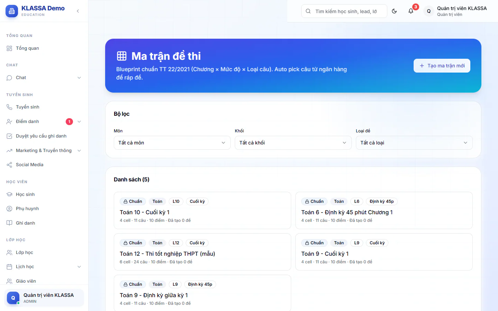

# Ma trận đề thi

Ma trận là bản thiết kế của một đề: đề có bao nhiêu câu ở mỗi chương, mỗi mức độ, mỗi loại câu, mỗi câu bao nhiêu điểm. Có ma trận rồi, bạn chỉ cần bấm **Tạo từ ma trận** là hệ thống tự chọn câu từ [Ngân hàng câu hỏi](ngan-hang-cau-hoi.md) để ráp đề, và các đề cùng ma trận luôn có cấu trúc giống nhau.

## Xem danh sách ma trận

Vào **Đề kiểm tra → Ma trận đề thi**.

Khung **Bộ lọc** có **Môn**, **Khối**, **Loại đề**. Mỗi ma trận hiện tên, môn, khối, loại đề, số ô, số câu, số điểm và số đề đã tạo từ ma trận đó. Ma trận có nhãn **Chuẩn** là ma trận mẫu của hệ thống.

Loại đề gồm: **Kiểm tra 15p**, **Định kỳ 45p**, **Giữa kỳ**, **Cuối kỳ**.

## Tạo ma trận mới

Chỉ Quản trị viên, Quản lý chi nhánh và Quản lý có nút tạo ma trận.

::: steps
1. Vào **Đề kiểm tra → Ma trận đề thi**, bấm **Tạo ma trận mới**. Hộp **Tạo ma trận mới** hiện ra.
2. Nhập **Tên ma trận** (bắt buộc, ít nhất 3 ký tự, ví dụ: Toán 9 - Định kỳ giữa kỳ 1).
3. Chọn **Môn** (bắt buộc), **Lớp**, **Loại đề**, và nhập **Tổng điểm** (từ 1 trở lên).
4. Bấm **Tạo**. Trang ma trận mở ra, bước tiếp theo là thêm các ô.
:::

## Thêm ô vào ma trận

Mỗi ô là một dòng yêu cầu, ví dụ "Chương 2, mức M2, trắc nghiệm, 4 câu, 0.25 điểm mỗi câu".

::: steps
1. Mở ma trận, bấm **Thêm cell**. Hộp **Thêm cell vào ma trận** hiện ra.
2. Chọn **Chương** (bắt buộc). Chương có dấu ⚡ là chương khác khối của ma trận, vẫn được phép chọn, ví dụ đề ôn thi tốt nghiệp gộp lớp 10, 11, 12.
3. Chọn **Đơn vị KT** nếu muốn chọn hẹp hơn.
4. Chọn **Mức độ** (M1, M2, M3, M4) và **Loại** (**Trắc nghiệm**, **Đúng/Sai**, **Trả lời ngắn**, **Tự luận**).
5. Nhập **Số câu** (từ 1) và **Điểm/câu**.
6. Bấm **Thêm**.
:::

Bảng **Cells** liệt kê từng ô với các cột **Chương**, **Đơn vị KT**, **Mức độ**, **Loại**, **Số câu**, **Điểm/câu**, **Tổng**. Đầu trang hiện tổng số câu và tổng điểm của các ô. Nếu tổng điểm các ô lệch quá 0.5 so với **Tổng điểm** của ma trận, hệ thống hiện cảnh báo màu vàng. Hãy chỉnh cho khớp.

Chỉ Quản trị viên, Quản lý chi nhánh và Quản lý thêm, khoá và xoá được ô.

Muốn bỏ một ô, bấm biểu tượng thùng rác ở cuối dòng và xác nhận **Xoá cell?**.

## Khoá câu hỏi cho một ô

Mặc định hệ thống chọn ngẫu nhiên. Nếu có câu bắt buộc phải xuất hiện, bạn khoá câu đó cho ô.

::: steps
1. Ở dòng ô cần khoá, bấm biểu tượng ổ khoá. Hộp **Khoá câu hỏi cụ thể cho cell** hiện ra.
2. Tìm và chọn câu trong danh sách câu phù hợp với ô. Bạn chọn nhiều nhất bằng **Số câu** của ô.
3. Bấm **Lưu**. Muốn bỏ khoá thì bấm **Bỏ tất cả khoá** rồi **Lưu**.
:::

Chọn ít hơn số câu của ô thì phần còn lại vẫn được chọn ngẫu nhiên. Ô có câu khoá hiện nhãn "... khoá" cạnh số câu.

## Tạo đề từ ma trận

Xem **Cách 3: Tạo từ ma trận** trong bài [Đề kiểm tra](bai-danh-gia.md). Bạn phải bấm **Preview pool** trước, hệ thống cho biết ngân hàng có đủ câu cho từng ô không rồi nút **Tạo đề** mới bấm được.

::: tip Mẹo
Ngân hàng cần đủ câu cho từng tổ hợp chương, mức độ, loại câu mà ma trận yêu cầu. Thiếu ô nào thì thêm câu vào ngân hàng ở đúng chương và mức độ đó.
:::

## Câu hỏi thường gặp

::: details Giáo viên có tạo được ma trận không?
Nút **Tạo ma trận mới** chỉ hiện với Quản trị viên, Quản lý chi nhánh và Quản lý. Giáo viên và Trợ giảng xem ma trận và dùng nó để tạo đề.
:::

::: details Vì sao bấm Tạo đề báo thiếu câu?
Ma trận đòi nhiều câu hơn số câu trong ngân hàng, hoặc các câu đã bị loại vì lớp vừa làm trong những đề gần nhất. Bạn thêm câu vào ngân hàng, hoặc chọn **Không loại trừ** ở ô **Tránh trùng với đề gần nhất**, hoặc tích **Vẫn tạo đề khi thiếu câu**.
:::
