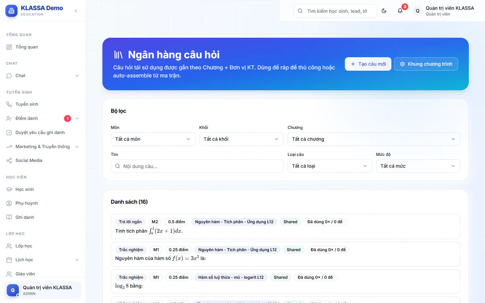
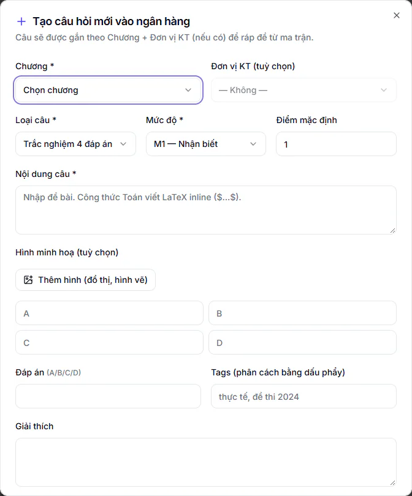

# Ngân hàng câu hỏi

Ngân hàng là kho câu hỏi dùng lại được. Mỗi câu gắn với một chương và một mức độ, nên bạn có thể ráp đề nhanh bằng cách chọn câu thủ công, hoặc để hệ thống tự chọn theo [ma trận đề thi](ma-tran-de-thi.md).

## Xem và lọc câu hỏi

Vào **Đề kiểm tra → Ngân hàng câu hỏi**.

Khung **Bộ lọc** có: **Môn**, **Khối**, **Chương**, **Tìm** (theo nội dung câu), **Loại câu**, **Mức độ**. Mỗi câu hiện các nhãn loại câu, mức độ, điểm, chương, và số lần dùng ("Đã dùng 3× / 2 đề"). Câu do AI soạn có nhãn **AI**, câu chia sẻ có nhãn **Shared**. Bấm vào câu để xem chi tiết.

Bốn loại câu: **Trắc nghiệm**, **Đúng/Sai**, **Trả lời ngắn**, **Tự luận** (khi tạo câu, hai loại đầu hiện đầy đủ là **Trắc nghiệm 4 đáp án** và **Đúng/Sai 4 ý**). Bốn mức độ: M1 Nhận biết, M2 Thông hiểu, M3 Vận dụng, M4 Vận dụng cao.

## Chuẩn bị: khung chương trình

Mỗi câu hỏi phải gắn với một chương, nên cần có chương trước. Bấm **Khung chương trình** ở đầu trang. Trang này chỉ Quản trị viên và Quản lý chi nhánh vào được, vai khác bấm vào sẽ bị báo không có quyền.

::: steps
1. Bấm **Tạo chương**. Hộp **Tạo chương mới** hiện ra.
2. Chọn **Môn** và **Lớp**, nhập **Thứ tự** và **Tên chương** (bắt buộc: **Môn** và **Tên chương**), bấm **Tạo**.
3. Nếu muốn chia nhỏ hơn, bấm **Thêm đơn vị** ở chương đó. Hộp **Thêm đơn vị KT** hiện ra, nhập **Tên đơn vị KT** (bắt buộc) và **Thứ tự**, bấm **Thêm**.
:::

Chương chỉ xoá được khi chưa có câu hỏi nào gắn vào.

## Tạo câu hỏi mới

::: steps
1. Vào **Đề kiểm tra → Ngân hàng câu hỏi**, bấm **Tạo câu mới**. Hộp **Tạo câu hỏi mới vào ngân hàng** hiện ra.

   

2. Chọn **Chương** (bắt buộc). Chọn **Đơn vị KT** nếu cần.
3. Chọn **Loại câu** và **Mức độ**, nhập **Điểm mặc định**.
4. Nhập **Nội dung câu** (bắt buộc). Công thức viết theo kiểu LaTeX trong dấu `$...$`. Có thể thêm hình minh hoạ.
5. Với câu trắc nghiệm, nhập đủ 4 đáp án A, B, C, D. Ô **Đáp án** nhập một chữ cái: A, B, C hoặc D. Câu Đúng/Sai nhập chuỗi như TTSS.
6. Nhập **Tags** (cách nhau bằng dấu phẩy) và **Giải thích** nếu muốn.
7. Tích **Chia sẻ cho toàn campus** nếu muốn người khác trong cơ sở dùng được câu này. Bỏ trống thì câu để riêng tư.
8. Bấm **Tạo câu**.
:::

::: warning Lưu ý
Đáp án của câu trắc nghiệm là **chữ cái** (A, B, C hoặc D), không phải nội dung đáp án. Nhập sai chữ cái, hệ thống báo "Đáp án MC phải là A/B/C/D".
:::

## Đưa câu từ đề vào ngân hàng

Nếu bạn đã soạn câu trong một đề, không cần gõ lại. Mở đề, vào tab **Câu hỏi**, bấm **Lưu vào ngân hàng**. Xem bài [Đề kiểm tra](bai-danh-gia.md).

## Xem, sửa, chia sẻ, xoá một câu

Bấm vào câu để mở trang chi tiết: nội dung, các lựa chọn, đáp án, giải thích, và danh sách đề đang dùng câu này. Người tạo câu, Quản trị viên, Quản lý chi nhánh và Quản lý có các nút:

- **Sinh lại AI**: AI viết lại câu. Các đề đang dùng câu này cũng tự cập nhật theo.
- **Sửa**: sửa loại câu, mức độ, nội dung, đáp án, điểm mặc định, tags, giải thích.
- **Chia sẻ** / **Hủy chia sẻ**: chuyển giữa **Đã chia sẻ campus** và **Riêng tư**.
- **Xoá**.

::: danger Không thể hoàn tác
Xoá câu khỏi ngân hàng không khôi phục được. Nếu câu đang được dùng trong đề, hệ thống cảnh báo "Câu này đang được dùng trong ... đề. Xoá sẽ làm các đề mất câu này." Hãy kiểm tra mục **Đang dùng trong ... đề kiểm tra** trước khi xoá.
:::

## Dùng câu hỏi để ráp đề

- Ráp tay: trong một đề, bấm **Thêm từ ngân hàng**, chọn nhiều câu rồi thêm vào.
- Ráp tự động: bấm **Tạo từ ma trận** ở **Danh sách đề**. Cần có đủ câu cho từng ô của ma trận.

## Câu hỏi thường gặp

::: details Vì sao không tạo được câu mới?
Câu hỏi bắt buộc gắn với một chương. Nếu danh sách **Chương** trống, nhờ Quản trị viên hoặc Quản lý chi nhánh tạo chương ở **Khung chương trình** trước.
:::

::: details Câu hỏi của tôi có bị giáo viên khác nhìn thấy không?
Chỉ khi bạn chia sẻ. Câu để **Riêng tư** thì chỉ bạn thấy, câu **Chia sẻ cho toàn campus** thì người khác trong cơ sở dùng được.
:::
