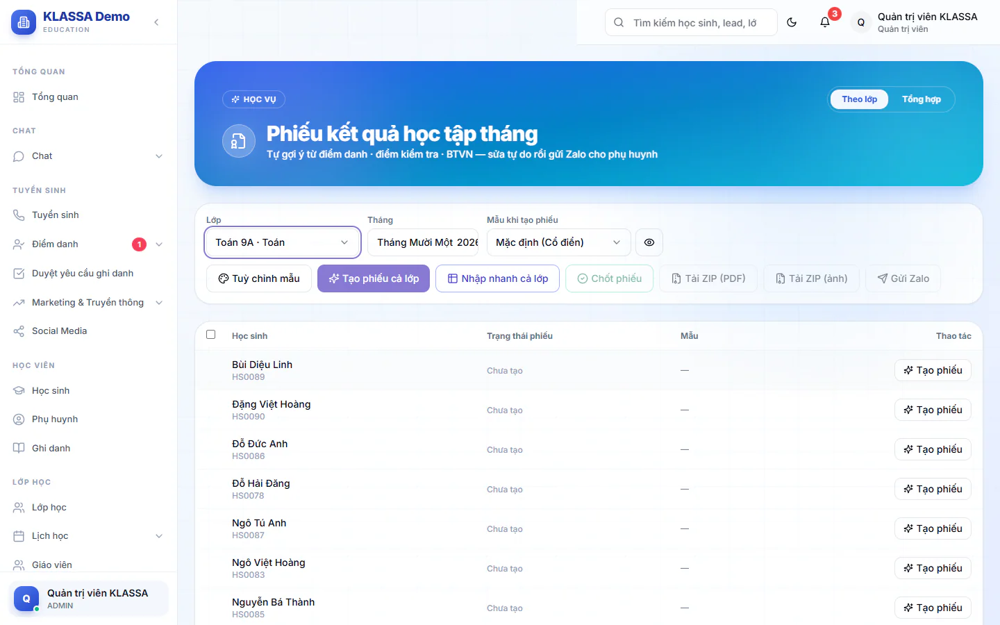
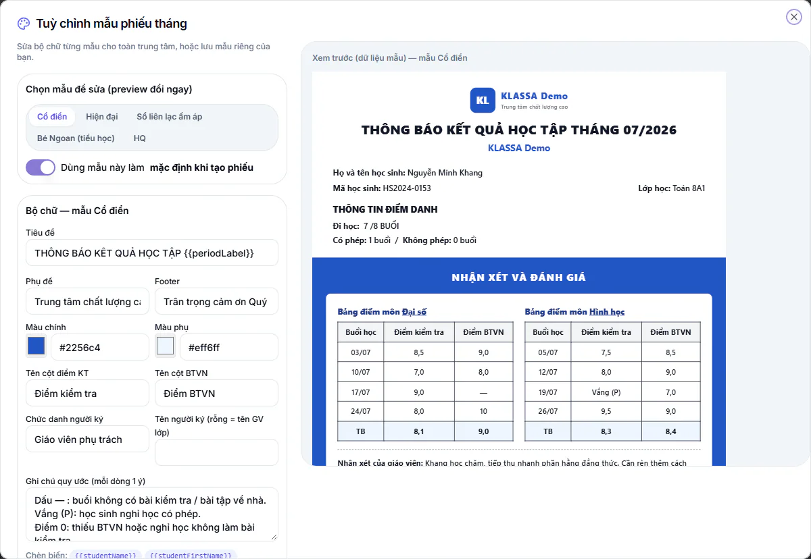

# Phiếu kết quả học tập tháng

Cuối mỗi tháng, mỗi học sinh có một tờ phiếu tổng kết gửi phụ huynh: số buổi đi học, bảng điểm từng buổi, nhận xét của giáo viên. Hệ thống dựng sẵn bản nháp từ dữ liệu có sẵn, bạn chỉ cần sửa lại rồi chốt và gửi.

Phiếu được **đóng băng** ngay khi tạo. Sau đó nếu ai sửa điểm danh hay điểm trong hệ thống thì phiếu đã tạo không tự đổi theo. Muốn lấy số liệu mới, bấm nút tạo lại (chỉ có ở phiếu nháp).

::: tip Đừng nhầm hai loại phiếu
Bài này nói về phiếu kết quả học tập (điểm, chuyên cần, nhận xét). Phiếu tiền học phí là chuyện khác: xem ở **Tài chính → Học phí**, và phụ huynh thấy ở mục **Phiếu thu** trên cổng phụ huynh, còn phiếu kết quả nằm ở mục **Phiếu tháng**. Xem thêm [Tổng quan học phí](../hoc-phi/tong-quan.md).
:::

## Ai dùng được và vào ở đâu

| Vai | Vào bằng | Phạm vi |
| --- | --- | --- |
| Quản trị viên, Quản lý chi nhánh, Quản lý | **Lớp học → Phiếu tháng** | Mọi lớp trong cơ sở mình quản lý, có thêm phiếu gộp nhiều lớp |
| Giáo viên, Trợ giảng | **Phiếu tháng lớp tôi** | Chỉ lớp mình được phân công |
| Lễ tân kiêm trợ giảng | **Phiếu tháng lớp tôi** | Chỉ lớp thường mình được xếp làm trợ giảng |

Lễ tân chưa được xếp trợ giảng lớp nào sẽ thấy thông báo **Không có quyền truy cập**.

## Phiếu lấy dữ liệu từ đâu

| Nội dung trên phiếu | Nguồn |
| --- | --- |
| Đi học, có phép, không phép | Tự lấy từ điểm danh các buổi trong tháng |
| Cột điểm kiểm tra | Tự lấy từ các bài kiểm tra mà phụ huynh đã được xem điểm |
| Cột điểm bài tập về nhà | Tự lấy từ bài tập về nhà đã chấm điểm |
| Nhận xét của giáo viên | Gợi ý từ nhận xét buổi học, bạn nên đọc và sửa lại |
| Xếp hạng lớp | Chỉ có khi bật xếp hạng (mặc định tắt) |
| Điểm kiểm tra tháng, lời nhắn (chỉ có ở mẫu thứ năm) | Giáo viên tự nhập |

## Tạo phiếu cho cả lớp

::: steps
1. Vào **Lớp học → Phiếu tháng** (giáo viên và trợ giảng vào **Phiếu tháng lớp tôi**).
2. Quản trị viên và quản lý đang ở tab **Theo lớp**. Chọn **Lớp** và **Tháng**.
3. Ở ô **Mẫu khi tạo phiếu**, chọn mẫu. Bấm biểu tượng con mắt bên cạnh (**Xem trước mẫu**) để xem thử bằng dữ liệu mẫu.
4. Bấm **Tạo phiếu cả lớp**. Hệ thống dựng phiếu **Nháp** cho mọi học sinh trong lớp.
:::

Bấm lại nhiều lần không sao: học sinh đã có phiếu được bỏ qua. Nếu bạn đổi ô **Mẫu khi tạo phiếu** rồi bấm lại, các phiếu nháp được đổi sang mẫu mới và vẫn giữ điểm, nhận xét đã nhập. Phiếu đã chốt không bị đụng tới.

Học sinh nào chưa có phiếu thì dòng đó có nút **Tạo phiếu** để tạo riêng.

Bảng danh sách có cột **Học sinh**, **Trạng thái phiếu** (Chưa tạo, Nháp, Đã chốt, Đã gửi Zalo), **Mẫu** và **Thao tác**.

### Năm mẫu có sẵn

**Cổ điển**, **Hiện đại**, **Sổ liên lạc ấm áp**, **Bé Ngoan (tiểu học)** và mẫu thứ năm (tên ngắn gồm hai chữ cái viết hoa, đứng cuối danh sách). Mẫu thứ năm có thêm khối **Điểm kiểm tra tháng** và mục **Lời nhắn**.

## Nhập điểm và nhận xét

Có hai cách. Nhập cả lớp trên một bảng thì nhanh hơn, sửa từng phiếu thì kỹ hơn.

### Nhập nhanh cả lớp

::: steps
1. Chọn lớp và tháng, bấm **Nhập nhanh cả lớp**. Bảng hiện ra, mỗi hàng là một học sinh.
2. Gõ vào các cột: **Chuyên cần**, điểm từng ngày (KT và BTVN), điểm kiểm tra tháng (chỉ mẫu thứ năm), **Nhận xét**, **Lời nhắn** (chỉ mẫu thứ năm). Bấm Tab để nhảy sang ô kế.
3. Học sinh nào có thay đổi sẽ có dấu sao cạnh tên.
4. Bấm **Lưu tất cả**.
:::

::: warning Lưu ý
Bảng chưa lưu cho tới khi bạn bấm **Lưu tất cả**. Phiếu đã chốt bị khoá, ô nhập không gõ được.
:::

**Điền hàng loạt bằng câu mẫu.** Ở thanh **Điền hàng loạt**, chọn **Nhận xét** hoặc **Lời nhắn**, bấm một câu mẫu hoặc tự gõ. Tích chọn các em cần điền (không chọn ai là áp cho cả lớp), rồi bấm **Điền cho ...**. Gõ `{{studentFirstName}}` để hệ thống tự thay bằng tên riêng của từng em.

**Nhờ AI soạn.** Bấm **AI soạn riêng từng em**. AI đọc điểm và chuyên cần của từng em rồi viết riêng, bám giọng văn các câu mẫu của trung tâm. Ô soạn phía trên dùng làm yêu cầu thêm cho AI. Kết quả chỉ điền vào bảng, chưa lưu.

::: warning Cần gói AI và công tắc AI
Nút này chỉ dùng được khi trung tâm có hai gói mở rộng **Nền tảng AI** và **AI — Gợi ý & Trợ lý Vận hành**, và công tắc **AI viết nhận xét phiếu tháng** đang bật. Công tắc mặc định bật, Quản trị viên chỉnh ở **Cài đặt**, thẻ **AI & Tự động**, mục **Tính năng AI**. Thiếu gói hoặc đã tắt công tắc thì hệ thống từ chối, bạn nhập nhận xét tay hoặc điền bằng câu mẫu như trên.
:::

::: tip Mẹo
Soạn sẵn câu mẫu ở **Tuỳ chỉnh mẫu → Câu mẫu để nhập hàng loạt**. Câu mẫu càng kỹ thì nhận xét AI viết ra càng giống giọng của trung tâm.
:::

::: warning Lưu ý
Luôn đọc lại nội dung AI viết trước khi gửi phụ huynh.
:::

Nếu lớp còn học sinh chưa có phiếu, thanh dưới bảng báo số học sinh và có nút **Tạo bổ sung**.

### Sửa từng phiếu

::: steps
1. Ở dòng học sinh, bấm biểu tượng bút chì (**Sửa**). Hộp **Sửa phiếu tháng** mở ra: bên trái là biểu mẫu, bên phải là tờ phiếu thật.
2. Bạn có thể bấm thẳng vào chỗ cần sửa trên tờ phiếu bên phải rồi gõ. Xong bấm ra ngoài là ăn.
3. Bấm **Lưu**, hoặc **Lưu & chốt phiếu** nếu đã xong.
:::

Biểu mẫu bên trái gồm: **Mẫu thiết kế** (đổi mẫu riêng cho phiếu này), thông tin chung, **Điểm danh**, các bảng điểm (có **Thêm dòng** và nút thêm bảng điểm cho lớp nhiều phân môn), **Xếp hạng lớp** (công tắc riêng cho phiếu này), **Nhận xét của giáo viên**. Mục **Chữ & hiển thị trên phiếu (riêng phiếu này)** cho đổi tiêu đề, chân trang, người ký chỉ ở phiếu đang mở.

## Chốt phiếu

Chốt nghĩa là xác nhận phiếu đã hoàn chỉnh. Chỉ phiếu đã chốt mới có link xem công khai, mã QR hoạt động và hiện trong cổng phụ huynh.

::: steps
1. Chốt một em: bấm **Chốt** ở dòng học sinh.
2. Chốt nhiều em: tích chọn các em rồi bấm **Chốt phiếu**. Không chọn ai thì chốt tất cả phiếu nháp. Hệ thống hỏi xác nhận trước khi chốt.
:::

**Mở lại phiếu đã chốt.** Chỉ Quản trị viên, Quản lý chi nhánh và Quản lý có nút **Mở lại** ở dòng học sinh. Phiếu về trạng thái Nháp để sửa, link chia sẻ tạm ngừng cho tới khi chốt lại. Nếu phiếu đã gửi Zalo, phụ huynh đang giữ ảnh cũ, nhớ gửi lại sau khi sửa.

## Gửi Zalo cho phụ huynh

Gửi Zalo cần gói mở rộng **Zalo (Cá nhân + OA)**.

Bạn cần liên kết Zalo cá nhân của mình ở **Cổng nhân viên → Zalo của tôi**. Phiếu được gửi bằng chính Zalo đó, và phụ huynh phải là bạn bè của nick này.

::: steps
1. Tích chọn các em cần gửi (không chọn ai là gửi mọi phiếu đã tạo).
2. Bấm **Gửi Zalo**. Hộp **Gửi phiếu qua Zalo cho phụ huynh** hiện danh sách các em.
3. Sửa lời nhắn kèm ảnh nếu muốn. Mặc định có hai biến: `[ten_hoc_sinh]` và `[thang]`.
4. Bấm **Bắt đầu gửi**. Phiếu nháp được chốt tự động trước khi gửi.
:::

Hệ thống gửi lần lượt từng em, giãn cách vài giây giữa các tin để nick Zalo an toàn. Muốn dừng giữa chừng, bấm **Dừng**. Em nào lỗi sẽ có lý do ngay ở dòng đó, ví dụ chưa có Zalo của phụ huynh hoặc ảnh phiếu quá 4MB.

## Tải về, lấy link và xoá

Ở mỗi dòng có các biểu tượng: **Xem**, **Sửa**, **Tải ảnh PNG**, **Tải PDF**, **Copy link**, **Xoá**. Phiếu nháp có thêm **Tạo lại từ dữ liệu gốc**, thao tác này đè lên các chỉnh sửa tay.

Trên thanh công cụ, **Tải ZIP (PDF)** và **Tải ZIP (ảnh)** tải mỗi học sinh một tệp riêng, gói chung trong một tệp ZIP.

**Copy link** chỉ dùng được khi phiếu đã chốt. Người nhận mở link không cần đăng nhập và tải được ảnh hoặc PDF.

Giáo viên và trợ giảng không xoá được phiếu đã chốt hoặc đã gửi, chỉ quản lý mới xoá được.

## Tuỳ chỉnh mẫu phiếu

Bấm **Tuỳ chỉnh mẫu**, chọn mẫu cần sửa, khung bên phải xem trước ngay. Bạn chỉnh được: tiêu đề, phụ đề, màu chính và màu phụ, tên cột điểm, chức danh và tên người ký, chân trang, ghi chú quy ước, **Câu mẫu để nhập hàng loạt**, và các công tắc trong **Mục hiển thị trên phiếu**:

- Thông tin điểm danh
- Bảng điểm
- Hiển thị xếp hạng lớp (mặc định tắt)
- Nhận xét giáo viên
- Ghi chú quy ước
- Mã QR link phiếu

Có hai nút lưu:

- **Lưu làm mẫu của tôi**: chỉ áp dụng cho phiếu bạn tạo.
- **Lưu mẫu trung tâm**: áp dụng cho cả trung tâm, chỉ Quản trị viên và quản lý có nút này. Bạn quay lại mẫu chung bằng **Về mẫu trung tâm**.

Mẫu chỉ ảnh hưởng phiếu tạo mới. Phiếu cũ giữ nguyên chữ đã đóng băng.

## Phụ huynh xem phiếu ở đâu

Phụ huynh vào mục **Phiếu tháng** trong cổng phụ huynh để xem các phiếu đã chốt của con. Mục này nằm trong gói **Cổng Phụ huynh** và Quản trị viên có thể bật hoặc tắt trong phần thiết lập cổng phụ huynh ở **Quản trị hệ thống → Thương hiệu**. Xem thêm [cổng phụ huynh](../cong-phu-huynh/gioi-thieu.md).

## Câu hỏi thường gặp

::: details Vì sao phiếu không đổi dù tôi đã sửa điểm?
Phiếu đóng băng ngay khi tạo. Với phiếu nháp, bấm **Tạo lại từ dữ liệu gốc** để lấy số liệu mới, lưu ý thao tác này đè mọi chỉnh sửa tay. Phiếu đã chốt thì **Mở lại** trước (quản lý làm).
:::

::: details Tôi không thấy nút Mở lại hay tab Tổng hợp?
Hai thứ này chỉ dành cho Quản trị viên, Quản lý chi nhánh và Quản lý. Tab **Tổng hợp** tạo phiếu gộp mọi lớp của một học sinh trong tháng: bạn gõ tên hoặc mã học sinh để tìm, rồi bấm vào tên để tạo.
:::

::: details Gửi Zalo báo lỗi thì làm sao?
Đọc lý do ở dòng của em đó. Thường gặp: bạn chưa liên kết Zalo cá nhân, chưa bật gói Zalo, nick Zalo đang đăng xuất, hoặc phụ huynh chưa có số Zalo trong hồ sơ.
:::

::: details Giáo viên có xem được phiếu lớp khác không?
Không. Giáo viên và trợ giảng chỉ thấy và làm phiếu cho lớp mình được phân công.
:::
