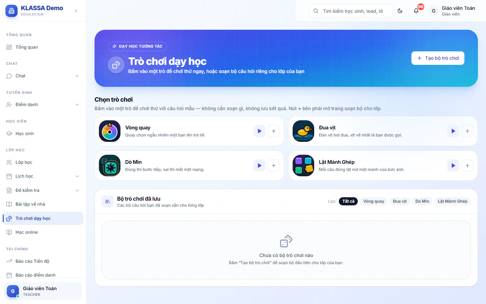
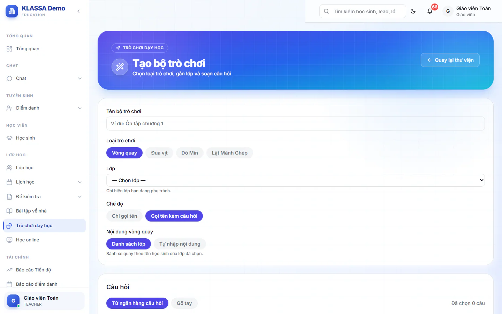

# Trò chơi dạy học

Trò chơi giúp buổi học sôi nổi hơn: giáo viên chiếu màn hình lên lớp, gọi học sinh lên trả lời bằng vòng quay hoặc đua vịt, hoặc cả lớp cùng trả lời để dò mìn và lật mảnh ghép. Bạn có thể chơi thử ngay với câu hỏi mẫu, hoặc soạn bộ câu hỏi riêng cho lớp mình.

Vào **Lớp học → Trò chơi dạy học**. Trang có hai phần: **Chọn trò chơi** và **Bộ trò chơi đã lưu**.

## Bốn trò chơi

| Trò chơi | Cách chơi |
| --- | --- |
| **Vòng quay** | Quay chọn ngẫu nhiên một bạn lên trả lời. |
| **Đua vịt** | Đàn vịt bơi đua, vịt về nhất là bạn được gọi. |
| **Dò Mìn** | Đúng thì bước tiếp, sai thì mất một mạng. |
| **Lật Mảnh Ghép** | Mỗi câu đúng lật mở một mảnh của bức ảnh. |

## Chơi thử

Bấm vào một trò ở phần **Chọn trò chơi** để chơi thử với câu hỏi mẫu. Chơi thử không cần soạn gì và không lưu kết quả, phù hợp để làm quen hoặc giới thiệu trò với lớp.

## Soạn bộ trò chơi cho lớp

::: steps
1. Vào **Lớp học → Trò chơi dạy học**.
2. Bấm **Tạo bộ trò chơi**, hoặc bấm dấu **+** ở bên phải thẻ một trò để tạo luôn bộ cho trò đó.
3. Điền **Tên bộ trò chơi** (bắt buộc), ví dụ Ôn tập chương 1.
4. Chọn **Loại trò chơi** và **Lớp**. Danh sách chỉ hiện lớp bạn đang phụ trách.
5. Thiết lập riêng của từng trò (bảng dưới).
6. Thêm câu hỏi ở phần **Câu hỏi**.
7. Bấm **Tạo bộ trò chơi**.
:::

Sau khi lưu, bạn sửa được tên, lớp, thiết lập và câu hỏi, nhưng không đổi được loại trò chơi.

### Thiết lập riêng của từng trò

| Trò | Ô cần chọn |
| --- | --- |
| **Vòng quay**, **Đua vịt** | **Chế độ**: **Chỉ gọi tên** hoặc **Gọi tên kèm câu hỏi**. Chọn **Chỉ gọi tên** thì không cần câu hỏi |
| **Vòng quay** | **Nội dung vòng quay**: **Danh sách lớp** (quay theo tên học sinh của lớp) hoặc **Tự nhập nội dung** (gõ từng ô, mỗi ô có tỉ lệ trúng; tối đa 40 ô, tỉ lệ tối đa 99) |
| **Dò Mìn** | **Số mạng** từ 1 đến 9 (mặc định 3) |
| **Lật Mảnh Ghép** | **Số mảnh ghép** từ 4 đến 20 (mặc định 6); **Đường dẫn ảnh cần đoán**, tức địa chỉ của tấm ảnh sẽ được lật dần |

::: warning Lưu ý
Vòng quay **Tự nhập nội dung** không ghi lượt cho học sinh nào, vì các ô không phải tên học sinh. Nếu mọi ô đều có tỉ lệ 0 thì không lưu được, vì không ô nào trúng.
:::

Bộ **Lật Mảnh Ghép** chưa có ảnh vẫn chơi được: các mảnh vẫn lật, chỉ không có tranh phía sau.

### Thêm câu hỏi

Ở phần **Câu hỏi** có hai cách:

- **Từ ngân hàng câu hỏi**: tìm bằng ô **Tìm câu hỏi…** rồi chọn. Chỉ câu trắc nghiệm có đủ lựa chọn và đáp án đúng mới dùng được. Xem [ngân hàng câu hỏi](ngan-hang-cau-hoi.md).
- **Gõ tay**: bấm **Thêm câu hỏi**, nhập **Đề bài**, các lựa chọn (**Thêm lựa chọn** nếu cần), rồi bấm **Đáp án đúng** ở lựa chọn đúng.

Mỗi bộ cần ít nhất một câu hỏi, trừ vòng quay hoặc đua vịt ở chế độ **Chỉ gọi tên**.

## Chơi bộ đã lưu trên lớp

::: steps
1. Ở phần **Bộ trò chơi đã lưu**, tìm bộ cần chơi. Dùng nhóm **Lọc** (**Tất cả** hoặc từng loại trò) để thu gọn danh sách.
2. Bấm **Chơi**. Bộ phải đã gắn lớp, nếu chưa thì hệ thống báo bạn sửa bộ và chọn lớp trước.
3. Chiếu màn hình lên lớp và chơi theo trò:
   - **Vòng quay**: bấm **Quay**. Sau khi trúng tên, bấm **Trả lời câu hỏi** nếu chơi kèm câu hỏi, hoặc **Quay lần nữa**.
   - **Đua vịt**: bấm **Xuất phát**, vịt về nhất là bạn được gọi. Sau đó bấm **Trả lời câu hỏi** hoặc **Đua lại** (nút ở màn kết quả; ngoài sân là **Đua tiếp**).
   - **Dò Mìn**: cả lớp trả lời từng câu. Đúng thì qua ô an toàn, sai thì mất một mạng.
   - **Lật Mảnh Ghép**: mỗi câu đúng mở thêm một mảnh. Mở hết thì cả lớp ngắm bức tranh trọn vẹn.
4. Hết buổi, bấm **Kết thúc** (ở Dò Mìn và Lật Mảnh Ghép khi hết trò là **Kết thúc và lưu kết quả**) để chốt buổi chơi.
:::

Mỗi lượt chơi được hệ thống chấm đúng sai và ghi lại theo lớp. Màn chơi có nút bật hoặc tắt âm thanh.

### Công cụ của Vòng quay và Đua vịt

- **Không gọi trùng**: mỗi bạn chỉ được gọi một lần trong vòng. Khi đã gọi hết cả lớp, bấm **Đặt lại lượt gọi** để bắt đầu vòng mới.
- **Tỉ lệ**: chỉnh tỉ lệ trúng của từng ô ngay trên sân khấu. Đặt 0 để tạm bỏ qua một ô. Chỉnh này chỉ áp dụng trong buổi đang chiếu.

## Sửa, xoá bộ trò chơi

Ở thẻ mỗi bộ có nút bút chì (**Sửa**) và thùng rác (**Xoá**). Bộ đã có lịch sử chơi của học sinh không bị xoá hẳn mà được đưa vào lưu trữ để giữ lại lịch sử. Bộ chưa ai chơi thì xoá luôn.

## Câu hỏi thường gặp

::: details Vì sao bấm Chơi mà không vào được?
Có thể bộ chưa gắn lớp. Bấm nút sửa, chọn **Lớp** rồi lưu lại.
:::

::: details Chơi thử khác chơi thật chỗ nào?
Chơi thử dùng câu hỏi mẫu, chạy ngay trên máy bạn và không ghi lại gì. Chơi bộ đã lưu thì có buổi chơi riêng cho lớp và các lượt trả lời được ghi lại.
:::

::: details Trợ giảng có tạo được bộ trò chơi không?
Có. Giáo viên và trợ giảng đều dùng được mục này, và chỉ chọn được lớp mình phụ trách.
:::
