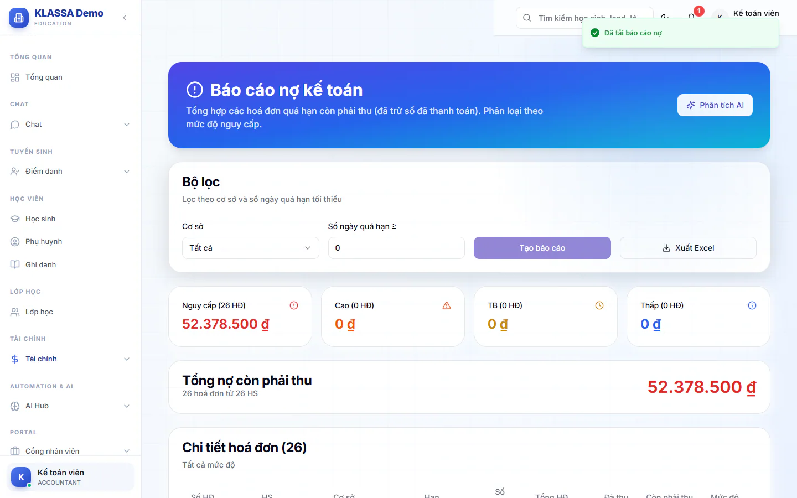

# Nợ kế toán

Báo cáo này tổng hợp các phiếu quá hạn còn phải thu (đã trừ số đã thanh toán) và xếp theo mức nguy cấp để bạn biết nên ưu tiên phiếu nào.

## Tạo báo cáo

::: steps
1. Vào **Tài chính → Báo cáo → Nợ kế toán**. Tiêu đề trang là **Báo cáo nợ kế toán**.
2. Chọn **Cơ sở** (mặc định **Tất cả**).
3. Nhập **Số ngày quá hạn ≥** nếu chỉ muốn xem phiếu quá hạn từ số ngày đó trở lên.
4. Bấm **Tạo báo cáo**.
:::

## Mức nguy cấp

Bốn thẻ chia phiếu theo số ngày quá hạn, mỗi thẻ cho số hoá đơn và số tiền:

| Mức | Số ngày quá hạn |
|---|---|
| **Nguy cấp** | trên 30 ngày |
| **Cao** | 15-30 ngày |
| **TB** | 8-14 ngày |
| **Thấp** | từ 7 ngày trở xuống |

Bấm vào một thẻ để bảng chi tiết chỉ còn phiếu của mức đó. Bấm lại lần nữa để bỏ lọc.

## Đọc kết quả

- Ô **Tổng nợ còn phải thu** cho tổng tiền, kèm số hoá đơn và số học sinh.
- Bảng **Chi tiết hoá đơn** có các cột: **Số HĐ**, **HS**, **Cơ sở**, **Hạn**, **Số ngày**, **Tổng HĐ**, **Đã thu**, **Còn phải thu**, **Mức độ**.

## Xuất Excel và phân tích

Bấm **Xuất Excel** để tải bảng. Nút chỉ bấm được sau khi đã tạo báo cáo. Nút **Phân tích AI** ở đầu trang nhờ trợ lý AI nhận xét số liệu.

## Câu hỏi thường gặp

::: details Khác gì Báo cáo nợ quá hạn?
Hai trang đều nói về phiếu quá hạn. [Báo cáo nợ quá hạn](qua-han.md) có thêm chức năng nhắc phụ huynh. **Nợ kế toán** tập trung vào tổng tiền, mức nguy cấp và cơ sở, phù hợp để đối chiếu sổ sách.
:::

::: details Muốn xem nợ theo từng học sinh?
Dùng [Quản lý công nợ](cong-no.md).
:::
