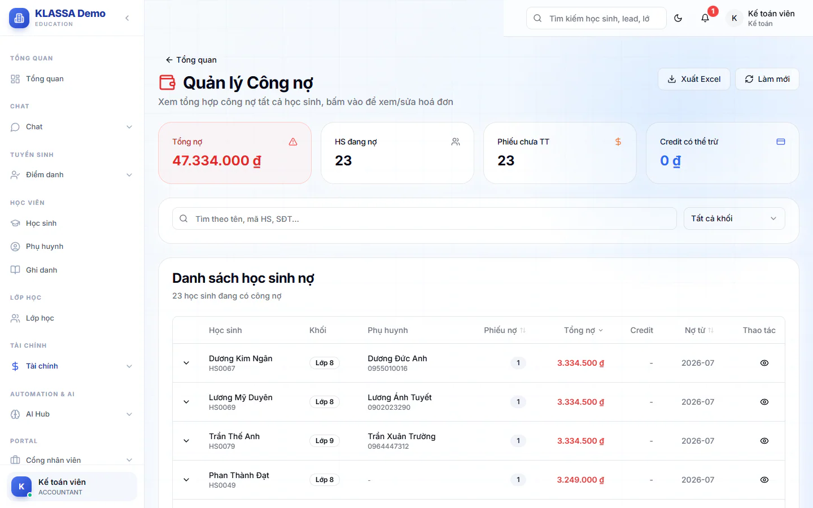

# Quản lý công nợ

Trang này cho bạn cái nhìn theo học sinh: em nào đang nợ, nợ mấy phiếu, tổng bao nhiêu, còn credit hay không. Dùng khi cần rà nợ để gọi phụ huynh hoặc quyết định xử lý từng em.

Muốn nhắc nợ hàng loạt thì dùng [Thu hồi công nợ](thu-hoi-cong-no.md). Muốn xem theo từng phiếu quá hạn thì dùng [Báo cáo nợ quá hạn](qua-han.md).

## Xem danh sách học sinh đang nợ

::: steps
1. Vào **Tài chính → Kế toán → Quản lý công nợ**.
2. Xem bốn ô tổng hợp trên cùng: **Tổng nợ**, **HS đang nợ**, **Phiếu chưa TT**, **Credit có thể trừ**.
3. Gõ vào ô **Tìm theo tên, mã HS, SĐT...** hoặc chọn **Khối** để thu hẹp danh sách.
4. Bấm tiêu đề cột **Phiếu nợ**, **Tổng nợ** hoặc **Nợ từ** để sắp xếp.
:::

Mỗi dòng cho biết học sinh, khối, phụ huynh, số phiếu nợ, tổng nợ, credit của em và tháng nợ sớm nhất (cột **Nợ từ**).

## Xem các phiếu nợ của một học sinh

::: steps
1. Bấm vào dòng của học sinh. Dòng mở rộng ra bảng phiếu với các cột **Mã phiếu**, **Tháng**, **Tổng**, **Đã trả**, **Còn nợ**, **Trạng thái**.
2. Trạng thái có ba mức: **Chưa TT**, **Thanh toán 1 phần**, **Đã TT**.
3. Bấm **Xem hoá đơn** ở một phiếu để nhảy sang [Hoá đơn chi tiết](hoa-don-chi-tiet.md) và tìm đúng phiếu đó.
4. Bấm biểu tượng con mắt ở cuối dòng học sinh để tìm mọi hoá đơn của em.
:::

Nếu học sinh còn credit, dưới bảng phiếu có dòng nhắc số credit khả dụng kèm liên kết **Áp dụng credit**. Liên kết này mở trang [Credit khả dụng](credit-kha-dung.md). Credit trừ vào phiếu bằng ô **Khấu trừ Credit** khi sửa hoá đơn.

## Xuất Excel

Bấm **Xuất Excel** để tải danh sách đang hiển thị (theo bộ lọc hiện tại). Bấm **Làm mới** nếu muốn tải lại số liệu mới nhất.

::: tip Mẹo
Sắp xếp theo **Nợ từ** để thấy những em nợ lâu nhất trước, đây thường là nhóm cần gọi điện trực tiếp.
:::

## Câu hỏi thường gặp

::: details Sao học sinh không có trong danh sách?
Trang chỉ liệt kê học sinh đang có phiếu chưa thanh toán đủ. Phiếu đã miễn hết nhờ [chốt thoả thuận](hoa-don-chi-tiet.md) không còn tính là nợ.
:::
