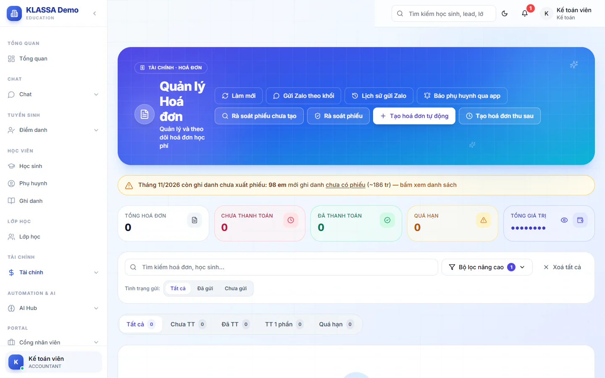

# Hoá đơn chi tiết

Trang này là nơi bạn tra từng hoá đơn học phí: ai đã đóng, ai còn nợ, số tiền gồm những khoản nào. Bạn cũng sửa hoá đơn, ghi nhận thu tiền và xử lý các ca đặc biệt tại đây.

Cách tạo hoá đơn hàng loạt và cách gửi hoá đơn cho phụ huynh xem ở [Tạo hoá đơn](../hoc-phi/tao-hoa-don.md) và [Gửi hoá đơn qua Zalo](../hoc-phi/gui-hoa-don-zalo.md).

## Tìm hoá đơn

::: steps
1. Vào **Tài chính → Kế toán → Hoá đơn chi tiết**. Tiêu đề trang là **Quản lý Hoá đơn**.
2. Gõ vào ô **Tìm kiếm hoá đơn, học sinh...** để tìm theo mã hoá đơn hoặc tên học sinh.
3. Bấm **Tất cả**, **Đã gửi** hoặc **Chưa gửi** ở dòng **Tình trạng gửi** để lọc theo việc đã gửi phụ huynh hay chưa.
4. Cần lọc kỹ hơn thì bấm **Bộ lọc nâng cao**, rồi chọn: **Từ ngày**, **Đến ngày**, **Kỳ hoá đơn**, **Nguồn tạo**, **Tiền từ (VNĐ)**, **Tiền đến (VNĐ)**. Ô lọc theo khối, lớp và giáo viên cũng nằm ở đây.
5. Bấm **Xoá tất cả** để bỏ mọi bộ lọc.
:::

Bảng danh sách có các cột: **Mã HĐ**, **Học sinh**, **Ngày tạo**, **Số tiền**, **Hạn nộp**, **Trạng thái**, **Đã gửi**, **Thao tác**.

Phiếu có nhãn **Cần xem** là phiếu mà hệ thống tự rà soát thấy có điểm bất thường. Nhãn này chỉ để cảnh báo, không chặn việc gì. Bấm vào nhãn để mở phần rà soát đúng phiếu đó.

## Các nút ở đầu trang

- **Làm mới**: tải lại danh sách.
- **Rà soát phiếu chưa tạo**: liệt kê học sinh đã ghi danh nhưng tháng này chưa có phiếu, hoặc có phiếu nhưng thiếu môn. Từ danh sách này bạn có thể tạo phiếu bổ sung cho học sinh đó, phiếu cũ đã gửi hay đã thu không bị đụng tới.
- **Rà soát phiếu**: chọn **Kỳ (tháng)** và **Khối** rồi bấm quét để tìm phiếu nghi sai. Mỗi phiếu có đề xuất sửa, bạn xem trước rồi mới áp dụng.
- **Tạo hoá đơn tự động** và **Tạo hoá đơn thu sau**: xem [Tạo hoá đơn](../hoc-phi/tao-hoa-don.md).
- **Gửi Zalo theo khối**, **Lịch sử gửi Zalo**, **Báo phụ huynh qua app**: gửi và theo dõi việc gửi phiếu. Việc gửi phiếu cho phụ huynh xem thêm ở bài Gửi hoá đơn qua Zalo.

## Xem và sửa một hoá đơn

::: steps
1. Ở dòng hoá đơn, bấm biểu tượng con mắt (gợi ý **Xem chi tiết**). Hộp **Chi tiết hóa đơn** hiện ra.
2. Xem các phần: thông tin học sinh, bảng môn học (số buổi, đơn giá, thành tiền, nợ cũ, khấu trừ), **Tổng kết tài chính**, lịch sử thanh toán, lịch sử nhắc nợ.
3. Bấm **Sửa hóa đơn** để chỉnh. Bạn sửa được số buổi, đơn giá, nợ kỳ trước, khấu trừ credit, phụ thu và ghi chú hiện trên phiếu.
4. Bấm **Lưu thay đổi**, hoặc **Hủy** để bỏ.
5. Bấm **Xuất PDF** nếu cần bản in.
:::

Ô **Khấu trừ Credit (VNĐ)** là số tiền thừa của học sinh được trừ vào phiếu này. Bấm **Áp lại credit** để hệ thống tính lại bằng số credit đang có, tối đa bằng học phí. Credit là gì: xem [Báo cáo Credit](tin-chi.md).

::: warning Lưu ý
Hoá đơn đã phát hành hoá đơn điện tử thì nút **Sửa hóa đơn** bị khoá. Cần huỷ hoá đơn điện tử trước rồi mới sửa.
:::

## Ghi nhận thu tiền

Ở dòng hoá đơn còn nợ, bấm biểu tượng ghi nhận thanh toán (gợi ý **Ghi nhận thanh toán**), điền số tiền rồi lưu. Phiếu đóng đủ chuyển sang **Đã thanh toán**, đóng một phần chuyển sang **Thanh toán một phần**.

## Chốt thoả thuận (miễn phần còn nợ)

Dùng khi phụ huynh thoả thuận đóng ít hơn và trung tâm đồng ý miễn phần còn lại. Phần miễn được ghi trên phiếu kèm lý do và người chốt, phiếu không còn bị tính là nợ.

::: steps
1. Mở **Chi tiết hóa đơn** của phiếu còn nợ.
2. Bấm **Chốt thoả thuận**. Nút chỉ hiện với Quản trị viên, Quản lý chi nhánh và Kế toán, và chỉ khi phiếu chưa đóng đủ.
3. Nhập **Số tiền miễn (VNĐ)**, từ 1 đến số còn nợ. Miễn đúng bằng số còn nợ thì phiếu chuyển **Đã thanh toán**. Miễn ít hơn thì phần còn lại vẫn là nợ.
4. Nhập **Lý do (bắt buộc)**: ai chốt, chốt thế nào.
5. Bấm nút **Miễn ...đ** để xác nhận.
:::

### Gỡ chốt thoả thuận

Chốt nhầm thì gỡ được. Chỉ Quản trị viên làm được.

::: steps
1. Mở **Chi tiết hóa đơn** của phiếu đã miễn. Dòng **Đã miễn theo thoả thuận** hiện số tiền đã miễn.
2. Bấm **Gỡ chốt** cạnh dòng đó.
3. Nhập **Lý do gỡ (bắt buộc)**, bấm **Gỡ chốt**.
:::

Sau khi gỡ, phiếu tính nợ lại phần từng miễn, nhắc nợ và báo cáo sẽ đòi lại như chưa từng chốt. Nút này không hiện nếu phiếu đã phát hành hoá đơn điện tử hoặc đã huỷ.

## Mở khoá phiếu đã thanh toán

Phiếu **Đã thanh toán** muốn sửa lại thì Quản trị viên bấm **Mở khóa (ADMIN)** trong hộp chi tiết. Thao tác được ghi vào nhật ký.

## Xoá hoá đơn

Chỉ Quản trị viên và Quản lý chi nhánh thấy lệnh xoá. Mở menu **Thao tác khác** ở dòng hoá đơn và chọn **Xoá hoá đơn**, hoặc tích nhiều phiếu rồi bấm **Xoá**.

::: danger Không thể hoàn tác
Xoá hoá đơn đã có thu tiền sẽ xoá luôn các khoản thanh toán của phiếu đó. Với phiếu không ở trạng thái chưa thanh toán, hệ thống yêu cầu bạn nhập mật khẩu và gõ lại mã hoá đơn để xác nhận. Xoá hàng loạt luôn yêu cầu mật khẩu và gõ lại số lượng phiếu. Chỉ dùng để dọn dữ liệu nhập nhầm hoặc dữ liệu thử.
:::

## Thao tác hàng loạt

Tích ô vuông ở đầu các dòng, thanh công cụ hiện ra:

- **Tải PDF (n)**: tải nhiều phiếu một lần, tối đa 50 phiếu.
- **Gửi Zalo (n)**: gửi các phiếu đã chọn. Nếu trong đó có phiếu **Cần xem**, hệ thống nhắc bạn kiểm tra trước khi gửi.
- **Xoá (n)**: chỉ Quản trị viên và Quản lý chi nhánh.
- **Bỏ chọn**.

## Câu hỏi thường gặp

::: details Sao tôi không sửa được tiền của phiếu tháng cũ?
Tháng đó đã được khoá sổ. Chỉ Quản trị viên sửa được tiền phiếu của kỳ đã khoá, hoặc Quản trị viên mở lại kỳ ở [Khoá sổ kỳ](khoa-so-ky.md) rồi sửa.
:::

::: details Phiếu có chữ "Đã gộp" nghĩa là gì?
Nợ của phiếu đó đã được gộp sang phiếu mới. Phụ huynh chỉ cần đóng phiếu mới.
:::
