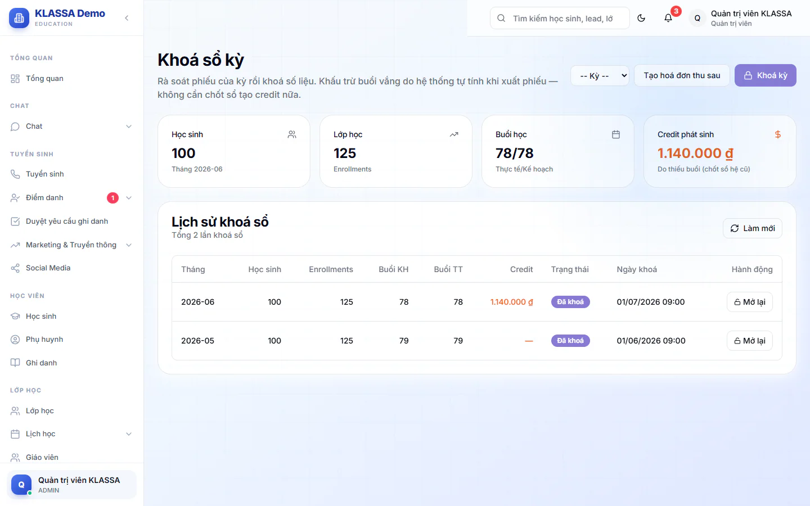

# Khoá sổ kỳ

Khoá sổ là bước chốt số liệu học phí của một tháng. Khi bấm khoá, hệ thống rà soát toàn bộ phiếu của tháng đó (12 loại kiểm tra) rồi đánh dấu kỳ đã khoá. Sau đó tiền trên phiếu của kỳ không bị sửa tuỳ tiện.

Trang này cần quyền quản lý tài chính, nên chỉ Quản trị viên vào được.

## Khoá một kỳ

::: steps
1. Vào **Tài chính → Kế toán → Khoá sổ kỳ**.
2. Bấm **Khoá kỳ**. Hộp **Khoá kỳ** hiện ra.
3. Ở ô **Chọn tháng**, chọn tháng cần khoá.
4. Nhập **Ghi chú (tuỳ chọn)** nếu cần.
5. Bấm nút **Khoá kỳ ...** ở cuối hộp (có ghi tháng bạn chọn, ví dụ **Khoá kỳ 10/2026**). Hệ thống hiện hộp **Đang khoá kỳ ...**, thường xong trong dưới 1 phút. Không đóng trang trong lúc này.
:::

Khoá một tháng đã khoá rồi sẽ báo lỗi "đã được khoá từ trước".

::: tip Mẹo
Cảnh báo từ rà soát không chặn việc khoá. Danh sách cảnh báo hiện ngay sau khi khoá để bạn xử lý dần. Phiếu nào có nhãn **Cần xem** thì mở ở [Hoá đơn chi tiết](hoa-don-chi-tiet.md) và dùng nút **Rà soát phiếu** để sửa.
:::

Khấu trừ buổi vắng do hệ thống tự tính khi xuất phiếu, nên bạn không cần khoá sổ để tạo credit.

## Đọc kết quả rà soát

Sau khi khoá, khung kết quả hiện: "Rà soát kỳ ...: đã quét ... phiếu" kèm số cảnh báo cần xem, hoặc "không phát hiện vấn đề". Mỗi cảnh báo có mức (**HIGH** là nặng), tên học sinh và mô tả. Khung hiện tối đa 30 cảnh báo đầu tiên.

Dưới đó là các ô số liệu của lần khoá gần nhất: **Học sinh**, **Lớp học**, **Buổi học**, **Credit phát sinh**.

## Lịch sử khoá sổ

Bảng **Lịch sử khoá sổ** liệt kê mọi lần khoá: **Tháng**, số học sinh, số ghi danh, buổi kế hoạch (**Buổi KH**), buổi thực tế (**Buổi TT**), **Credit**, **Trạng thái**, **Ngày khoá**.

Trạng thái có ba mức: **Đang xử lý**, **Đã khoá**, **Đã mở lại**.

## Mở lại một kỳ đã khoá

Dùng khi cần sửa tiền phiếu của tháng đã khoá.

::: steps
1. Trong bảng **Lịch sử khoá sổ**, bấm **Mở lại** ở dòng kỳ có trạng thái **Đã khoá**.
2. Đọc hộp **Xác nhận mở lại sổ tháng**, rồi bấm **Xác nhận mở lại**.
:::

Với kỳ khoá theo cách hiện tại, việc mở lại chỉ đổi trạng thái, không đụng tới khấu trừ hay phiếu. Với kỳ khoá từ cách làm cũ, các credit do lần chốt cũ tạo ra bị thu hồi và các khoản thu từ credit đó bị xoá khỏi phiếu.

::: warning Lưu ý
Mở lại kỳ cũ có thể làm thay đổi tiền trên phiếu. Chỉ mở khi thật cần và kiểm tra phiếu sau đó.
:::

## Kỳ đã khoá ảnh hưởng gì

- Chỉnh tiền trên phiếu hoặc xoá phiếu của kỳ đã khoá chỉ Quản trị viên làm được. Các vai khác sẽ nhận thông báo "đã khoá sổ".
- Điểm danh của buổi thuộc kỳ đã khoá vẫn lưu được, nhưng thay đổi đó không tự vào phiếu. Cần chỉnh học phí thì liên hệ kế toán sửa phiếu.
- Hệ thống tính phiếu không truy lùi vào kỳ đã khoá.

## Tạo hoá đơn thu sau ngay trên trang này

Trên trang còn có ô chọn kỳ và nút **Tạo hoá đơn thu sau**, dùng cho học sinh học theo gói thu sau theo buổi đã học. Cách dùng xem [Tạo hoá đơn](../hoc-phi/tao-hoa-don.md).

## Câu hỏi thường gặp

::: details Khoá sổ có chặn cô giáo điểm danh bù không?
Không. Điểm danh vẫn lưu, chỉ có cảnh báo hiện ra là kỳ đã khoá và thay đổi không tự vào phiếu.
:::

::: details Tôi là Kế toán, sao không vào được Khoá sổ kỳ?
Trang cần quyền quản lý tài chính, hiện chỉ Quản trị viên có. Hãy nhờ Quản trị viên khoá giúp.
:::
