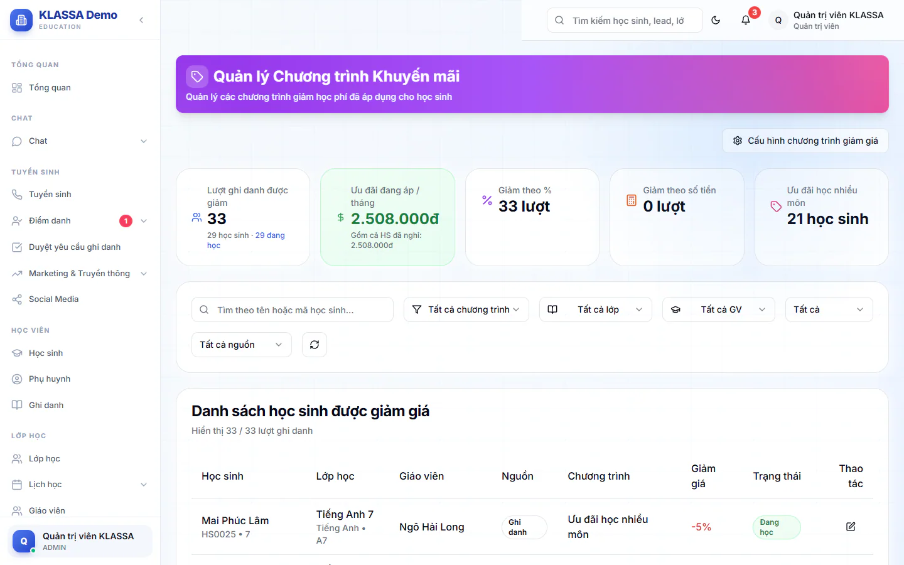

# Quản lý khuyến mãi

Trang này cho bạn thấy toàn bộ ưu đãi giảm học phí đang áp dụng: ai được giảm, giảm theo chương trình nào, mức bao nhiêu. Bạn cũng chỉnh được mức giảm của từng học sinh và đặt tên các chương trình giảm giá của trung tâm.

Menu chỉ hiện trang này với Quản trị viên. Quản lý chi nhánh cũng dùng được các thao tác bên dưới khi mở được trang.

## Xem danh sách học sinh được giảm

::: steps
1. Vào **Tài chính → Kế toán → Quản lý khuyến mãi**.
2. Xem các ô tổng hợp trên cùng: **Lượt ghi danh được giảm** (kèm số học sinh và số em đang học), **Ưu đãi đang áp / tháng**, **Giảm theo %**, **Giảm theo số tiền**, và số học sinh của chương trình phổ biến nhất.
3. Lọc danh sách bằng ô tìm **Tìm theo tên hoặc mã học sinh...** và các ô **Chương trình**, **Lớp học**, **Giáo viên**, **Trạng thái**, **Nguồn**.
4. Đọc bảng **Danh sách học sinh được giảm giá**.
:::

Ô **Chương trình** ngoài các chương trình của trung tâm còn có mục **Tuỳ chỉnh (giảm riêng từng HS)**. Ô **Nguồn** có: **Ghi danh**, **Yêu cầu ghi danh**, **Ghi danh batch**. Ô **Trạng thái** có: **Đang học**, **Tạm dừng**, **Tạm ngưng**, **Hoàn thành**.

Bảng có các cột: **Học sinh**, **Lớp học**, **Giáo viên**, **Nguồn**, **Chương trình**, **Giảm giá**, **Trạng thái**, **Thao tác**. Mức giảm hiện dạng `-25%` hoặc `-200.000đ`.

## Chỉnh mức giảm của một học sinh

::: steps
1. Ở dòng học sinh, bấm biểu tượng bút ở cột **Thao tác**. Biểu tượng chỉ có ở dòng có nguồn **Ghi danh**.
2. Hộp **Chỉnh sửa giảm giá** hiện ra. Chọn **Chương trình giảm giá**. Chọn chương trình thì loại và mức giảm tự điền theo cấu hình.
3. Chọn **Loại giảm giá**: **Phần trăm (%)** hoặc **Số tiền (VNĐ)**.
4. Nhập **Giá trị giảm**. Giảm theo phần trăm thì tối đa 100.
5. Bấm **Lưu thay đổi**.
:::

::: warning Lưu ý
Việc chỉnh ở đây đổi ưu đãi gắn với ghi danh của học sinh. Phiếu học phí đã xuất không tự sửa theo. Nếu cần đổi tiền trên phiếu đã có, hãy sửa ở [Hoá đơn chi tiết](hoa-don-chi-tiet.md).
:::

## Cấu hình các chương trình giảm giá

Mỗi trung tâm tự đặt tên chương trình, mô tả và mức giảm mặc định. Mức này chỉ là gợi ý tự điền khi chọn chương trình trong form ghi danh. Bạn vẫn chỉnh được riêng từng học sinh, và cách tính tiền trên hoá đơn không đổi.

::: steps
1. Bấm **Cấu hình chương trình giảm giá** ở đầu trang.
2. Bấm **Thêm chương trình** để thêm một dòng mới.
3. Điền **Tên chương trình (ngắn)**, ví dụ "Ưu đãi anh chị em".
4. Điền **Mức giảm** và chọn **Loại**: phần trăm hoặc **đ (số tiền)**.
5. Điền **Mô tả đầy đủ (in trên phiếu thu)**.
6. Dùng công tắc để **Đang bật** hoặc **Đã tắt (ẩn khỏi form chọn)**. Chương trình đã tắt không hiện khi chọn ở form ghi danh.
7. Bấm **Lưu tất cả**.
:::

Bấm **Xoá** ở một dòng để bỏ chương trình khỏi danh sách (chỉ có hiệu lực sau khi bấm **Lưu tất cả**). Mỗi chương trình phải có tên, và mức giảm phần trăm không được vượt 100.

## Câu hỏi thường gặp

::: details Tại sao có dòng không có biểu tượng bút?
Chỉ dòng có nguồn **Ghi danh** mới sửa được tại trang này.
:::
