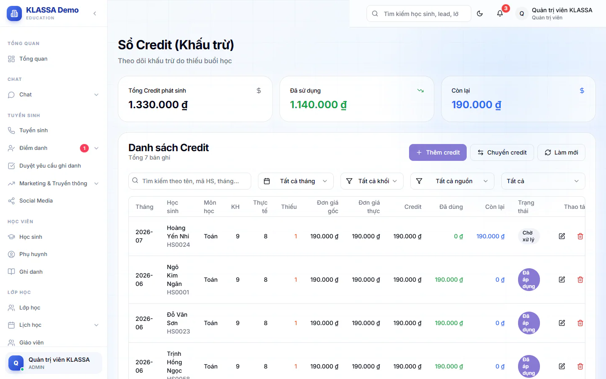
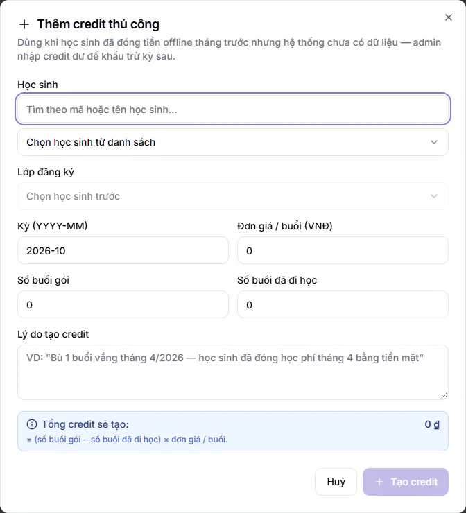

# Sổ credit (Sổ cái công nợ)

Credit là khoản tiền thừa của học sinh mà trung tâm đang giữ, ví dụ học sinh đã đóng đủ tiền nhưng nghỉ một số buổi. Khoản này được trừ vào phiếu học phí kỳ sau thay vì hoàn tiền mặt. Sổ credit ghi lại từng khoản như vậy: cấp bao nhiêu, đã dùng bao nhiêu, còn lại bao nhiêu.

Trong menu, trang này tên **Sổ cái công nợ**. Tiêu đề trên trang là **Sổ Credit (Khấu trừ)**.

## Xem sổ

::: steps
1. Vào **Tài chính → Kế toán → Sổ cái công nợ**.
2. Xem ba ô tổng hợp: **Tổng Credit phát sinh**, **Đã sử dụng**, **Còn lại**.
3. Dùng các ô lọc: ô tìm **Tìm kiếm theo tên, mã HS, tháng...**, **Tháng**, **Khối**, **Nguồn**, **Trạng thái**.
:::

Bảng có các cột: **Tháng**, **Học sinh**, **Môn học**, **KH** (số buổi theo kế hoạch), **Thực tế** (số buổi đã học), **Thiếu**, **Đơn giá gốc**, **Đơn giá thực** (đơn giá sau ưu đãi của học sinh, dùng để tính credit), **Credit**, **Đã dùng**, **Còn lại**, **Trạng thái**.

Ô **Nguồn** cho biết credit sinh ra từ đâu:

| Nguồn | Nghĩa |
|---|---|
| **Vắng buổi** | Học sinh đã đóng tiền nhưng vắng buổi |
| **Phụ thu buổi dư** | Khoản phát sinh từ buổi học dư của học sinh |
| **Thủ công** | Kế toán hoặc quản lý thêm tay |
| **Bù ví (top-up)** | Bù thêm vào số dư của học sinh |
| **Chuyển từ HS khác** | Nhận từ học sinh khác |

Ô **Trạng thái** có bốn mức: **Chờ xử lý** (chưa dùng), **Đã áp dụng** (đã trừ vào phiếu), **Hết hạn**, **Đã huỷ**.

## Thêm credit thủ công

Dùng khi học sinh đã đóng tiền ngoài hệ thống từ trước nên hệ thống chưa có dữ liệu để tự tính credit dư.

::: steps
1. Bấm **Thêm credit**. Hộp **Thêm credit thủ công** hiện ra.
2. Chọn **Học sinh** (gõ mã hoặc tên để tìm), rồi chọn **Lớp đăng ký** của em.
3. Nhập **Kỳ (YYYY-MM)**, ví dụ 2026-04.
4. Nhập **Đơn giá / buổi (VNĐ)**, **Số buổi gói** và **Số buổi đã đi học**. Ô đơn giá tự điền theo lớp, có tính ưu đãi nếu học sinh có.
5. Nhập **Lý do tạo credit** để người sau hiểu vì sao có khoản này.
6. Kiểm tra dòng **Tổng credit sẽ tạo**, bằng (số buổi gói trừ số buổi đã đi học) nhân đơn giá. Bấm **Tạo credit**.
:::

Nút **Tạo credit** chỉ bấm được khi số buổi đã đi học không vượt số buổi gói, đơn giá lớn hơn 0 và tổng credit lớn hơn 0.

## Chuyển credit giữa hai học sinh

Dùng khi muốn gộp phần dư của hai anh chị em, hoặc chuyển phần dư của một em sang em khác.

::: steps
1. Bấm **Chuyển credit**. Hộp **Chuyển credit giữa 2 học sinh** hiện ra.
2. Chọn **Học sinh nguồn (bị trừ credit)**. Dòng **Ví khả dụng** hiện số credit em đó còn.
3. Nhập **Số tiền chuyển (VNĐ)**. Không được vượt ví khả dụng.
4. Chọn **Học sinh đích (nhận credit)**. Em khác cùng phụ huynh được gợi ý sẵn, hoặc tìm theo mã hoặc tên.
5. Nhập **Lý do chuyển**, ít nhất 3 ký tự.
6. Bấm **Chuyển credit**.
:::

## Sửa một dòng credit

Bấm biểu tượng bút ở cuối dòng (gợi ý **Sửa credit**). Hộp **Chỉnh sửa Credit** cho sửa **Số tiền đã dùng (VNĐ)**, **Trạng thái** và **Ghi chú**.

::: warning Lưu ý
Credit đã trừ vào hoá đơn (đã dùng hoặc đang ở trạng thái **Đã áp dụng**) thì hai ô số tiền đã dùng và trạng thái bị khoá. Muốn chỉnh, hãy sửa từ hoá đơn, ở ô **Khấu trừ Credit** (xem [Hoá đơn chi tiết](hoa-don-chi-tiet.md)). Làm vậy để sổ credit và hoá đơn luôn khớp nhau.
:::

## Xoá một dòng credit

Chỉ Quản trị viên thấy biểu tượng thùng rác (gợi ý **Xoá credit**).

::: danger Không thể hoàn tác
Hộp **Xác nhận xoá credit** xoá vĩnh viễn dòng credit. Việc xoá được ghi vào nhật ký. Hãy chắc chắn trước khi bấm **Xác nhận xoá**.
:::

## Câu hỏi thường gặp

::: details Nút Thêm credit và Chuyển credit nằm ở đâu?
Ở góc trên bảng **Danh sách Credit**. Hai nút này chỉ hiện với vai được phép tạo và sửa số liệu tài chính.
:::

::: details Sổ lệch với hoá đơn thì làm gì?
Dùng [Rà soát credit](ra-soat-credit.md) để quét và đồng bộ lại từng ca.
:::

::: details Muốn xem tổng credit theo học sinh?
Xem [Credit khả dụng](credit-kha-dung.md) để thấy mỗi học sinh còn bao nhiêu, hoặc [Báo cáo Credit](tin-chi.md) để xem theo tháng.
:::
