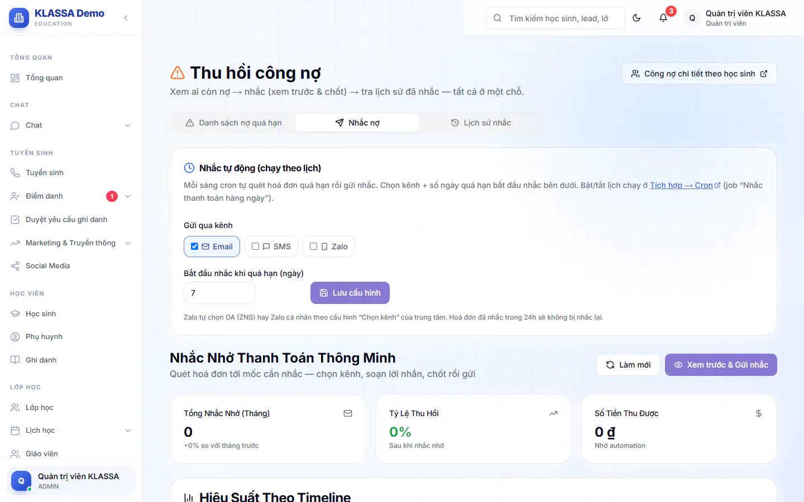

# Thu hồi công nợ

Trang này gom ba việc thu nợ vào một chỗ: xem ai còn nợ, nhắc phụ huynh (xem trước rồi mới gửi) và tra lại đã nhắc những ai. Chỉ Quản trị viên và Quản lý chi nhánh vào được, Kế toán không vào trang này.

Muốn xem nợ theo từng học sinh, bấm nút **Công nợ chi tiết theo học sinh** ở góc trên phải, hoặc xem [Quản lý công nợ](cong-no.md).

## Ba tab của trang

Vào **Tài chính → Thu hồi công nợ**. Trang có ba tab.

### Tab Danh sách nợ quá hạn

Giống hệt [Báo cáo nợ quá hạn](qua-han.md): bộ lọc, bảng phiếu, nhắc từng phiếu, nhắc hàng loạt, ghi nhận nhắc tay và xuất Excel.

### Tab Nhắc nợ

Dùng để nhắc phụ huynh theo mốc thời gian của hạn nộp. Tab có hai phần: **Nhắc tự động (chạy theo lịch)** ở trên và **Nhắc Nhở Thanh Toán Thông Minh** ở dưới.

#### Nhắc tay theo mốc

::: steps
1. Bấm **Xem trước & Gửi nhắc**. Hệ thống quét ra các phiếu đang tới mốc cần nhắc nhưng chưa gửi gì cả.
2. Hộp **Soạn & chốt nhắc nợ** hiện ra. Ở **Gửi qua kênh nào**, tích một hoặc nhiều kênh: **Email**, **SMS**, **Zalo**, **Thông báo App/Web**.
3. Nếu tích **Zalo**, có ô **Kèm ảnh hoá đơn**. Tích thì hệ thống mở trình gửi hoá đơn Zalo để gửi ảnh phiếu kèm mã QR. Bỏ tích thì chỉ gửi chữ.
4. Soạn lời nhắn hoặc chọn một mẫu đã lưu. Cách soạn và các biến chèn giống phần "Soạn lời nhắn" trong [Báo cáo nợ quá hạn](qua-han.md).
5. Trong danh sách, tích những phiếu muốn nhắc. Mỗi dòng có học sinh, phụ huynh, hoá đơn, số tiền, **Mốc** và số lần **Đã nhắc**.
6. Bấm **Gửi nhắc (n)**.
:::

Các mốc nhắc là: **3 ngày trước**, **1 ngày trước**, **Đúng hạn**, **+1 ngày**, **+3 ngày**, **+7 ngày**, **+14 ngày (Final)**.

Phía dưới có ba ô thống kê: **Tổng Nhắc Nhở (Tháng)**, **Tỷ Lệ Thu Hồi**, **Số Tiền Thu Được**, cùng bảng **Hiệu Suất Theo Timeline** và **Hoạt Động Gần Đây**.

::: warning Lưu ý
Gửi nhắc không tự động treo lớp của học sinh. Việc treo lớp vì nợ học phí chỉ làm bằng tay.
:::

#### Nhắc tự động theo lịch

Mỗi sáng hệ thống tự quét phiếu quá hạn và gửi nhắc. Bạn chỉ cần chọn cách nhắc.

::: steps
1. Ở khung **Nhắc tự động (chạy theo lịch)**, ô **Gửi qua kênh**: tích **Email**, **SMS**, **Zalo**. Phải chọn ít nhất một kênh.
2. Nhập **Bắt đầu nhắc khi quá hạn (ngày)**, từ 0 đến 60.
3. Bấm **Lưu cấu hình**.
:::

Zalo tự chọn gửi qua Zalo OA hay Zalo cá nhân theo cách trung tâm đã cấu hình kênh gửi. Phiếu đã nhắc trong 24 giờ không bị nhắc lại.

::: tip Mẹo
Lưu cấu hình ở đây chỉ chọn kênh và số ngày. Việc bật hoặc tắt lịch chạy nằm ở trang **Tích hợp**, công việc **Nhắc thanh toán hàng ngày**. Hãy kiểm tra công việc đó đang bật nếu bạn muốn nhắc tự động thật sự chạy.
:::

### Tab Lịch sử nhắc

Tra lại phụ huynh nào đã được nhắc, nhắc lần mấy, gần nhất khi nào.

::: steps
1. Chọn **Năm** và tháng ở hai ô chọn đầu hàng.
2. Gõ vào ô **Tìm tên HS / phụ huynh / số hoá đơn / SĐT** rồi bấm biểu tượng tìm.
3. Bấm vào một dòng để mở rộng và xem từng lần nhắc (kênh gửi, kết quả).
4. Dùng **Trước** và **Sau** để chuyển trang.
:::

Bảng có các cột: **Học sinh**, **Phụ huynh**, **Hoá đơn**, **Trạng thái**, **Số tiền**, **Đã nhắc**, **Gần nhất**.

## Câu hỏi thường gặp

::: details Kế toán có dùng được trang này không?
Không. Trang chỉ dành cho Quản trị viên và Quản lý chi nhánh. Kế toán vẫn xem được [Báo cáo nợ quá hạn](qua-han.md) và [Quản lý công nợ](cong-no.md).
:::

::: details Sao phiếu của tôi không có trong hộp Soạn & chốt nhắc nợ?
Hộp này chỉ liệt kê phiếu đang tới đúng một trong các mốc nhắc. Phiếu chưa tới mốc thì xem ở tab **Danh sách nợ quá hạn** và nhắc từ đó.
:::
