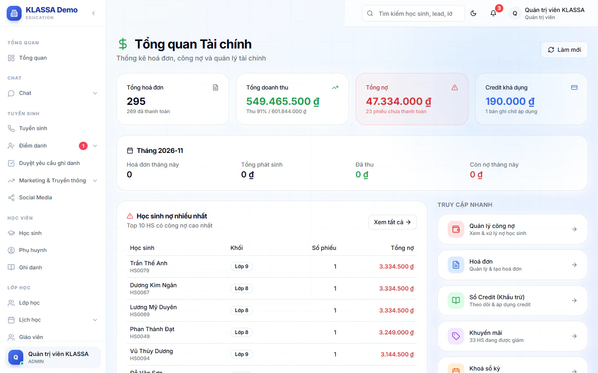

# Kế toán, công nợ và báo cáo tài chính

Nhóm **Kế toán** gom các trang giúp bạn theo dõi hoá đơn, ai còn nợ, tiền thừa của học sinh (credit), ưu đãi giảm giá và việc chốt số liệu cuối tháng. Bài này chỉ đường: cần làm việc gì thì vào trang nào.

Việc tạo hoá đơn, gửi hoá đơn và cài gói học phí nằm ở nhóm [Học phí](../hoc-phi/quan-ly-hoc-phi.md), không nằm ở đây.

## Ai thấy nhóm Kế toán

Quản trị viên, Quản lý chi nhánh và Kế toán thấy nhóm này. Một số trang hẹp hơn, xem cột "Ai dùng" bên dưới. Các vai khác không thấy menu kế toán.

## Các trang trong nhóm Kế toán

Vào **Tài chính → Kế toán** rồi chọn trang.

| Trang | Dùng để | Ai dùng |
|---|---|---|
| **Hoá đơn chi tiết** | Tìm, xem, sửa, thu tiền, xoá hoá đơn. Xem [Hoá đơn chi tiết](hoa-don-chi-tiet.md). | Quản trị viên, Quản lý chi nhánh, Kế toán |
| **Quản lý công nợ** | Xem từng học sinh đang nợ bao nhiêu. Xem [Quản lý công nợ](cong-no.md). | Quản trị viên, Quản lý chi nhánh, Kế toán |
| **Sổ cái công nợ** | Sổ ghi tiền thừa (credit) của học sinh. Xem [Sổ credit](so-cai-credit.md). | Quản trị viên, Quản lý chi nhánh, Kế toán |
| **Báo cáo credit khả dụng** | Danh sách học sinh còn credit chưa dùng. Xem [Credit khả dụng](credit-kha-dung.md). | Quản trị viên, Quản lý chi nhánh, Kế toán |
| **Rà soát & đồng bộ credit** | Tìm và sửa chỗ sổ credit lệch với hoá đơn. Xem [Rà soát credit](ra-soat-credit.md). | Quản trị viên, Quản lý chi nhánh, Kế toán |
| **Quản lý khuyến mãi** | Xem và chỉnh ưu đãi giảm giá của học sinh. Xem [Khuyến mãi](khuyen-mai.md). | Quản trị viên |
| **Khoá sổ kỳ** | Chốt số liệu một tháng và tạo hoá đơn thu sau. Chỉ Quản trị viên mở lại được kỳ đã khoá. Xem [Khoá sổ kỳ](khoa-so-ky.md). | Quản trị viên, Kế toán |

Hai trang cùng nhóm Kế toán nhưng thuộc bài khác: **Mẫu hóa đơn** và **Cấu hình tài chính** (xem [Cài đặt tài chính](../hoc-phi/cai-dat.md)).

## Trang nằm ngoài nhóm Kế toán

| Trang | Đường vào | Dùng để |
|---|---|---|
| **Thu hồi công nợ** | **Tài chính → Thu hồi công nợ** | Xem nợ quá hạn, nhắc phụ huynh, tra lịch sử nhắc. Chỉ Quản trị viên và Quản lý chi nhánh. Xem [Thu hồi công nợ](thu-hoi-cong-no.md). |
| **Báo cáo doanh thu** | **Tài chính → Báo cáo → Báo cáo doanh thu** | Doanh thu theo tháng, môn, cơ sở. Xem [Báo cáo doanh thu](bao-cao-doanh-thu.md). |
| **Báo cáo nợ** | **Tài chính → Báo cáo → Báo cáo nợ** | Danh sách phiếu quá hạn. Xem [Báo cáo nợ quá hạn](qua-han.md). |
| **Nợ kế toán** | **Tài chính → Báo cáo → Nợ kế toán** | Tổng nợ còn phải thu theo mức nguy cấp. Xem [Nợ kế toán](bao-cao-no-ke-toan.md). |
| **Báo cáo Credit** | **Tài chính → Báo cáo → Báo cáo Credit** | Credit phát sinh và đã dùng theo tháng. Xem [Báo cáo Credit](tin-chi.md). |

Bốn báo cáo cuối dành cho Quản trị viên, Quản lý chi nhánh và Kế toán.

## Trang Tổng quan tài chính

Trang có tiêu đề **Tổng quan Tài chính**, mở bằng nút bên dưới (khác với mục **Tổng quan tài chính** trong menu, là trang tổng quan dòng tiền riêng). Trang tóm tắt nhanh: tổng hoá đơn, tổng doanh thu, tổng nợ, credit khả dụng, số liệu của tháng hiện tại và 10 học sinh nợ nhiều nhất. Từ đây bấm vào các ô để đi tới Quản lý công nợ, Hoá đơn, Sổ credit, Khuyến mãi và Khoá sổ kỳ. Ô **Khoá sổ kỳ** chỉ hiện với Quản trị viên và Kế toán.

::: steps
1. Vào **Tài chính → Học phí**.
2. Bấm nút **Quản lý Tài chính** ở đầu trang. Nút này chỉ hiện với vai có quyền xem tài chính.
:::

## Câu hỏi thường gặp

::: details Credit là gì?
Credit là khoản tiền thừa của học sinh mà trung tâm giữ lại để trừ vào phiếu kỳ sau. Giải thích đầy đủ ở [Báo cáo Credit](tin-chi.md).
:::

::: details Kế toán có tự nhắc nợ phụ huynh không?
Có hai cách: nhắc tay hàng loạt và nhắc tự động theo lịch. Cả hai nằm ở [Thu hồi công nợ](thu-hoi-cong-no.md).
:::
