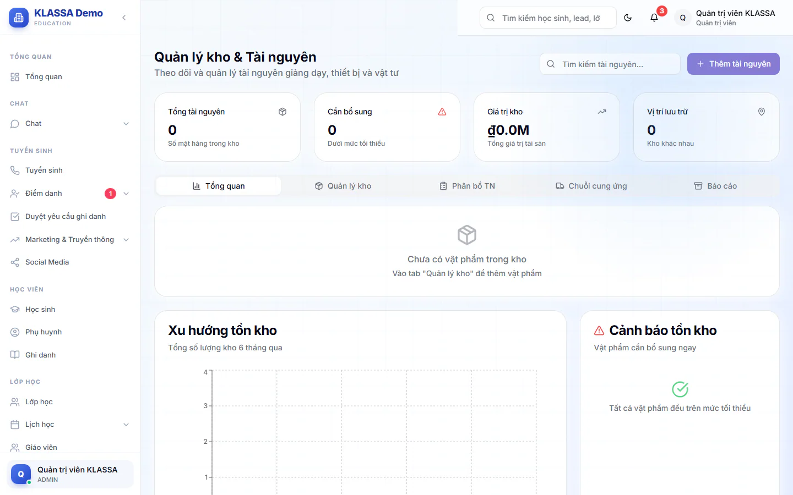
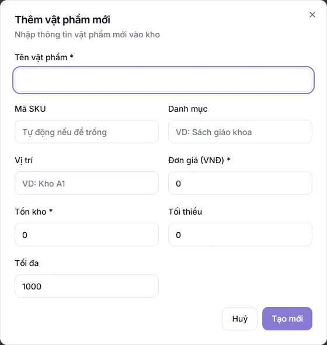

# Quản lý kho: thêm, sửa, xoá vật phẩm

Trang **Quản lý Kho** giúp bạn biết trung tâm đang có bao nhiêu sách, thiết bị, vật tư, để ở đâu và món nào sắp hết. Việc nhập hàng, xuất hàng nằm ở bài [Nhập kho, xuất kho và báo cáo](nhap-xuat.md).

Ai làm được gì:

- **Quản trị viên** và **Quản lý chi nhánh**: xem, thêm, sửa, nhập xuất và xoá.
- **Quản lý**: xem, thêm, sửa, nhập xuất, nhưng không xoá được.
- Các vai khác không thấy mục này trong menu.

## Đọc nhanh tình hình kho

::: steps
1. Vào **Cấu hình hệ thống → Quản lý Kho**. Trang **Quản lý kho & Tài nguyên** mở ra.
2. Xem bốn ô số liệu ở đầu trang: **Tổng tài nguyên** (số mặt hàng), **Cần bổ sung** (số món dưới mức tối thiểu), **Giá trị kho** (tổng giá trị, tính theo triệu đồng), **Vị trí lưu trữ** (số kho khác nhau).
3. Mở tab **Tổng quan** để xem thống kê theo danh mục, **Xu hướng tồn kho**, khung **Cảnh báo tồn kho** (các món cần bổ sung ngay) và **Hoạt động gần đây**.
:::

Một món được tính là cần bổ sung khi số tồn nhỏ hơn hoặc bằng mức **Tối thiểu** bạn đặt cho món đó.

## Thêm một vật phẩm mới

::: steps
1. Ở trang **Quản lý Kho**, bấm **Thêm tài nguyên** (hoặc vào tab **Quản lý kho** và bấm **Thêm vật phẩm mới**). Hộp **Thêm vật phẩm mới** hiện ra.
2. Điền thông tin:
   - **Tên vật phẩm** (bắt buộc).
   - **Mã SKU**: để trống thì hệ thống tự tạo mã.
   - **Danh mục**, ví dụ "Sách giáo khoa".
   - **Vị trí**, ví dụ "Kho A1".
   - **Đơn giá (VNĐ)** (bắt buộc).
   - **Tồn kho** (bắt buộc khi tạo mới): số lượng đang có.
   - **Tối thiểu** và **Tối đa**: mức báo thiếu và mức coi là thừa.
3. Bấm **Tạo mới**. Thông báo "Đã thêm vật phẩm mới" hiện ra.
:::

::: warning Lưu ý
Giá trị không được âm, và **Tối thiểu** không được lớn hơn **Tối đa**. Mã SKU đã dùng cho món khác sẽ bị từ chối với thông báo "SKU đã tồn tại".
:::

## Tìm và lọc vật phẩm

Vào tab **Quản lý kho**. Bảng **Danh sách tồn kho** liệt kê từng món với cột **Vật phẩm**, **Danh mục**, **Tồn kho**, **Trạng thái**, **Vị trí**, **Giá trị**.

- Gõ tên vào ô **Tìm kiếm tài nguyên...** ở đầu trang.
- Dùng khung **Bộ lọc & Tìm kiếm** để chọn danh mục (**Tất cả danh mục**) và vị trí (**Tất cả vị trí**).
- Cột **Trạng thái** cho biết **Thiếu hụt** (dưới mức tối thiểu), **Thừa kho** (vượt mức tối đa) hoặc **Ổn định**.

## Sửa thông tin vật phẩm

::: steps
1. Ở dòng của món cần sửa, bấm nút có gợi ý **Chỉnh sửa**. Hộp **Chỉnh sửa vật phẩm** hiện ra.
2. Đổi tên, mã, danh mục, vị trí, đơn giá, mức tối thiểu hoặc tối đa.
3. Bấm **Cập nhật**.
:::

Ô **Tồn kho** bị khoá khi sửa. Muốn đổi số lượng, dùng nút nhập kho hoặc xuất kho để hệ thống ghi lại lịch sử, xem [Nhập kho, xuất kho và báo cáo](nhap-xuat.md).

## Xoá vật phẩm

::: steps
1. Ở dòng của món cần xoá, bấm nút có gợi ý **Xoá**.
2. Hộp **Xoá vật phẩm** hỏi lại. Bấm **Xoá** để xác nhận.
:::

::: danger Không thể hoàn tác
Xoá vật phẩm cũng xoá toàn bộ lịch sử nhập, xuất của món đó. Món nhập nhầm tên thì nên sửa thay vì xoá. Chỉ Quản trị viên và Quản lý chi nhánh có nút xoá.
:::

## Hai tab chỉ để xem mẫu

Tab **Phân bổ TN** và **Chuỗi cung ứng** hiện số liệu minh hoạ có sẵn (nhà cung cấp, đơn đặt hàng, yêu cầu phân bổ). Chúng không lấy từ kho của bạn và bạn không lưu được gì ở đó. Hãy bỏ qua hai tab này khi làm việc thật.

## Câu hỏi thường gặp

::: details Tôi không thấy mục Quản lý Kho trong menu?
Mục này chỉ hiện cho Quản trị viên, Quản lý chi nhánh và Quản lý. Xem [Vai trò người dùng](../tai-khoan/vai-tro-nguoi-dung.md).
:::

::: details Giá trị kho được tính thế nào?
Mỗi món lấy số tồn nhân với đơn giá, rồi cộng tất cả lại.
:::

::: details Kho có tách theo từng cơ sở không?
Không. Vật phẩm chỉ có thêm trường **Vị trí** do bạn tự gõ, ví dụ "Kho A1". Bạn có thể dùng tên cơ sở làm vị trí nếu muốn phân biệt.
:::
