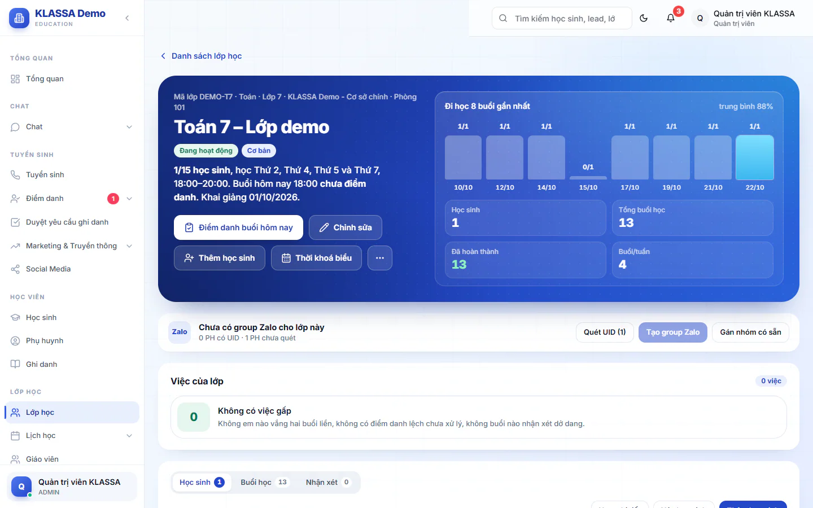

# Chi tiết lớp học

Trang chi tiết gom mọi thứ về một lớp: tình hình hôm nay, việc cần xử lý, danh sách học sinh, các buổi đã học và nhận xét. Từ đây bạn cũng đi tiếp tới điểm danh, thêm học sinh và sửa lớp.

## Mở một lớp

::: steps
1. Vào **Lớp học**.
2. Bấm vào thẻ lớp hoặc nút **Chi tiết**.
3. Muốn quay lại, bấm **Danh sách lớp học** ở góc trên.
:::

Dải đầu trang ghi tên lớp, trạng thái, cấp độ (nhãn **Lớp linh hoạt** nếu là [lớp linh hoạt](lop-linh-hoat.md)), cùng các số **Học sinh**, **Tổng buổi học**, **Đã hoàn thành** (mọi buổi đã học) và **Buổi/tuần**. Khung **Đi học 8 buổi gần nhất** cho thấy tỉ lệ có mặt từng buổi.

Các nút trên dải đầu trang, tuỳ quyền của bạn:

- **Điểm danh buổi hôm nay**: hiện khi hôm nay lớp có buổi. Bấm để sang trang [điểm danh](../diem-danh/cham-hang-ngay.md).
- **Chỉnh sửa**: sang trang [sửa lớp](chinh-sua.md). Chỉ vai có quyền sửa lớp (Quản trị viên, Quản lý chi nhánh, Quản lý).
- **Thêm học sinh**: mở hộp thêm học sinh, xem bên dưới.
- **Thời khoá biểu**: mở [thời khóa biểu](lich-day.md) chỉ của lớp này.
- Nút ba chấm **Thao tác khác**: **Danh sách học sinh**, và với Quản trị viên, Quản lý chi nhánh có thêm **Tạm dừng lớp học** hoặc **Mở lại lớp học**, **Xóa lớp học**.

## Việc của lớp

Thẻ **Việc của lớp** báo những gì cần xử lý ngay:

- **Vắng 2 buổi liền**: nêu tên các em. Bấm **Xem em** (hoặc **Xem N em**) để bảng học sinh chỉ còn các em đó.
- **Lệch điểm danh chưa xử lý**: giáo viên và lễ tân điểm danh khác nhau cho cùng một em. Bấm **Xử lý** để sang trang đối chiếu. Chỉ Quản trị viên, Quản lý chi nhánh và Quản lý xử lý được, xem [Đối chiếu điểm danh](../diem-danh/doi-chieu.md).
- **Nhận xét dở dang buổi dd/mm**: buổi đã nhận xét một phần, còn em đi học chưa có nhận xét. Người có quyền nhận xét (giáo viên, trợ giảng, quản lý, hoặc người được xếp trợ giảng ở lớp) bấm nút để viết tiếp ngay.

Khi không có gì, thẻ ghi **Không có việc gấp**.

## Ba tab của lớp

- **Học sinh**: danh sách em đang học, gồm ngày **Nhập học**, tỉ lệ **Đi học**, và tuỳ quyền bạn có thêm cột **Phụ huynh**, **Nhận xét TB**, **Học phí T** của tháng hiện tại (nhãn **Chưa có phiếu** nếu chưa có phiếu). Bấm tên em để mở hồ sơ. Nút **Xem chi tiết** mở trang danh sách học sinh đầy đủ của lớp. Vai có quyền xoá học sinh thấy thêm **Xóa học sinh**.
- **Buổi học**: các buổi của lớp, gồm cả buổi đã huỷ. Buổi được tạo khi giáo viên hoặc lễ tân điểm danh.
- **Nhận xét**: nhận xét học sinh theo buổi. Tab này chỉ hiện với quản lý, và với giáo viên, trợ giảng, lễ tân kiêm trợ giảng đang được phân công đúng lớp đó.

Bên cạnh có ba thẻ nhỏ: **Lịch học** (các buổi mỗi tuần), **Giáo viên** (nhãn **Giáo viên chính** và **Trợ giảng**) và **Thông tin lớp** (môn, khối, cơ sở, phòng, sĩ số dạng học sinh đang học trên sức chứa, ngày khai giảng và bế giảng).

## Thêm học sinh vào lớp

::: steps
1. Bấm **Thêm học sinh**. Trang danh sách học sinh mở và hộp **Thêm học sinh vào lớp** hiện ra.
2. Tìm và chọn một hoặc nhiều em. Có thể bật tuỳ chọn hiện học sinh **tất cả các khối** khi lớp ghép khối.
3. Chọn **Gói học phí** (bắt buộc).
4. Bấm nút **Thêm N học sinh**.
:::

Lễ tân, Quản lý, Quản lý chi nhánh và Quản trị viên ghi danh thẳng. Giáo viên và trợ giảng bấm thêm thì hệ thống tạo một yêu cầu ghi danh chờ duyệt. Kế toán không có nút này. Chi tiết ghi danh xem [Ghi danh](../hoc-sinh/ghi-danh.md).

::: warning Lưu ý
**Xóa học sinh** khỏi lớp cần xác nhận ở hộp **Xác nhận xóa học sinh**. Đọc kỹ danh sách trước khi bấm.
:::

## Nhóm Zalo của lớp

Các vai dùng được Zalo (không gồm giáo viên và trợ giảng) thấy thanh nhóm Zalo ở đầu trang. Ở đó bạn gán nhóm Zalo có sẵn cho lớp bằng **ID nhóm Zalo**, hoặc gỡ nhóm. Gỡ nhóm không xoá nhóm trên Zalo. Lớp chưa có nhóm thì chưa gửi được nhận xét và thông báo vào nhóm.

## Câu hỏi thường gặp

::: details Sao tôi không thấy tab Nhận xét?
Tab này chỉ dành cho quản lý và người đang được phân công ở lớp. Lễ tân thường chỉ thấy tab này ở lớp mà mình được xếp trợ giảng.
:::

::: details Lớp linh hoạt có xem được học sinh không?
Có, nhưng đó là lớp chung cả môn, đọc thêm ở [Lớp linh hoạt](lop-linh-hoat.md). Lễ tân kiêm trợ giảng không được mở dữ liệu nhận xét của lớp linh hoạt.
:::
