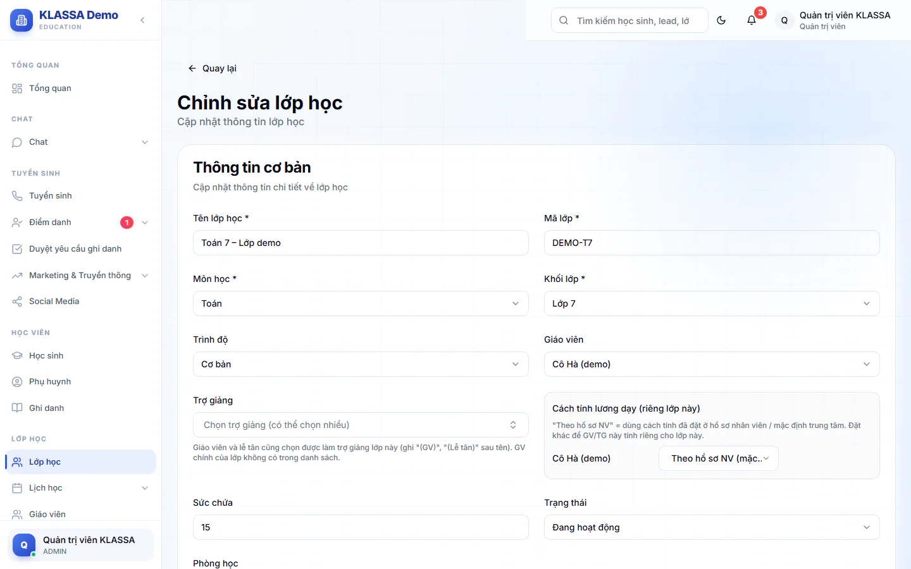

# Sửa, tạm dừng và xoá lớp

Dùng trang này khi đổi giáo viên, thêm trợ giảng, đổi phòng hoặc lịch học, hoặc khi lớp nghỉ một thời gian. Ghi danh học sinh vào lớp xem [Ghi danh](../hoc-sinh/ghi-danh.md).

## Chỉnh sửa thông tin lớp

::: steps
1. Vào **Lớp học**, mở lớp rồi bấm **Chỉnh sửa**. Hoặc bấm menu ba chấm của lớp và chọn **Chỉnh sửa lớp học** (Quản lý không thấy menu ba chấm, dùng nút **Chỉnh sửa** ở trang chi tiết).
2. Sửa các ô ở phần **Thông tin cơ bản**: **Tên lớp học**, **Mã lớp**, **Môn học**, **Khối lớp** (bắt buộc), **Trình độ** (**Cơ bản** hoặc **Nâng cao**), **Sức chứa**, **Trạng thái** (**Đang hoạt động**, **Tạm dừng**, **Hoàn thành**), **Phòng học**. Ô **Mô tả** hiện chưa được lưu.

   

3. Ở phần **Lịch học**, đổi **Thứ**, **Giờ bắt đầu**, **Giờ kết thúc** hoặc bấm **Thêm lịch học** để thêm buổi. Giờ bắt đầu phải trước giờ kết thúc.
4. Bấm **Lưu thay đổi**.
:::

## Đổi giáo viên chính

Chọn người khác ở ô **Giáo viên**. Khi bạn chọn một người mới, ô **Ngày nhận lớp** hiện ra. Ngày này là ngày giáo viên mới bắt đầu dạy lớp, dùng để tính lương đúng khi bàn giao giữa tháng. Giáo viên cũ được đóng phân công đến đúng ngày đó. Để trống thì hệ thống lấy ngày hôm nay.

Ô này có lựa chọn **Không phân công**, nhưng hiện chọn nó rồi bấm **Lưu thay đổi** chưa gỡ được giáo viên chính đang có. Muốn đổi người dạy, hãy chọn giáo viên khác. Lớp chưa có giáo viên chính (lớp mới tạo để **Chưa phân công**) sẽ hiện ở việc **Chưa có giáo viên chính** trong [danh sách lớp](danh-sach.md).

## Thêm trợ giảng

Bấm ô **Trợ giảng** và tích chọn nhiều người. Danh sách gồm trợ giảng, giáo viên (ghi "(GV)" sau tên, giáo viên kiêm trợ giảng lớp khác) và lễ tân (ghi "(Lễ tân)", lễ tân kiêm trợ giảng). Giáo viên chính của lớp không nằm trong danh sách này. Lễ tân chỉ có quyền trợ giảng ở đúng lớp được xếp, ngoài lớp đó vẫn là lễ tân.

Khi lớp có giáo viên hoặc trợ giảng, mục **Cách tính lương dạy (riêng lớp này)** hiện ra cho từng người: **Theo hồ sơ NV (mặc định)**, **Theo sĩ số học sinh**, **Cố định mỗi buổi** hoặc **Cố định theo giờ** (nhập đ/buổi hoặc đ/giờ). Để mặc định nếu không có thoả thuận riêng cho lớp này.

## Phòng bị trùng giờ

Giống lúc tạo lớp: nếu phòng đã có lớp khác cùng giờ, hộp xác nhận liệt kê các lớp trùng và hỏi bạn có vẫn gán phòng không.

## Tạm dừng, mở lại và xoá lớp

Chỉ **Quản trị viên** và **Quản lý chi nhánh** làm được. Mở menu ba chấm của lớp (ở danh sách hoặc ở nút thao tác khác trên trang chi tiết).

- **Tạm dừng lớp học**: lớp chuyển sang **Tạm dừng**, học sinh vẫn được giữ trong lớp. Hộp xác nhận ghi số học sinh đang học.
- **Mở lại lớp học**: lớp về lại **Đang hoạt động**. Hiện cho lớp đang tạm dừng.
- **Xóa lớp học**: lớp chuyển sang **Đã hủy**, mọi ghi danh trong lớp chuyển sang trạng thái hủy bỏ.

::: danger Không thể hoàn tác
Xoá lớp đặt lớp ở trạng thái **Đã hủy** và huỷ ghi danh của toàn bộ học sinh trong lớp. Hệ thống ghi rõ "Hành động này không thể hoàn tác". Nếu chỉ muốn nghỉ tạm, hãy chọn **Tạm dừng lớp học**.
:::

## Câu hỏi thường gặp

::: details Giáo viên nghỉ việc thì lớp của họ ra sao?
Khi cho nhân viên nghỉ việc, tài khoản bị khoá nhưng phân công lớp không tự đóng. Lớp vẫn ghi tên giáo viên đó. Hãy mở từng lớp của giáo viên đó (xem ở [chi tiết giáo viên](../giao-vien/chi-tiet.md)) và chọn giáo viên mới ở ô **Giáo viên**.
:::

::: details Đổi trạng thái ở đây và ở menu ba chấm có khác nhau không?
Kết quả giống nhau. Menu ba chấm có hộp xác nhận kèm số học sinh, tiện hơn khi chỉ muốn tạm dừng hoặc mở lại.
:::
